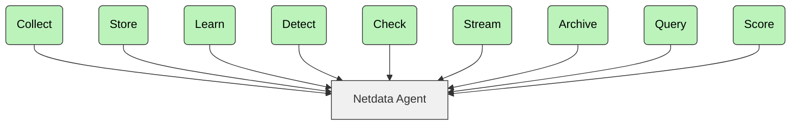

<a href="./README.md"><b>English</b></a> | <b>简体中文</b>

<h3 align="center">为你的基础设施带来“X 光视力”！</h3>
<h4 align="center">每个指标，每秒呈现，绝不注水。</h4>

 

  
   
  
  
  
   
  
  
   
  
  

  
  
  
  

<b>访问我们的<a href="https://www.netdata.cloud">官网</a></b>

菜单：**[我们是谁](#我们是谁)** | **[核心特性](#核心特性)** | **[快速上手](#快速上手)** | **[工作原理](#工作原理)** | **[常见问题](#常见问题)** | **[文档](#book-文档)** | **[社区](#tada-社区)** | **[贡献](#pray-贡献)** | **[许可证](#scroll-许可证)**

> [!WARNING]
> 人们**会对 Netdata 上瘾。**
> 一旦你在系统上用起来，*就再也回不去了。*

---

## 我们是谁

Netdata 是一个开源的实时基础设施监控平台。在你的整个基础设施中进行监控、检测和响应。

**核心优势：**

* **即时洞察**——借助 Netdata，你可以获取每秒级的指标和可视化。
* **零配置**——无需复杂设置，即刻部署。
* **ML 驱动**——检测异常、预测问题并自动化分析。
* **高效**——以最小的资源占用实现最大的可扩展性。
* **安全与分布式**——数据留在本地，无需集中收集。

使用 Netdata，你可以获得实时、每秒级的更新。一目了然的**清晰洞察**，毫无复杂性。

  
<strong>所有英雄都有精彩的起源故事。点击了解我们的故事。</strong>

   

2013 年，在 Costa Tsaousis 担任 COO 的公司，相当大比例的云端交易在无声中失败，严重影响了业务表现。

Costa 和他的团队试遍了当时所有可用的故障排查工具，没有一个能找到根本原因。正如 Costa 后来写道：

“*我无法相信，监控系统提供的指标如此之少、分辨率如此之低、扩展性如此之差，而运行成本又如此之高。*”

备受挫败的他决定从零开始，打造自己的监控工具。

那个决定带来了无数个深夜和周末，也引发了基础设施监控与故障排查方式（包括方法和成本）的根本性转变。

### 最节能的监控工具

根据[阿姆斯特丹大学的研究](https://www.ivanomalavolta.com/files/papers/ICSOC_2023.pdf)，Netdata 是监控基于 Docker 的系统时最节能的工具。该研究还显示，与其他监控方案相比，Netdata 在 CPU 占用、内存占用和执行时间方面表现出色。

---

## 核心特性

| 特性             | 描述                     | 独特之处                             |
|------------------|--------------------------|--------------------------------------|
| **实时**         | 每秒级的数据采集与处理   | 眨眼即成——点击即可即时看到结果       |
| **零配置**       | 自动检测与发现           | 自动发现所运行节点上的一切           |
| **ML 驱动**      | 无监督异常检测           | 在边缘为每个指标训练多个 ML 模型     |
| **长期保留**     | 高性能存储               | 每个样本约 0.5 字节，分层存储便于归档 |
| **高级可视化**   | 丰富、交互式的仪表盘     | 无需查询语言即可随心切分数据         |
| **极致可扩展**   | 原生水平扩展             | 父子级联集中化，每秒数百万样本       |
| **全景可视**     | 从基础设施到应用         | 化繁为简，消除孤岛                   |
| **边缘计算**     | 在你自己的环境中处理     | 分发代码而非集中数据                 |

> [!NOTE]  
> 想试试 Netdata 与 Prometheus 的正面对决？查看[完整对比](https://www.netdata.cloud/blog/netdata-vs-prometheus-2025/)。

---

## Netdata 生态

这种三段式架构让你可以从单节点扩展到复杂的多云环境：

| 组件             | 描述                                                                                                                                                 | 许可证                                     |
|------------------|------------------------------------------------------------------------------------------------------------------------------------------------------|--------------------------------------------|
| **Netdata Agent** | • 核心监控引擎 • 负责采集、存储、ML、告警与导出 • 可运行于服务器、云、K8s、IoT • 对生产零影响                                                 | [GPL v3+](https://www.gnu.org/licenses/gpl-3.0) |
| **Netdata Cloud** | • 企业级功能 • 用户管理、RBAC、水平扩展 • 集中式告警 • 免费社区版 • 指标存储不集中化                                                       |                                            |
| **Netdata UI**    | • 仪表盘与可视化 • 免费使用 • 包含在标准安装包中 • 通过 CDN 获取最新版本                                                                      | [NCUL1](https://app.netdata.cloud/LICENSE.txt)  |

## 可监控的内容

借助 Netdata，你可以跨平台监控以下所有组件：

|                                                                                                   组件 |              Linux               | FreeBSD | macOS |                      Windows                      |
|------------------------------------------------------------------------------------------------------------:|:--------------------------------:|:-------:|:-----:|:-------------------------------------------------:|
|                             **系统资源**<small> CPU、内存与系统共享资源</small> |               完整               |   支持   |  支持  |                        支持                        |
|                                **存储**<small> 磁盘、挂载点、文件系统、RAID 阵列</small> |               完整               |   支持   |  支持  |                        支持                        |
|                                 **网络**<small> 网络接口、协议、防火墙等</small> |               完整               |   支持   |  支持  |                        支持                        |
|                        **硬件与传感器**<small> 风扇、温度、控制器、GPU 等</small> |               完整               |   部分   | 部分  |                        部分                        |
|                                       **操作系统服务**<small> 资源、性能与状态</small> | 支持<small> `systemd`</small> |    -    |   -   |                         -                         |
|                                      **进程**<small> 资源、性能、OOM 等</small> |               支持                |   支持   |  支持  |                        支持                        |
|                                                                           系统与应用**日志** | 支持<small> `systemd`-journal |    -    |   -   | 支持<small> `Windows Event Log`、`ETW`</small> |
|                                 **网络连接**<small> 按 PID 实时查看 TCP 与 UDP 套接字</small> |               支持                |    -    |   -   |                         -                         |
|                               **容器**<small> Docker/containerd、LXC/LXD、Kubernetes 等</small> |               支持                |    -    |   -   |                         -                         |
|                                 **虚拟机**（宿主机视角）<small> KVM、qemu、libvirt、Proxmox 等</small> | 支持<small> `cgroups`</small> |    -    |   -   |         支持<small> `Hyper-V`</small>          |
|                       **综合检查**<small> 测试 API、TCP 端口、Ping、证书等</small> |               支持                |   支持   |  支持  |                        支持                        |
| **打包集成的应用**<small> nginx、apache、postgres、redis、mongodb 等数百种</small> |               支持                |   支持   |  支持  |                        支持                        |
|                       **云厂商基础设施**<small> AWS、GCP、Azure 等</small> |               支持                |   支持   |  支持  |                        支持                        |
|                       **自定义应用**<small> OpenMetrics、StatsD，即将支持 OpenTelemetry</small> |               支持                |   支持   |  支持  |                        支持                        |

在 Linux 上，你可以持续监控所有内核特性和硬件传感器的错误，包括 Intel/AMD/Nvidia GPU、PCI AER、RAM EDAC、IPMI、S.M.A.R.T、Intel RAPL、NVMe、风扇、电源和电压读数。

---

## 快速上手

你可以在所有主流操作系统上安装 Netdata。开始使用：

### 1. 安装 Netdata

选择你的平台并按照安装指南操作：

* [Linux 安装](https://learn.netdata.cloud/docs/installing/one-line-installer-for-all-linux-systems)
* [macOS](https://learn.netdata.cloud/docs/installing/macos)
* [FreeBSD](https://learn.netdata.cloud/docs/installing/freebsd)
* [Windows](https://learn.netdata.cloud/docs/netdata-agent/installation/windows)
* [Docker 指南](/packaging/docker/README.md)
* [Kubernetes 部署](https://learn.netdata.cloud/docs/installation/install-on-specific-environments/kubernetes)

> [!NOTE]
> 你可以在 `http://localhost:19999` 访问 Netdata 界面（远程则为 `http://NODE:19999`）。

### 2. 配置采集器

Netdata 会自动发现大多数指标，但你也可以手动配置一些采集器：

* [所有采集器](https://learn.netdata.cloud/docs/data-collection/)
* [SNMP 监控](https://learn.netdata.cloud/docs/data-collection/monitor-anything/networking/snmp)

### 3. 配置告警

你可以使用数百个内置告警，并与以下工具集成：

`email`、`Slack`、`Telegram`、`PagerDuty`、`Discord`、`Microsoft Teams` 等。

> [!NOTE]  
> 如果已配置 MTA，邮件告警默认即可工作。

### 4. 配置 Parent 节点

借助 Netdata Parent 节点，你可以集中管理仪表盘、告警和存储：

* [流式传输参考](https://learn.netdata.cloud/docs/streaming/streaming-configuration-reference)

> [!NOTE]  
> 你可以使用 Netdata Parent 节点实现集中仪表盘、更长保留期和告警配置。

### 5. 连接 Netdata Cloud

[登录 Netdata Cloud](https://app.netdata.cloud/sign-in) 并连接你的节点，即可获得：

* 随时随地访问
* 水平扩展与多节点仪表盘
* 通过界面配置告警与数据采集
* 基于角色的访问控制
* 提供免费套餐

> [!NOTE]  
> Netdata Cloud 是可选的。你的数据始终留在你自己的基础设施中。

## 在线演示站点

  <b>观看 Netdata 实战运行</b> 
  <a href="https://frankfurt.netdata.rocks"><b>FRANKFURT</b></a> |
  <a href="https://newyork.netdata.rocks"><b>NEWYORK</b></a> |
  <a href="https://atlanta.netdata.rocks"><b>ATLANTA</b></a> |
  <a href="https://sanfrancisco.netdata.rocks"><b>SANFRANCISCO</b></a> |
  <a href="https://toronto.netdata.rocks"><b>TORONTO</b></a> |
  <a href="https://singapore.netdata.rocks"><b>SINGAPORE</b></a> |
  <a href="https://bangalore.netdata.rocks"><b>BANGALORE</b></a>
   
  <i>这些演示集群以默认配置运行，展示真实的监控数据。</i>
   
  <i>选择离你最近的实例以获得最佳性能。</i>

---

## 工作原理

借助 Netdata，你可以运行一套用于指标采集、处理和可视化的模块化流水线。

借助每个 Agent，你可以：

1. **采集**——从系统、容器、应用、日志、API 和综合检查中收集指标。
2. **存储**——将指标保存到高效的分层时序数据库中。
3. **学习**——基于近期行为为每个指标训练 ML 模型。
4. **检测**——使用训练好的 ML 模型识别异常。
5. **检查**——将指标与预设或自定义的告警规则进行比对。
6. **流式传输**——实时将指标发送到 Netdata Parent 节点。
7. **归档**——将指标导出到 Prometheus、InfluxDB、OpenTSDB、Graphite 等。
8. **查询**——通过 API 访问指标，用于仪表盘或第三方工具。
9. **评分**——使用评分引擎发现指标之间的模式和关联。

> [!NOTE]  
> 了解更多：[Netdata 的架构](https://learn.netdata.cloud/docs/netdata-agent/#distributed-observability-pipeline)

## Agent 能力

借助 Netdata Agent，你可以开箱即用地使用以下核心能力：

| 能力                   | 描述                                                                                                                                   |
|------------------------|-----------------------------------------------------------------------------------------------------------------------------------------|
| **全面采集**           | • 800+ 集成 • 系统、容器、虚拟机、硬件传感器 • OpenMetrics、StatsD 与日志 • 即将支持 OpenTelemetry                              |
| **性能与精度**         | • 每秒采集 • 1 秒延迟的实时可视化 • 高分辨率指标                                                                                   |
| **边缘 ML**            | • 在边缘训练 ML 模型 • 每个指标自动异常检测 • 基于历史行为的模式识别                                                               |
| **高级日志管理**       | • 直接集成 systemd-journald 与 Windows 事件日志 • 在边缘处理日志 • 丰富的日志可视化                                                |
| **可观测性流水线**     | • 父子关系 • 灵活的集中化 • 多级复制与保留                                                                                         |
| **自动化可视化**       | • NIDL 数据模型 • 自动生成仪表盘 • 无需查询语言                                                                                    |
| **智能告警**           | • 预配置告警 • 多种通知方式 • 主动检测                                                                                             |
| **低维护**             | • 自动检测 • 零干预 ML • 易于扩展 • 对 CI/CD 友好                                                                               |
| **开放与可扩展**       | • 模块化架构 • 易于定制 • 与现有工具集成                                                                                           |

---

## CNCF 成员资格

  <picture>
    <source media="(prefers-color-scheme: dark)" srcset="https://raw.githubusercontent.com/cncf/artwork/master/other/cncf/horizontal/white/cncf-white.svg">
    <source media="(prefers-color-scheme: light)" srcset="https://raw.githubusercontent.com/cncf/artwork/master/other/cncf/horizontal/color/cncf-color.svg">
    
  </picture>
   
  Netdata 积极支持云原生计算基金会（CNCF），并且是其成员。 
  它是 <a href="https://landscape.cncf.io/?item=observability-and-analysis--observability--netdata">CNCF 全景图</a> 中星标最多的项目之一。

---

## 常见问题

<strong>Netdata 安全吗？</strong>

 

安全。Netdata 遵循 [OpenSSF 最佳实践](https://bestpractices.coreinfrastructure.org/en/projects/2231)，采用安全优先的设计，并定期接受社区审计。

* [安全设计](https://learn.netdata.cloud/docs/security-and-privacy-design)
* [安全策略与公告](https://github.com/netdata/netdata/security)

<strong>Netdata 会占用很多资源吗？</strong>

 

不会。即使启用了 ML 和每秒级指标，Netdata 的资源占用也极低。

* \~5% CPU 和 150MiB 内存（生产系统默认）
* 禁用 ML 和告警并使用临时存储时，低于 1% CPU 和 \~100MiB 内存
* 配备合适硬件的 Parent 节点每秒可扩展至数百万指标

> 你可以通过仪表盘中的 **Netdata Monitoring** 部分查看其资源占用情况。

<strong>可以实现多长的数据保留？</strong>

 

磁盘允许范围内，要多少有多少。

借助 Netdata，你可以使用分层保留：

* 第 0 层：每秒分辨率
* 第 1 层：每分钟分辨率
* 第 2 层：每小时分辨率

系统会根据缩放级别自动查询对应层级。

<strong>Netdata 可以扩展到多台服务器吗？</strong>

 

可以。借助 Netdata，你可以：

* 通过多个 Agent 水平扩展
* 通过强大的 Parent 节点垂直扩展
* 通过 Netdata Cloud 无限扩展

> 你可以使用 Netdata Cloud 将多个独立的基础设施合并为一个逻辑视图。

<strong>磁盘 I/O 会是问题吗？</strong>

 

不会。Netdata 会尽量少用磁盘：

* 指标每 17 分钟均匀分散地刷新到磁盘
* 使用直接 I/O 和压缩（ZSTD）
* 可以完全在内存中运行，或流式传输到 Parent 节点

> 你可以使用 `alloc` 或 `ram` 模式，完全不写磁盘。

<strong>Netdata 与 Prometheus + Grafana 有什么不同？</strong>

 

使用 Netdata，你得到的是一套完整的监控解决方案——而不只是工具。

* 无需手动设置或搭建仪表盘
* 内置 ML、告警、仪表盘和关联分析
* 更高效、更易部署

> [性能对比](https://blog.netdata.cloud/netdata-vs-prometheus-performance-analysis/)

<strong>Netdata 与商业 SaaS 工具有什么不同？</strong>

 

使用 Netdata，你可以把所有指标保存在自己的基础设施上——不采样、不聚合、不丢失。

* 默认高分辨率指标
* 每个指标独立 ML 模型，而非共享模型
* 无限扩展，而成本不会飙升

<strong>Netdata 可以与 Nagios、Zabbix 等并存运行吗？</strong>

 

可以。你可以把 Netdata 和传统工具一起使用。

借助 Netdata，你可以获得：

* 实时、高分辨率监控
* 零配置和自动生成的仪表盘
* 异常检测和高级可视化

<strong>如果感到信息过载怎么办？</strong>

 

你可以从小处着手：

* 使用仪表盘的目录和搜索
* 探索异常评分（“AR” 开关）
* 在 Netdata Cloud 中创建自定义仪表盘

> [文档与指南](https://learn.netdata.cloud/guides)

<strong>我必须使用 Netdata Cloud 吗？</strong>

 

不是。Netdata Cloud 是可选的。

没有它 Netdata 也能工作，但使用 Cloud 你可以：

* 通过 SSO 远程访问
* 保存仪表盘定制
* 集中配置告警
* 基于角色协作

<strong>Netdata 收集哪些遥测数据？</strong>

 

匿名遥测数据帮助我们改进产品。你可以禁用它：

* 给安装程序加上 `--disable-telemetry`，或者
* 创建 `/etc/netdata/.opt-out-from-anonymous-statistics` 并重启 Netdata

> 遥测数据帮助我们了解使用情况，而不是追踪用户。不会收集任何私有数据。

<strong>谁在使用 Netdata？</strong>

 

加入我们的用户包括：

* 大型公司（Amazon、ABN AMRO Bank、Facebook、Google、IBM、Intel、Netflix、Samsung）
* 高校（NYU、Columbia、Seoul National、UCL）
* 全球政府组织
* 基础设施密集型组织
* 技术运营商
* 初创公司和自由职业者
* 系统管理员和 DevOps 专业人士

---

## \:book: 文档

访问 [Netdata Learn](https://learn.netdata.cloud) 获取完整文档和指南。

> [!NOTE]  
> 涵盖部署、配置、告警、导出、故障排查等内容。

---

## \:tada: 社区

加入 Netdata 社区：

* [Discord](https://discord.com/invite/2mEmfW735j)
* [论坛](https://community.netdata.cloud)
* [GitHub 讨论](https://github.com/netdata/netdata/discussions)

> [!NOTE]  
> [行为准则](https://github.com/netdata/.github/blob/main/CODE_OF_CONDUCT.md)

关注我们：
[Twitter](https://twitter.com/netdatahq) | [Reddit](https://www.reddit.com/r/netdata/) | [YouTube](https://www.youtube.com/c/Netdata) | [LinkedIn](https://www.linkedin.com/company/netdata-cloud/)

---

## \:pray: 贡献

我们欢迎你的贡献。

你可以通过以下方式帮助我们保持敏锐：

* 分享最佳实践和监控心得
* 报告问题或缺失的功能
* 改进文档
* 开发新的集成或采集器
* 在论坛和聊天中帮助其他用户

> [!NOTE]  
> [贡献指南](https://github.com/netdata/.github/blob/main/CONTRIBUTING.md)

---

## \:scroll: 许可证

Netdata 生态包括：

* **Netdata Agent**——开源核心（GPLv3+）。**包含**数据采集、存储、ML、告警、API，并**再分发**了若干其他开源工具和库。
    * [Netdata Agent 许可证](https://github.com/netdata/netdata/blob/master/LICENSE)
    * [Netdata Agent 再分发清单](https://github.com/netdata/netdata/blob/master/REDISTRIBUTED.md)
* **Netdata UI**——闭源但可免费与 Netdata Agent 和 Cloud 搭配使用，通过 CDN 交付，集成了第三方开源组件。
    * [Netdata Cloud UI 许可证](https://app.netdata.cloud/LICENSE.txt)
    * [Netdata UI 第三方许可证](https://app.netdata.cloud/3D_PARTY_LICENSES.txt)
* **Netdata Cloud**——闭源，提供免费和付费套餐，增加远程访问、SSO 和可扩展性。
