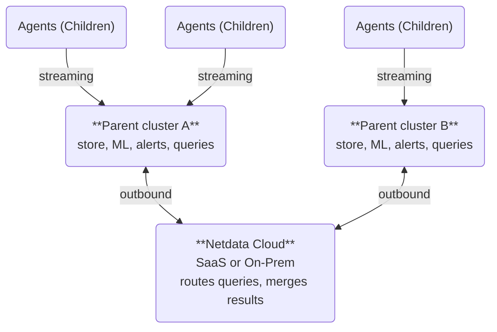

# Netdata Design

**Netdata is designed to simplify and automate operations and troubleshooting: it ships finished, collects at high fidelity in real time, keeps your metrics, logs and traces where they are created, and scales out by adding Parents.** This document explains why Netdata is built this way and what that means for scale, availability, history, openness and the choices it makes for you.

It is one of three core documents. [Welcome to Netdata](/docs/welcome-to-netdata.md) explains the outcomes and principles, this document explains the design behind them, and the [Complete Product Description](/docs/netdata-complete-product-description.md) lists every capability.

## Observability should just work

**Netdata's thesis is that monitoring should arrive finished, so your team can focus on the infrastructure and not on the monitoring.**

Monitoring that your team has to build and finish never ends: it needs scarce skills, it needs maintenance as the infrastructure changes, it multiplies the tools you operate, it is never complete when a crisis hits, and it has to be relearned at every company.

Netdata ships finished. Every metric arrives with meaning and a correct chart, alerts and anomaly detection come pre-configured, and the platform maintains its own storage. Your team focuses on the infrastructure, not on the monitoring.

Customization is appealing until you count what it costs: the expert hours to build it, the hours to keep it correct, the gaps nobody got to, and the knowledge that leaves when the expert does.

The rest of this document shows how the design delivers that.

## Dashboards that build themselves

**Every Netdata metric arrives with a correct, ready-made chart, because Netdata gives metrics meaning when they are collected, not when they are visualized.**

Every collector decides, for each chart, what is being monitored, the units, the title, the best chart type, which time-series belong together, which labels describe each instance, and which rollups provide higher-level views. Prometheus and OpenTelemetry metrics get the same treatment through collection profiles. So dashboards build themselves: every metric arrives with a correct, ready-made chart, and teams adjust the default grouping and slicing per space, room or person.

Other monitoring tools rely on a query language so experts can build dashboards by hand. Netdata removes that work, and with it the errors hand-written queries introduce: rates applied to gauges, averages of averages, series silently missing from a sum. In Netdata, a wrong chart is a bug we fix, not a mistake you made.

You can install Netdata in the middle of a crisis: real-time charts and AI-assisted troubleshooting work immediately, and machine learning anomaly detection starts after 15 minutes of data.

At 3 a.m., operators search for a metric and find a verified chart for it, instead of building one in the middle of an incident. Missing visualizations are one of the biggest delays in a crisis; Netdata removes them by visualizing every metric it collects.

For automation, every chart is one call to Netdata's data API, which returns the full analysis in a single response. You can also ask Netdata AI, or any AI assistant through Netdata's MCP server, in plain language. Your data is never locked in: Netdata can also export metrics to other systems.

The same idea applies to the whole stack: the [NIDL framework](/docs/NIDL-Framework.md) (Nodes, Instances, Dimensions, Labels) is the single data model behind every chart, alert and query.

## Data stays where it is created

**Instead of centralizing the data, Netdata distributes the monitoring code to each system, keeping data local while providing unified access.** This architecture enables linear scaling to millions of metrics per second and terabytes of logs, automated root cause analysis, a faster experience and significantly lower total cost of ownership.

Your metrics stay on your own infrastructure, in your Agents and Parents. Netdata shines when your data is distributed. Agents collect and store metrics on every node. Parents receive streams from many Agents (Children), store their metrics, run machine learning and alerts for them, and answer queries for them.

Netdata Cloud (SaaS or On-Prem, including air-gapped) is the orchestration layer: it routes each query to the Parents that hold the data and merges the results. Each Parent serves the complete view of all its own nodes on its own; the fleet-wide view across all Parents is what Netdata Cloud adds, and with On-Prem, including air-gapped, that view runs entirely inside your network.

All connections are outbound. Children connect to their Parents, Parents connect to their sibling or upstream Parents, and Parents connect to Netdata Cloud. Children need no inbound access from Netdata Cloud: Cloud reaches them, for dashboards, live [Functions](/docs/top-monitoring-netdata-functions.md) and configuration, through their Parents.

Netdata stores metric samples on your Agents and Parents, on their disks. It has no object-storage tier for metrics; object-storage offload exists for logs and traces.

## Scale out: Parent clusters are shards

**Netdata scales out: each Parent cluster is a shard, and you add capacity by adding shards, placed as close to the edge as possible.**

Shards never talk to each other, and no metric samples stream out of them: Netdata Cloud queries them on demand and merges the results. The view across all of them is what Netdata Cloud provides, as SaaS or On-Prem, including air-gapped.

A central TSDB must first move every sample across the network and ingest and index it in one place before any query can run. Netdata skips that step entirely: the data is already where the query runs.

### Sizing

**Plan about one Parent for every 500 nodes; this is a planning unit, not a limit.**

For large infrastructures, we recommend deploying Parents for about every 500 nodes (about 2 million metrics per second on 20 CPU cores and 80 GB RAM, including all overheads). Parents can handle multiple times this load, given the right resources, so this is not a hard limit. About 500 nodes is a planning unit for capacity and cost math, not a per-Parent maximum: the benchmark below ran 1,000 nodes on a single Parent.

For example, a fleet of 2,000 nodes needs 4 Parents for the recommended capacity, and a fleet of 20,000 nodes needs about 40, with each Parent placed in the data center, region or cloud zone of its Agents. The [Parent sizing guidelines](/docs/scalability.md#parent-sizing-guidelines) list the layouts and resources.

In a benchmark, a single Parent ingested 4.6 million metrics per second from 1,000 nodes using about 9 of its 52 CPU cores and 47 GiB of its 200 GiB of RAM: 37% less CPU, 88% less RAM and 97% less disk I/O than Prometheus on the same data. This was a test load, not a maximum. The planning figure of about 500 nodes per Parent includes machine learning, alerts, queries, the operating system and headroom; the benchmark measured ingestion with ML and alerts disabled.

Large queries were up to 22x faster: Netdata answers each query from the storage tier that matches the chart's resolution, and every point in a higher tier keeps its min, max, average and anomaly rate, so the chart is the same, only faster.

An independent study, the [University of Amsterdam evaluation (ICSOC 2023)](https://www.ivanomalavolta.com/files/papers/ICSOC_2023.pdf), found Netdata the most energy-efficient of the monitoring tools it compared. More numbers are in [Scalability](/docs/scalability.md) and [Sizing Netdata Agents](/docs/netdata-agent/sizing-netdata-agents/README.md).

## Fleet-wide queries

**Netdata Cloud answers a fleet-wide query by asking each Parent to aggregate its own nodes and merging the partial results.**

When a dashboard shows a chart across many nodes, Netdata Cloud picks one Parent for each node and sends each Parent a single request listing all the nodes it holds. Each Parent aggregates its own nodes locally, including grouping by node and top-N, and returns partial aggregates (sums and counts), not raw samples. Cloud merges them exactly, so a fleet average is never an average of averages. For top-N, Cloud asks each Parent for extra candidates, checks that the merged ranking is provably exact, and fetches more when it is not. Requests run in parallel. Adding Parents adds both ingestion and query capacity.

Netdata Cloud is an autoscaling Kubernetes service. The work of querying raw samples runs on the Agents and Parents. Cloud receives results already aggregated over time and across cardinality, and performs only the last step: merging them, on the fly, into the charts you see. Apart from the routing decision, this touches no database; it is pure compute. For Cloud, queries are lightweight and read-only.

**Netdata Cloud is not in the data path.** If it is unreachable, every Agent and Parent keeps collecting, storing, detecting anomalies and evaluating alerts, Agent-dispatched notifications keep flowing, and every Parent still serves the dashboards for all its nodes. If a data center loses its internet link, admins inside it still get the full picture from their Parents and Agents directly.

## What one query returns

**A Netdata query returns the analysis, not only the samples.**

A Netdata query does not return only samples over time. In the same response it returns every point with its value, its anomaly rate and flags for gaps, counter resets and partial data; a breakdown per node, instance, dimension, label key and label value, each with min, max, average, anomaly rate and its contribution to the result; how many sources were selected, queried and failed at each level; and which storage tier answered. Other TSDBs need several queries, recording rules or external tools to approach this.

Each Netdata chart is a whole Grafana dashboard: slice and dice by node, instance, dimension or label, compare with previous periods, drill down and correlate, all with a click. Every chart offers:

- **Group by** node, instance, dimension, label keys or combinations, with a second-stage group-by.
- **Aggregation across sources** (average, sum, percentage, min, max, extremes) and **aggregation over time** (min, max, average, sum, percentiles, median, standard deviation and more).
- **Anomaly ribbon** and an info column that marks partial, overflown and empty points.
- **Compare periods**, **drill down** from node to instance to dimension, and **correlate metrics** from a highlighted window.
- **Chart values** (median, standard deviation, P95, range, volume) with CSV export.
- More than a dozen chart types, including heatmap, table and gauge.
- Zoom, pan and highlight synchronized across all charts, annotations, and alert management.

See [Netdata charts](/docs/dashboards-and-charts/netdata-charts.md) for the full list.

## For Netdata, missing data is data

**One unhealthy machine never blanks a fleet view: the dashboard renders from every node that answered and shows which are missing.**

If a Parent is slow or unreachable, the dashboard still renders from every node that answered and shows which nodes are missing. Every response reports which sources failed, so dashboards keep rendering while an automated check or report can reject any result that is not complete. You choose, per use, instead of the database choosing for you.

Every chart shows how many sources were rendered and how many should have answered but failed, and an info ribbon below the chart marks every point built from partial data, whether a Child died, a plugin stopped, or a data source became unavailable.

In most TSDBs, an aggregate across nodes silently drops series that failed to report: a fleet sum over 100 nodes, 3 of which did not report, simply comes back lower, with nothing on the chart saying so.

## High availability

**Parents form active-active clusters: every Parent in a cluster holds all of that cluster's data, so losing one interrupts nothing.**

For 2,000 nodes, 4 Parents give you the recommended capacity. For high availability, make each one a cluster of 2 Parents. A cluster of 2 Parents keeps 2 copies of its nodes' data.

- **Without clusters, a Parent restart loses nothing.** Even without Parent clusters, a Parent restart or a short connectivity interruption between Children and Parents loses nothing: every Agent keeps its own history and dashboard, and back-fills the Parent when it returns. Children configured with minimal local storage keep only a recent buffer (about an hour in RAM); a Parent outage longer than that buffer leaves a gap for those Children. Children with default storage keep their full history and back-fill the Parent.
- **A cluster adds uninterrupted fleet dashboards on top.** A Parent cluster of two or more keeps serving when one Parent is lost. Place cluster members in different racks, data centers or regions to survive the loss of a site.
- **Failover is automatic at every level.** Children and Parents fail over automatically to another upstream Parent at every level, and gaps are back-filled after a disconnection.
- **Machine learning is trained once and shared.** Models are trained on the first node that sees the data and streamed to the others, so a cluster does not repeat that work.

See [clustering and high availability of Parents](/docs/observability-centralization-points/metrics-centralization-points/clustering-and-high-availability-of-netdata-parents.md) and [replication of past samples](/docs/observability-centralization-points/metrics-centralization-points/replication-of-past-samples.md).

## Configure and inspect any node from one place

**From one UI you can provision data collection jobs, change alerts and run live Functions on any node, directly or indirectly connected to Netdata Cloud, without restarts.**

The streaming topology between Children and Parents forms a private network, and Functions and dynamic configuration are routed through it. Netdata Cloud asks a Parent to provision configuration to a Child; the Parent passes the message down the path, Parent to Parent, until it reaches the Child, which hands it to the relevant plugin. Live Functions take the same path: a PostgreSQL deadlock Function, for example, can be reached through a grandparent and is routed in real time to the Child's PostgreSQL module. Every level holds routing information, including real-time detection that a plugin died or a Child disconnected.

Dynamic configuration from the UI requires a paid plan; see [feature availability by plan](/docs/netdata-oss-limitations.md).

## History: tiers and what they cost

**Every Agent and Parent keeps tiered history, and you choose how long each tier lasts.**

Every Agent and Parent keeps tiered history: per-second (about 0.6 bytes per sample), per-minute and per-hour. Defaults are 14 days, 3 months and 2 years, configurable per tier. Parents scale to TiBs of storage: retention is bounded only by the disk you give them, and each tier's size and age are configurable.

Higher tiers keep min, max, average and anomaly rate for every point. The tiers are updated in parallel and written once, in append-only files that are never reorganized, so there is no database maintenance. Retention planning is in [Disk requirements and retention](/docs/netdata-agent/sizing-netdata-agents/disk-requirements-and-retention.md).

## Collect everything, every second, analyze everything

**Netdata collects every metric it can reach, at the highest frequency the source supports, and applies machine learning to all of them.**

- **Every second, by default.** Per-second collection matches the speed at which systems operate: CPUs execute billions of instructions per second, and a minute average hides stress spikes, microbursts and brief stalls. Netdata replaces the console tools engineers already use during incidents (`top`, `iostat`, `netstat`) with the same resolution, history and machine learning.
- **Collection is tuned so it does not disturb what it monitors.** Most metrics are collected per second when the source updates frequently, slower metrics every 5-10 seconds, and expensive metrics are disabled by default. All frequencies are configurable, and any collector can be disabled. The [Netdata resource footprint](/docs/netdata-agent/sizing-netdata-agents/README.md) lists what this costs.
- **Everything, because crises are unexpected.** A crisis happens when something breaks that nobody predicted, so nobody knows in advance which data they will need. Selective monitoring asks you to predict what will break; complete coverage removes the guess.
- **Structure keeps everything usable.** Metrics are organized hierarchically (disks stay in the disk section, containers in the container view), so more metrics never make finding one slower. A new metric adds very little memory and about 0.6 bytes per sample on disk.
- **Machine learning runs on every metric.** Netdata trains 18 models per metric on different time windows and flags a sample as anomalous only when all of them agree, which keeps false positives very rare. The result is stored as one bit with every sample, so anomaly rates are available for any metric, any time window and any tier. See [ML accuracy, reliability and sensitivity](/docs/ml-ai/ml-anomaly-detection/ml-anomaly-detection.md).

## Edge architecture with no separate database to operate

**Running data at the edge means there is no separate database to run, compact or back up, because Agents and Parents run autonomously.**

Centralized systems need database administration, capacity planning for central storage, pipeline scaling and maintenance windows. Netdata's edge architecture has none of these:

- **No separate database to run.** The time-series database is part of the Agent and Parent process; there are no separate database processes to tune, compact or back up.
- **No big-bang upgrades.** Each Agent updates independently, and new data formats are readable before they are written.
- **Fixed relationships.** A Parent-Child connection is configured once, and Netdata alerts on disconnections.
- **Cardinality protection.** Automated protections clean up archived, ephemeral instances so short-lived containers do not accumulate. They never touch collected metrics. See [extreme cardinality protection](/docs/extreme-cardinality-protection.md).
- **Isolated failures.** An issue affects one Parent, not the whole monitoring foundation.
- **Efficient disk use.** Data is committed to disk spread over time, so the I/O is small and predictable.

## Open by design

**Every deployment, from one node to very large fleets, runs the same complete open-source engine.**

Everything that collects, stores, analyzes, alerts on, streams and queries your data is open source (GPLv3 or later): collection, the database, machine learning, alerting, streaming and Parents, the APIs and the MCP server. Netdata Cloud is a thin orchestration layer over the Agents; by itself it holds and does nothing, because the data and its processing are in the Agents and Parents. The dashboard is the same for free and paid users.

- **Licences, exactly.** The Agent is GPLv3 or later. The dashboard is licensed under the Netdata Cloud UI License (NCUL1): free to use, provided in binary form, and usable only to interface with Netdata Agents and Netdata Cloud.
- **Embedding means calling the APIs.** Netdata's APIs are GPL, and anyone can embed API calls anywhere.
- **Open in, open out.** Netdata ingests Prometheus and OpenTelemetry (metrics, logs and traces), Nagios plugins and StatsD, and can export metrics to Prometheus, Graphite, OpenTSDB and other systems when you want them elsewhere. Export is openness: your data is never locked in.
- **Netdata is a complete platform on its own.** You do not need to run anything beside it to collect, store, visualize, alert on or analyze your data.

## Design choices

**These are choices Netdata makes for you, each with what Netdata does instead.**

- **No query language.** Netdata does not use a query language. Every chart is explored by grouping, filtering and aggregating nodes, instances, dimensions and labels with a click, one request to the data API returns the full analysis, and Netdata AI or any AI assistant answers plain-language questions across your infrastructure.
- **Metrics live on your Agents and Parents.** Netdata has no object-storage tier for metrics. Retention is bounded by the disk you give your Parents, and it is configurable per tier.
- **Parent clusters are shards.** They do not talk to each other. The view across all of them is what Netdata Cloud provides, as SaaS or On-Prem, including air-gapped.
- **Netdata is opinionated.** It is built for teams that want monitoring that works from the start. Teams that want to hand-build dashboards, joins and recording rules over raw samples will find a different tool fits them better.
- **Netdata is infrastructure and application observability.** It is not a business-intelligence, SIEM, ITSM or data-warehouse platform; it can export metrics and forward logs and traces to the systems that are.

## Questions buyers ask

### How does Netdata answer a fleet-wide query across 20,000 nodes?

Cloud sends one request to each Parent, listing the nodes that Parent holds; each Parent aggregates locally and returns partial results, and Cloud merges them exactly. See [Fleet-wide queries](#fleet-wide-queries).

### How many nodes can one Parent handle, and how do I size a fleet of 2,000 nodes?

Plan about one Parent per 500 nodes; a Parent can handle more with the right resources. For 2,000 nodes, use 4 Parents, or 4 clusters of 2 for high availability. See [Sizing](#sizing).

### What happens when a Parent fails?

In a cluster, nothing is interrupted, because every Parent holds all the cluster's data. Without a cluster, Children keep their own history and back-fill the Parent when it returns. See [High availability](#high-availability).

### What happens when Netdata Cloud is unreachable?

Every Agent and Parent keeps collecting, storing, detecting anomalies and alerting, and every Parent still serves dashboards for all its nodes. See [Fleet-wide queries](#fleet-wide-queries).

### How long can I keep per-second data?

You choose, per tier, and retention is bounded by the disk you give your Parents. The default is 14 days of per-second data. See [History](#history-tiers-and-what-they-cost).

### What does it cost in disk and CPU to collect everything every second?

Per-second samples take about 0.6 bytes on disk, and the Agent footprint is stated on the [sizing page](/docs/netdata-agent/sizing-netdata-agents/README.md). In the benchmark above, Netdata used 37% less CPU, 88% less RAM and 97% less disk I/O than Prometheus on the same data.

### How do I build dashboards without a query language?

You do not need to: every metric arrives with a ready-made chart, and you slice it with a click. See [Dashboards that build themselves](#dashboards-that-build-themselves).

### Where does my data live, and who can see it?

Your metrics stay on your Agents and Parents. Netdata Cloud routes queries and merges results. See [Data stays where it is created](#data-stays-where-it-is-created) and [Security and privacy design](/docs/security-and-privacy-design/README.md).

### Is Netdata open source?

The whole engine is open source (GPLv3 or later). The dashboard is free to use under its own licence. See [Open by design](#open-by-design).

### Why does Netdata collect everything instead of what I select?

Because the metric you did not think to select is often the one that explains the incident. See [Collect everything](#collect-everything-every-second-analyze-everything).

## Related documents

- [Welcome to Netdata](/docs/welcome-to-netdata.md): outcomes, values and principles.
- [Complete Product Description](/docs/netdata-complete-product-description.md): every capability.
- [Scalability](/docs/scalability.md) and [Sizing Netdata Agents](/docs/netdata-agent/sizing-netdata-agents/README.md): numbers.
- [Clustering and high availability of Parents](/docs/observability-centralization-points/metrics-centralization-points/clustering-and-high-availability-of-netdata-parents.md).
- [Security and privacy design](/docs/security-and-privacy-design/README.md).
- [Enterprise Evaluation Guide](/docs/netdata-enterprise-evaluation.md).
- [NIDL framework](/docs/NIDL-Framework.md).
