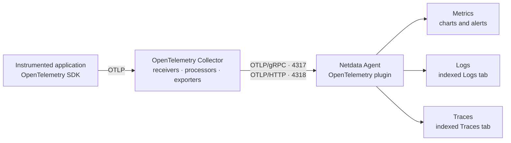

# Ingest OpenTelemetry Metrics, Logs, and Traces

Send OpenTelemetry data to Netdata through an [OpenTelemetry Collector](https://opentelemetry.io/docs/collector/#when-to-use-a-collector). Your applications send their data to the Collector. The Collector exports it to the Netdata Agent over OTLP/gRPC or OTLP/HTTP. For host and application metrics that Netdata can collect directly, the native collectors are usually simpler, and they come with purpose-built charts and alerts.

## Choose the collection path

| Situation                                                                           | Recommended path                                                                             |
|:------------------------------------------------------------------------------------|:---------------------------------------------------------------------------------------------|
| Netdata is the only consumer of host or application metrics                         | Use Netdata's [native collectors](/src/collectors/COLLECTORS.md)                             |
| An application already emits OTLP, or a Collector fans data out to several backends | Export to Netdata from an OpenTelemetry Collector, as described below                        |
| Network devices send syslog                                                         | Use the dedicated [OpenTelemetry Collector syslog setup](/docs/npm/syslog/otel-collector.md) |

The Netdata Agent receives OTLP metrics, logs, and traces. Traces are stored on the receiving Agent under their own retention settings, the `traces` section of `otel.yaml`, and explored in the Traces tab; see [Send traces](/docs/opentelemetry/otlp-ingestion.md#send-traces) below and [Trace Storage and Retention](/docs/opentelemetry/trace-storage-and-retention.md).

## How data flows



## What you need

- A Netdata Agent with the OpenTelemetry plugin. Linux native DEB and RPM packages install it as a dependency of `netdata`, static builds bundle it (except the 32-bit ARMv6 build), and all Docker images include it. macOS kickstart installs provision a Rust toolchain and build it; if no adequate toolchain ends up available, the install continues with a warning and without the plugin. Linux source builds need `--enable-plugin-otel`. It is not available on Windows or FreeBSD. Wherever it is present, Netdata starts it automatically.
- An OpenTelemetry Collector. The examples use [OpenTelemetry Collector Contrib](https://github.com/open-telemetry/opentelemetry-collector-releases), because the `host_metrics` and `file_log` receivers are Contrib components.
- Network access from the Collector to the Agent's endpoint.
- For log and trace verification, a Netdata Cloud account and sign-in. The `otel-logs` and `otel-traces` views are access-gated: they require a signed-in member of the node's Space with permission to view sensitive data, on a paid plan or an active trial.

The maintained examples are validated with OpenTelemetry Collector Contrib `0.157.0`. Upstream documentation links on these pages follow upstream's latest version, which may be newer than the validated examples; if you run an older release, check that release's component identifiers before copying the configuration.

For production pipelines beyond these smoke tests, continue with [Metrics Collection](/docs/opentelemetry/metrics-collection.md), [Logs Collection](/docs/opentelemetry/logs-collection.md), and [Transformations](/docs/opentelemetry/transformations.md). Each page links its examples to the complete upstream Collector documentation.

The plugin starts automatically and listens for OTLP/gRPC on the IPv4 loopback endpoint `127.0.0.1:4317`. The OTLP/HTTP listener on `127.0.0.1:4318` is off by default. To use it, turn it on in `otel.yaml` and restart the Agent:

```yaml
receivers:
  otlp:
    protocols:
      http:
        enabled: true
```

The examples below put the Collector and Agent on the same host and intentionally disable TLS only for that loopback connection.

## Export to the local Agent

Add one of these exporters to the Collector configuration:

```yaml
exporters:
  otlp_grpc/netdata:
    endpoint: "127.0.0.1:4317"
    tls:
      insecure: true
```

```yaml
exporters:
  otlp_http/netdata:
    endpoint: "http://127.0.0.1:4318"
    tls:
      insecure: true
```

Both exporters work. `otlp_grpc` sends to port `4317`. `otlp_http` sends to port `4318` and takes a full URL as its `endpoint`; it needs the OTLP/HTTP listener turned on. Use `127.0.0.1`, not `localhost`: `localhost` can resolve to an IPv6 address, and the Agent listens on IPv4 by default.

Keep the exporter's default encoding and compression:

- **Encoding:** the default is protobuf. With `encoding: json`, a metric value of NaN or infinity makes the Agent reject the whole request. With protobuf, the Agent does not chart such a value: it leaves out a gauge or sum data point that has it, and in a histogram or summary data point it leaves out only that number.
- **Compression:** the default is gzip, the only compression the Agent accepts. Do not set `compression` to `zstd`, `snappy`, or another algorithm.

## Smoke-test Host Metrics

If you already use native Netdata host collectors, this pipeline duplicates some host metrics. Use it as a smoke test or when hostmetrics is already part of a shared OpenTelemetry pipeline.

```yaml
receivers:
  host_metrics:
    collection_interval: 10s
    scrapers:
      cpu: {}
      memory: {}
      network: {}

exporters:
  otlp_grpc/netdata:
    endpoint: "127.0.0.1:4317"
    tls:
      insecure: true

service:
  pipelines:
    metrics:
      receivers: [host_metrics]
      exporters: [otlp_grpc/netdata]
```

Save the configuration and start or reload the Collector using the service controls for your installation.

In Netdata, open the node's Metrics tab and search for contexts such as `otel.system.cpu.time` or `otel.system.memory.usage`. A successful TCP connection alone is not proof of ingestion; verify an actual chart.

## Smoke-test logs with `file_log`

Create a readable input file before starting this pipeline:

```bash
printf '%s\n' 'INFO netdata OpenTelemetry filelog smoke test' >> /tmp/netdata-otel-example.log
```

Then run this Collector configuration:

```yaml
receivers:
  file_log/netdata_example:
    include: [/tmp/netdata-otel-example.log]
    start_at: beginning

processors:
  resource/netdata_example:
    attributes:
      - key: service.name
        value: netdata-otel-filelog-example
        action: upsert

exporters:
  otlp_grpc/netdata:
    endpoint: "127.0.0.1:4317"
    tls:
      insecure: true

service:
  pipelines:
    logs:
      receivers: [file_log/netdata_example]
      processors: [resource/netdata_example]
      exporters: [otlp_grpc/netdata]
```

In Netdata, open the node's Logs tab, select the `otel-logs` source, and choose `netdata-otel-filelog-example` with the **Services** selector. To filter by the stored field instead, use `resource.attributes.service.name = netdata-otel-filelog-example`. The `service.namespace` and `service.name` resource attributes identify log streams, so set them consistently in production pipelines.

## Send traces

Traces come from instrumented applications. The application's OpenTelemetry SDK sends its spans to the Collector, and the Collector forwards them to the Agent. On the Agent's host, the Collector cannot listen on the ports the Agent uses (`4317` and `4318`), so give the Collector's `otlp` receiver another port:

```yaml
exporters:
  otlp_grpc/netdata:
    endpoint: "127.0.0.1:4317"
    tls:
      insecure: true

receivers:
  otlp:
    protocols:
      grpc:
        endpoint: "127.0.0.1:4319"

service:
  pipelines:
    traces:
      receivers: [otlp]
      exporters: [otlp_grpc/netdata]
```

Then point the application at the Collector, for example with `OTEL_EXPORTER_OTLP_ENDPOINT=http://127.0.0.1:4319` and `OTEL_EXPORTER_OTLP_PROTOCOL=grpc` in its environment.

Set the `service.name` resource attribute in every application; it names the service each span belongs to. The spans appear in the Traces tab. How they are stored and kept is in [Trace Storage and Retention](/docs/opentelemetry/trace-storage-and-retention.md).

## Accept remote senders securely

The default loopback endpoints are the safe choice for a same-host Collector. To receive remote OTLP traffic, bind
beyond loopback with TLS or mutual TLS and restrict ports `4317` and `4318` with network controls — the procedure and certificate
rotation are in [Securing the OTLP Endpoint](/docs/opentelemetry/securing-the-otlp-endpoint.md). See
the [OpenTelemetry plugin reference](/src/crates/otel-plugin/README.md) for every option.

## Monitor the OpenTelemetry plugin

The plugin does not slow senders down, and it leaves the capacity of the host to you: disk space, memory, and
object storage. It gives you charts for these conditions. Netdata ships no alerts for the plugin's own charts
(`netdata.otel.*`): add the alerts that fit your installation.

| What to watch | Charts | What it means |
|:--------------|:-------|:--------------|
| Data that the plugin cannot store | `netdata.otel.log_records` and `netdata.otel.spans`, dimension `failed` | The disk is full, or a write to it failed. The sender sends these records again, while its retry settings allow it. |
| Data that the plugin rejects | `netdata.otel.metric_data_points`, `netdata.otel.log_records`, `netdata.otel.spans`, dimension `rejected` | Usually a timestamp outside the accepted time window. See the troubleshooting list below. A request that the plugin rejects as a whole (for example, one larger than 4 MiB) is not on these charts: the sender gets the error. |
| Disk space | The Agent's `disk.space` chart of the filesystem that holds the OpenTelemetry data; `netdata.otel.index_size`, `netdata.otel.index_files` | The retention limits apply to the indexed files of each tenant. Files that are not indexed yet, catalogs, and the download cache use more space. |
| Tenants | `netdata.otel.tenants` | Each tenant has its own files and its own retention limits. More tenants need more disk and more memory. The plugin never removes a tenant: the number does not go down when the data of a tenant expires, and the tenant is there again after a restart. A number that rises when you added no tenant means that senders use tenant names that you did not plan. With object storage, a start of the plugin takes longer while object storage is slow: the time to list the catalogs, up to 20 seconds for each tenant of logs and for each tenant of traces, and more when catalogs must be downloaded. The plugin accepts no data until the start is complete. For object storage that does not answer at all, see the notes below this table. |
| Indexing | `netdata.otel.indexing_operations`, `netdata.otel.indexing_operations_oldest_wait`, `netdata.otel.indexing_operations_finished` | When the number of waiting operations grows, the host receives data faster than it can index it. The files that wait use disk space that `netdata.otel.index_size` does not count. Give the host more CPU or more memory, or send less data. When the plugin starts, it first indexes the files that the last run left. It accepts no data until that is done, and these charts start after it. |
| The two worker processes | `netdata.otel.wal_events_queued` | The plugin has two worker processes: the ingestor receives the data and writes it, and the ledger indexes it. The ingestor tells the ledger about each write-ahead log (WAL) file that it creates, syncs, and closes. The chart shows how many of these messages wait to be sent. The number is near zero when the ledger keeps up. When it grows, the ledger is slower than the ingestor, and the ingestor uses more memory. Give the host more CPU, or send less data. |
| Object storage | `netdata.otel.uploads`, `netdata.otel.uploads_finished`, `netdata.otel.index_files_waiting_for_remote` | These charts exist only when object storage is enabled. They show uploads that fail, and local files that the plugin cannot delete until object storage confirms them. While these files wait, the local disk can hold more than the retention limits. A file can wait up to about 15 minutes after its upload, until its catalog is uploaded too. If files still wait after an hour while no upload fails, the plugin could not check the files of earlier runs when it started: object storage was slow or gave an error at that time, or it does not hold all the files of an earlier run (for example, after you changed `remote_storage.uri`). The plugin checks these files only when it starts. Restart the Agent. If the files still wait, look in the journal of `otel-plugin/ledger` for warnings from the start with `startup budget`, `skipping remote reconciliation`, `reconciliation failed`, `catalog stat failed`, or `the remote has neither this catalog`. |
| Memory and CPU of the plugin | The Agent's application charts (`app.mem_usage`, `app.cpu_utilization`), group `otel-plugin` | Memory grows with the volume of data and with the number of services and tenants. The plugin keeps a small state for each tenant, and for each service that sent logs, for as long as it runs. This part of the memory does not go down until the Agent restarts. Indexing uses memory in bursts. |
| Charts made from logs and traces | `netdata.otel.derived_services`, `netdata.otel.derived_expired_services`, `netdata.otel.derived_adjusted_log_records`, `netdata.otel.derived_adjusted_requests` | The first two charts have one dimension for logs and one for traces. `netdata.otel.derived_services` shows the services that have their own charts, plus one for the shared chart set when it is in use. The limit of 500 services applies to logs and to traces separately. When a dimension reaches it, the data of new services of that signal goes to the shared chart set, and `netdata.otel.derived_adjusted_log_records` (for logs) or `netdata.otel.derived_adjusted_requests` (for traces) shows it as `overflowed`. A service that sends no data for 15 minutes loses its charts (`netdata.otel.derived_expired_services`), and its place becomes free. |

The plugin relies on these rules and does not check them:

- Use one plugin for one data directory. Two Agents that write to the same `base_dir` can damage the stored data.
  Do not let other programs delete or change the files under `base_dir`: no cleanup jobs, and no temporary
  filesystem that is emptied at boot.
- Keep the clock of the host correct. The plugin uses it to accept and reject records and to apply retention by age.
  The Agent's charts `system.clock_sync_state` and `system.clock_sync_offset` show a clock that is not synchronized.
  A clock that is far ahead makes retention delete data too early. If the clock was ahead and was moved back, log
  records and spans without a time of their own get a time that is too late, and the files of services that send
  little are not closed on time, until the clock reaches its earlier time again. If it was moved back by more than
  the accepted time window (24 hours by default), the plugin also rejects new logs and spans, until the clock is
  again less than that window behind its earlier time. Restart the Agent to end this at once.
- Several Agents can use one object storage location, but each must have its own Netdata machine GUID. Do not clone
  a host together with its GUID and point both hosts at the same location.
- The plugin does not delete objects from object storage: the location grows until you set expiry rules on it. The
  data is under the prefix `v2/<signal>/tenants/` and the catalogs are under `v2/<signal>/catalog/` (the signal is
  `logs` or `traces`). If you set expiry rules, do not let the objects under `tenants` expire before the objects
  under `catalog`. A catalog that names an object that is gone makes queries incomplete.
- When the plugin starts, it lists all the catalog objects of the location, also those of other Agents that use the
  same location. While it starts, the list uses memory: some hundred MB for one million catalog objects. Expiry
  rules on old catalogs keep this small.
- With object storage enabled, the plugin needs object storage when it starts: it lists the catalogs there before
  it receives data. While object storage does not answer, or answers with an error, the plugin waits and tries
  again. One attempt can take some minutes, and the next attempt starts 30 seconds after a failed one. During this
  time the plugin's ports are not open: senders get a refused connection, no metrics, logs or traces are received,
  and you cannot query logs or traces. When object storage answers again, the plugin completes its start. You do
  not have to restart the Agent.
- For each failed attempt, the Agent journal has a warning from `otel-plugin/ledger` (`journalctl
  SYSLOG_IDENTIFIER=otel-plugin/ledger`) with `startup catalog sync` and the error from object storage. The plugin
  also tries again after an error that your configuration causes, for example wrong credentials
  (`PermissionDenied`) or a bucket that does not exist. If the warning shows such an error, correct
  `remote_storage.uri` or the credentials and restart the Agent. A warning that says `timed out` is usual while
  object storage cannot be reached: one request took longer than its limit (5 minutes by default). If the attempts
  still time out when object storage answers, the list of a location with very many catalog objects needs more
  time: the warning names the setting that holds the limit.

## Delivery is at least once

Netdata answers an export of logs or traces with success only after the records are on its disk. A sender that gets
no success answer sends the batch again: the OpenTelemetry protocol expects this. Netdata stores what it receives. It
does not compare records to find copies, because the protocol gives a log record no identity. So Netdata does not
lose a record after a success answer, but it can store a record two times. These are the causes:

- **A storage error:** the disk is full, or a write to it failed. Netdata answers `UNAVAILABLE` (HTTP 503). A part of
  the batch, or all of it, can be on the disk already. The charts `netdata.otel.log_records` and `netdata.otel.spans`
  show these records on their `failed` dimension.
- **A stop or a restart of the Agent:** the plugin first answers the exports that are in progress, for up to half a
  second. An export that it could not answer in that time gets no answer, and its records can be on the disk.
- **A crash of the Agent or of the host** after the plugin wrote the records and before the sender got the answer.
- **An answer that is late or lost:** Netdata stored the batch, but the sender did not wait long enough, or the
  network lost the answer.
- **Copies that are made before the data reaches Netdata:** for example, a Collector that reads a log file again
  after its own restart, or two pipelines that send the same data.

For traces, the view of one trace shows each span one time, also when Netdata stored copies of it. Counts of spans
include each stored copy.

Netdata has no setting for this. To keep copies rare:

- Give the exporter a `timeout` that is long enough for Netdata to write a batch. The Collector's default is 5
  seconds. Increase it if the disk of the Agent is slow.
- For the `filelog` receiver, use a `file_storage` extension, so that a restart of the Collector does not read the
  files again. See [logs collection](/docs/opentelemetry/logs-collection.md).
- Send each set of data through one pipeline.

## Troubleshoot the pipeline

- **The plugin is absent:** on Linux native packages, confirm the `netdata-plugin-otel` package is installed; on ARMv6 static builds, Windows, and FreeBSD the plugin is not available.
- **The plugin does not start:** check the Agent journal for strict `otel.yaml` or `NETDATA_OTEL_CFG_*` validation errors.
- **The Collector connects but data is absent:** check that the exporter uses the right port: `4317` for `otlp_grpc`, `4318` for `otlp_http`. The `otlp_http` exporter needs the OTLP/HTTP listener, which is off by default. Then look for rejected exports in the Collector log and in the Agent journal. On a systemd-based Agent host, query recent plugin messages with `journalctl SYSLOG_IDENTIFIER=otel-plugin SYSLOG_IDENTIFIER=otel-plugin/ingestor --since "-10 min"`.
- **A metric is absent:** exponential histograms are not currently ingested. For other metrics, inspect mapping errors and search for the `otel.<metric-name>` context.
- **The Collector reports `Unavailable` or HTTP 503 for logs or traces:** first check if the Agent stopped or restarted at that time. When it stops, the plugin first answers the exports that are in progress, for up to half a second. An export that it could not answer in that time ends with a closed connection and no answer (in rare cases with the message `the plugin is stopping`). The same happens to an export in progress when the Agent or the host stops suddenly. Exports that come while the plugin is down get a refused connection. There is nothing to repair: the Collector sends the batch again. Netdata can have the records of an export that was cut on its disk already, so they can appear two times (see [Delivery is at least once](#delivery-is-at-least-once)). In the other cases Netdata could not store the data: its disk is full, or a write to its disk failed. The Collector keeps the batch and sends it again. The charts `netdata.otel.log_records` and `netdata.otel.spans` show these records on their `failed` dimension. Make room on the disk that holds the OpenTelemetry data, or repair it. One failure can refuse more than one batch, and a refused batch can be on the disk in part or in full. When the Collector sends such a batch again, Netdata stores it again, so some records can appear two times.
- **Some metric data points are absent:** Netdata rejects a metric data point when its timestamp is further from the current time than the expiry of its chart (15 minutes by default), in the past or in the future. The chart `netdata.otel.metric_data_points` shows these data points on its `rejected` dimension, and the plugin logs a warning in the Agent journal. Check the clock of the host that produced the metrics. Netdata also rejects a data point when the name of its metric or of its dimension is longer than 255 bytes, and when its chart already has 4,096 dimensions. For a histogram or a summary, Netdata leaves out the buckets or quantiles that do not fit and does not reject the data point. A chart keeps at most 1,024 labels. When the attributes of a metric give more labels, Netdata leaves out the rest.
- **Some logs are absent:** by default, Netdata accepts log timestamps from up to 24 hours in the past through 10 minutes in the future. Records outside this window are rejected, and the Collector logs a `Partial success response` warning for them.
- **Some spans are absent:** by default, Netdata accepts a span only if it started no more than 24 hours ago and ends no more than 10 minutes in the future; a span without an end time is judged by its start. The Collector logs a `Partial success response` warning for rejected spans, and the Agent logs a warning in its journal.

For plugin-specific diagnosis, use the [OpenTelemetry plugin reference](/src/crates/otel-plugin/README.md). To derive a metric from matching log records, continue with [Create metrics from OpenTelemetry logs](/docs/opentelemetry/logs-to-metrics.md).
