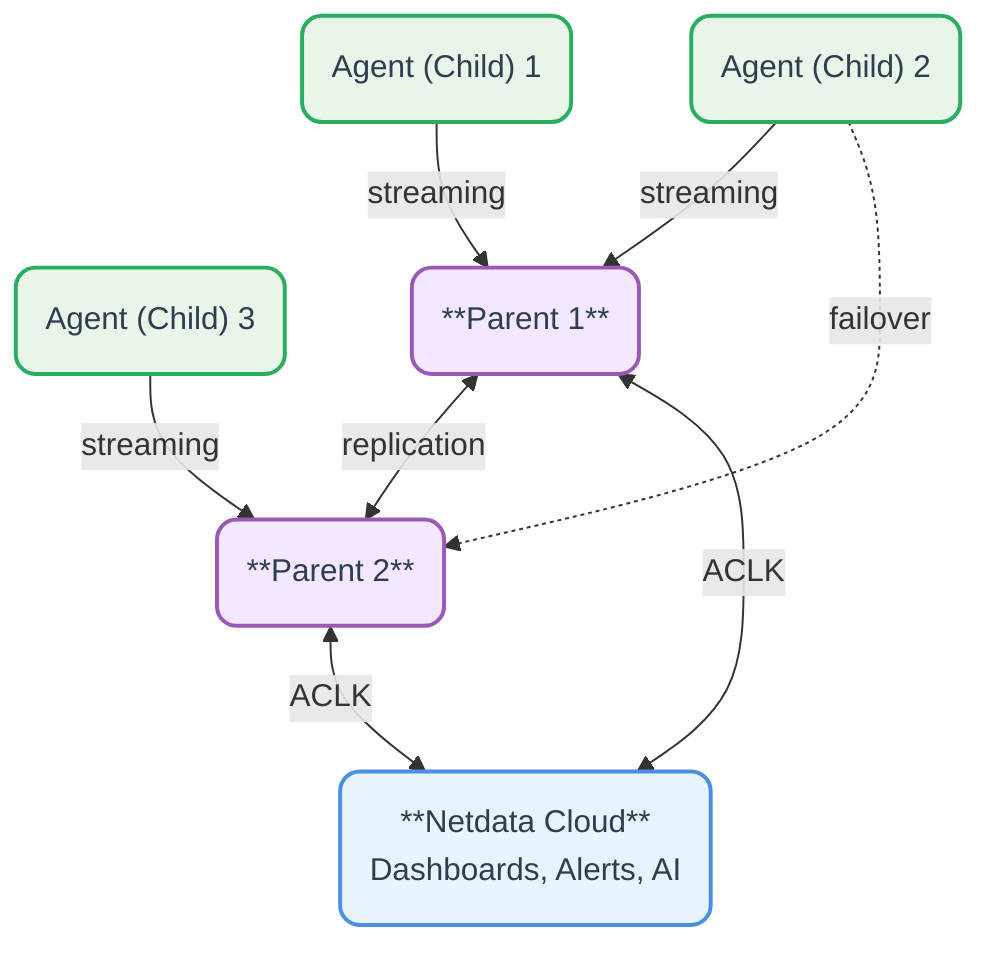

# Welcome to Netdata

**Netdata is an observability platform for systems, networks, clouds and applications, designed to simplify and automate operations and troubleshooting, with high-fidelity, real-time insights, and with your metrics, logs and traces kept in your own infrastructure.**

Install it, and every system and application you run is collected, charted, scored for anomalies and watched by alerts from the first minute. You start with working dashboards and alerts, not a blank page, and shape them from there: add your own, tune the ones that matter, and choose which ones notify you. It works the same on your first node and on a very large fleet.

Instead of centralizing the data, Netdata **distributes the monitoring code** to each system, **keeping data local** while providing **unified access**. This architecture enables **linear scaling** to millions of metrics per second and terabytes of logs, **automated root cause analysis**, a faster experience and significantly **lower total cost of ownership**.

This page explains what working with Netdata is like and the principles behind it. [Netdata Design](/docs/netdata-design.md), the [Complete Product Description](/docs/netdata-complete-product-description.md) and the [Enterprise Evaluation Guide](/docs/netdata-enterprise-evaluation.md) go deeper on each part.

## What it covers

- **Observability platform:** metrics, logs, traces, machine learning, topologies, flows, anomalies, forecasting and live views, in one platform.
- **Systems:** Linux, Windows, macOS and FreeBSD, from IoT and edge devices to bare-metal servers, virtual machines, Kubernetes, HPC and data centers.
- **Networks:** 1700+ SNMP profiles, 150k+ SNMP trap profiles, BGP, NetFlow, sFlow and IPFIX flows, topology, and licence management. See the [network performance monitoring docs](/docs/npm/README.md).
- **Clouds:** AWS, Azure and GCP, plus private and hybrid clouds.
- **Applications:** 800+ native integrations, OpenMetrics (Prometheus), OpenTelemetry (OTLP) and StatsD. See the [Complete Product Description](/docs/netdata-complete-product-description.md).

## How Netdata is different

### It is automated, so the work is already done

**Netdata does the work other approaches leave to your team.**

It discovers collection sources and starts collecting. It builds dashboards algorithmically from the structure of the data, so every metric has a correct chart. It ships pre-configured alerts that watch each instance of the components it finds. It discovers dependencies between systems and applications. It runs machine learning on every metric, and it manages itself.

At 3 a.m., you search for a metric, find it already charted, and see which metrics behaved unusually in the incident window.

### It is high-fidelity and real-time at any scale

**Netdata collects at per-second resolution by default, independently of scale, because each Agent and Parent does its share of the work.**

Per-second data shows spikes, saturation and the order of cascading failures that minute-level averages hide. Netdata collects on a beat: when a sample is late, the system is usually under stress, and the chart shows the gap instead of hiding it.

Because Netdata evaluates every metric every second, anomalies such as traffic floods and DDoS patterns show up in the data within seconds of starting.

### Your metrics, logs and traces stay in your own infrastructure

**Data is stored where it is created: on your Agents and Parents.**

Your metrics, logs and traces leave your servers only when someone views them. Netdata Cloud routes queries to the nodes that hold the data and merges the answers, and it is not in the data path. Every Agent keeps working without Cloud and without internet access. Netdata meets data-sovereignty and residency requirements by design.

### Troubleshooting starts from data that is already explained

**Machine learning and AI start from complete, well-described data.**

Anomaly detection runs on every metric. The Anomaly Advisor ranks the metrics that behaved unusually in a window you select. Netdata AI performs root-cause and blast-radius analysis and writes AI reports. The MCP server connects any AI assistant to your infrastructure. You can install Netdata in the middle of a crisis and get real-time insights and AI-assisted troubleshooting immediately.

## The principles behind it

### Meaning is given at collection time

**Every metric is collected with its meaning, so Netdata can chart it correctly without anyone describing it.**

Each metric arrives with its unit, its family, its place in the structure and the way it should be aggregated. That is why dashboards build themselves, why every chart is a complete analytical tool you explore by pointing and clicking, and why Netdata has no query language: there is nothing you need to express to get a correct chart. See [Netdata charts](/docs/dashboards-and-charts/netdata-charts.md) and [Netdata Design](/docs/netdata-design.md).

- **A verified chart for every metric,** without building it.
- **The same structure everywhere,** so what you learn on one system applies to all of them.
- **Quality that does not depend on who is on call:** junior and senior engineers see the same views.

### Collect everything

**Netdata collects everything that systems and applications expose, so the metric you did not know to monitor is already there.**

Selecting what to collect ties the quality of your visibility to what someone thought of in advance. Netdata removes that dependency by discovering applications, containers and services and starting to collect.

- **No blind spots:** during an incident, the data you need was already collected.
- **Accurate sequencing:** the exact order of events across systems.
- **Complete context for machine learning and AI,** which can only reason about what was collected.

### Every Agent is complete, and scaling is adding Parents

**Every Agent is a full monitoring system, and a larger fleet is the same architecture with more Parents.**

An Agent collects, stores, queries, visualizes, runs machine learning and evaluates alerts on its own. Parents are the same software, centralizing the data of many Agents, and they form active-active clusters, so one Parent can be lost without losing the view. Adding Agents or Parents does not change the ones that exist. Each Parent cluster is an independent shard, so adding Parents adds capacity: about one Parent per 500 nodes, so 2,000 nodes run on 4 Parents and 20,000 on about 40 (see [Netdata Design](/docs/netdata-design.md#sizing)). See also [Scalability](/docs/scalability.md).

- **No re-architecture as you grow:** the engine that runs on one node runs on a very large fleet.
- **High availability without a separate product.**
- **No separate database to run, tune or back up:** the time-series database is part of the Agent and Parent.

### Missing data is data

**When something cannot be collected on time, Netdata shows the gap, because the gap itself is information.**

The same rule holds across the fleet: when a node does not answer a query, the dashboard still renders from every node that did and shows which are missing, so an incomplete answer is never presented as a complete one.

- **Stress is visible** the moment it starts.
- **Honest answers:** a fleet-wide result always says which sources it covers.

### Alerts that cover every component

**Pre-configured alerts watch every individual instance of the systems and applications Netdata detects.**

Alerts are templates that apply to each database, web server, container and service as it appears, so new instances are covered automatically and an alert tells you which instance is failing. Conditions that matter but should not wake anyone are visible on the dashboard but do not send notifications by default. Every stock alert can be edited or disabled, and you can add your own, from the dashboard or in configuration files. See [notifications](/docs/alerts-and-notifications/notifications/README.md) for the channels your team uses.

- **Coverage from the start**, plus your own alerts where you need them.
- **Early detection** of component failures before they become service outages.

### Logs in place, or ingested efficiently

**Netdata handles logs in two ways, and neither needs a separate logging backend.**

- **Logs monitoring** queries system logs in place, without moving them: systemd journal on Linux, event logs on Windows and the unified log on macOS, with every field filterable and live counters, in the same dashboard as the metrics.
- **Logs ingestion** takes OpenTelemetry logs from any source and stores them locally, or offloads them to S3-compatible object storage. Every field is indexed and searchable.

**Netdata indexes every log field and stores logs in a fraction of their raw size.**

Log systems usually trade search power for storage. Indexing only streams keeps storage small but limits filtering. Indexing every word allows any search but needs several times the raw size. Netdata indexes every field, balancing storage cost and search efficiency.

Traces arrive through the same OpenTelemetry pipeline, so one data model covers metrics, logs and traces. See [working with logs](/docs/category-overview-pages/working-with-logs.md) and [OpenTelemetry](/docs/category-overview-pages/opentelemetry.md).

- **One place to look** when a metric, a log line and a trace tell parts of the same story.
- **Logs stay under your control,** on your nodes or in your own object storage.

### Open by design

**Netdata works with the standards and tools you already use.**

It ingests Prometheus, OpenTelemetry, Nagios plugins and StatsD, exports metrics to Prometheus, Graphite, OpenTSDB and other systems, and connects to AI assistants through its [MCP server](/docs/netdata-ai/mcp/README.md). The Agent is open source, and your data is never locked in.

## How it feels to work with Netdata

**You install it, open the dashboard, and the answers are already there.**

### At 3 a.m.

An alert fires. You open the node and every metric of that system is already collected, charted and organized in a table of contents that follows the data. You do not need to know a metric's name, write a query or build a dashboard. The anomaly ranking shows which metrics behaved unusually in the incident window, so you start from the most likely culprits instead of from a blank page.

### In the middle of a crisis

You can install Netdata while the incident is happening. The moment the Agent starts, you have real-time, per-second charts of everything on the system and AI-assisted troubleshooting. Machine learning needs about 15 minutes to build its first models and has no baseline for behavior before the install, so anomaly scores come later; the live data and the AI assistance are useful immediately.

### For a large organization

Every node is complete on its own. You add Parents for shared storage, longer history and high availability, and Netdata Cloud gives you one view of all of them. Teams see the same dashboards and the same structure across the whole fleet.

### For a small team

Nobody has to build the monitoring before it is useful. Install the Agent and the system is covered. Dashboards, alerts and anomaly detection exist from the first minute and follow the infrastructure as it changes.

### For a dynamic environment

New containers and nodes appear in the dashboards as soon as they exist, with the same coverage as everything else. Removed resources disappear, and machine learning models keep adapting to new behavior.

## How the pieces fit

**Every Agent is complete on its own, Parents add shared storage and fleet capacity, and Netdata Cloud ties them together.**

| Layer | What it does |
|---|---|
| [**Netdata Agent**](/docs/deployment-guides/standalone-deployment.md) | The complete engine on every system: collection, storage, query engine, dashboard, machine learning and alerting. It works alone, with no other component. |
| [**Netdata Parent**](/docs/deployment-guides/deployment-with-centralization-points.md) | The same software, configured as a Parent. It receives streams from many Agents, stores their metrics, runs machine learning and alerts for them, and answers queries for them. Parents form active-active clusters. |
| [**Netdata Cloud**](/docs/netdata-cloud/README.md) | SaaS or On-Prem, including air-gapped. Routes each query to the Parents that hold the data, merges the results, and adds users, roles, notifications and AI. It is not in the data path. |

## Who it is for

**Netdata is for operations teams, sysadmins, DevOps and platform engineers and SREs, from a single team to an enterprise, who want complete visibility without having to build it.**

It is opinionated: it collects everything, visualizes everything and runs machine learning on everything, so large teams get the same views across a very large fleet, and lean teams get complete visibility without specialized skills.

Netdata is infrastructure and application observability. It is not a business-intelligence, SIEM, ITSM or data-warehouse platform; it can export metrics and forward logs and traces to the systems that are.

## What you get on day one

**Install an Agent and you get these, out of the box:**

- **Discovery:** applications, containers and services are found and monitored automatically. See the [Complete Product Description](/docs/netdata-complete-product-description.md).
- **A verified chart for every metric,** organized in a table of contents that adapts to the data. See [Netdata charts](/docs/dashboards-and-charts/netdata-charts.md).
- **Anomaly detection** on every metric. See [machine learning](/docs/ml-ai/ml-anomaly-detection/ml-anomaly-detection.md).
- **Pre-configured alerts** for systems and applications, with [notifications](/docs/alerts-and-notifications/notifications/README.md) to the tools your team uses.
- **Logs:** systemd journal, Windows event logs and macOS unified logs, explored in place, and OpenTelemetry logs ingested and stored locally or on S3. See [working with logs](/docs/category-overview-pages/working-with-logs.md).
- **OpenTelemetry metrics, logs and traces** through OTLP. See [OpenTelemetry](/docs/category-overview-pages/opentelemetry.md).
- **Live views:** processes, network connections, systemd units and more, through [Functions](/docs/top-monitoring-netdata-functions.md).
- **AI:** ask Netdata AI, or connect any AI assistant through the [MCP server](/docs/netdata-ai/mcp/README.md).

Custom dashboards are supported but optional: Netdata provides single-node, multi-node and infrastructure-level dashboards automatically.

## What you still do

**You decide where Netdata runs and who can see it; the rest is automatic.** Typically you:

1. **Install Netdata Agents** on your Linux, Windows, FreeBSD and macOS servers and VMs, or on Kubernetes.
2. Optionally, **dedicate machines to Parents** for shared storage, longer retention and high availability. See [Sizing](/docs/scalability.md#parent-sizing-guidelines).
3. **Provide credentials** to collectors that need them (databases, message brokers and other protected applications), and configure collection for custom applications and SNMP devices.
4. **Review alerts** and set up your notification channels.
5. **Choose retention** for your history tiers.
6. **Invite colleagues,** with enterprise SSO (OpenID Connect, Okta) and SCIM v2, and assign roles.

Netdata configurations are infrastructure-as-code friendly, and provisioning systems can automate deployment on large infrastructures. A complete Netdata deployment is usually achieved within a few days.

## Get started

1. **Install an Agent.** Use the [one-line installer](/packaging/installer/methods/kickstart.md) on Linux, or the [Windows](/packaging/windows/WINDOWS_INSTALLER.md), [macOS](/packaging/installer/methods/macos.md), [FreeBSD](/packaging/installer/methods/freebsd.md), [Docker](/packaging/docker/README.md) and [Kubernetes](/packaging/installer/methods/kubernetes.md) options.
2. **Open the dashboard** at `http://localhost:19999`.
3. **Connect to Netdata Cloud** for the fleet view. The [getting started guide](/docs/getting-started-netdata/guide.md) walks through it.
4. **Add Parents** when you want shared storage and high availability. See [deployment with centralization points](/docs/deployment-guides/deployment-with-centralization-points.md).
5. **Invite your team.** See [organize your infrastructure and invite your team](/docs/netdata-cloud/organize-your-infrastructure-invite-your-team.md).

## Where to go next

| If you want to know | Read |
|---|---|
| Why Netdata is built this way | [Netdata Design](/docs/netdata-design.md) |
| Everything Netdata does | [Complete Product Description](/docs/netdata-complete-product-description.md) |
| How to size Agents and Parents | [Scalability](/docs/scalability.md) and [Sizing Netdata Agents](/docs/netdata-agent/sizing-netdata-agents/README.md) |
| How high availability works | [Clustering and high availability of Parents](/docs/observability-centralization-points/metrics-centralization-points/clustering-and-high-availability-of-netdata-parents.md) |
| How Netdata handles security and privacy | [Security and privacy design](/docs/security-and-privacy-design/README.md) |
| How to evaluate Netdata for an enterprise | [Enterprise Evaluation Guide](/docs/netdata-enterprise-evaluation.md) |
| Which features need a paid plan | [Access control and feature availability](/docs/netdata-oss-limitations.md) |

## Questions buyers ask

### What does Netdata replace?

Netdata is a complete, standalone observability platform: it covers collection, storage, dashboards, alerting and machine learning in one product.

### Do I need to run anything besides Netdata?

No. Agents work alone, and Parents are optional.

### Can I run it without internet access?

Yes. Agents and Parents run without internet access, and Netdata Cloud On-Prem, including air-gapped, brings the fleet view inside your network.

### How long does a rollout take?

A complete deployment is usually achieved within a few days; an Agent starts showing dashboards the moment it is installed.

### Which operating systems does it support?

Linux, Windows, macOS and FreeBSD, plus Docker and Kubernetes.

### How do I start?

Install an Agent and open the dashboard. See [Get started](#get-started).
