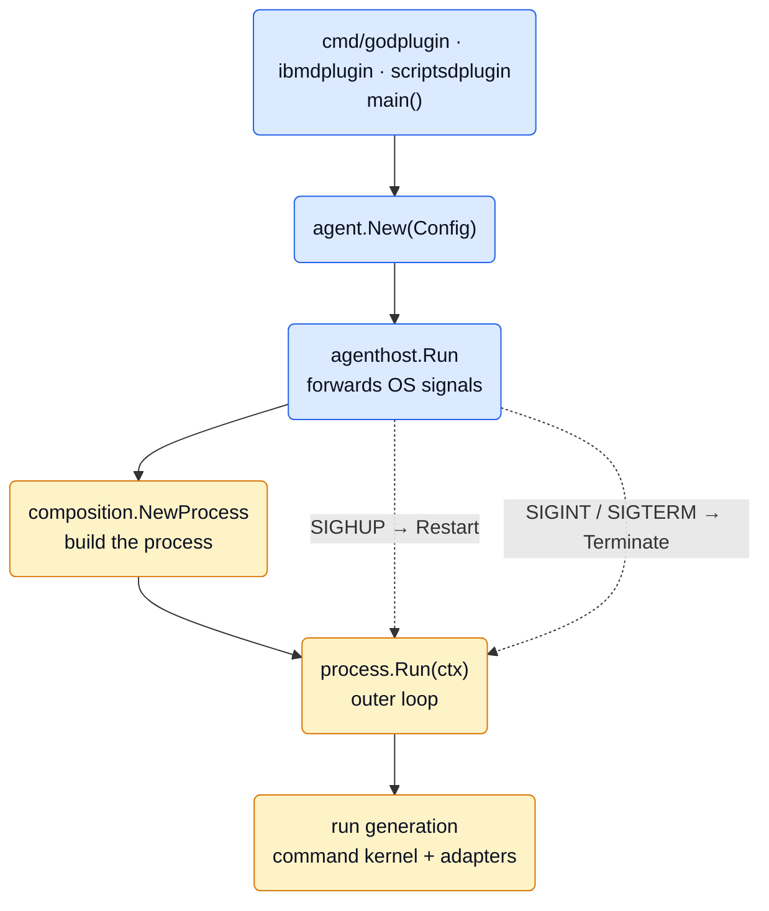
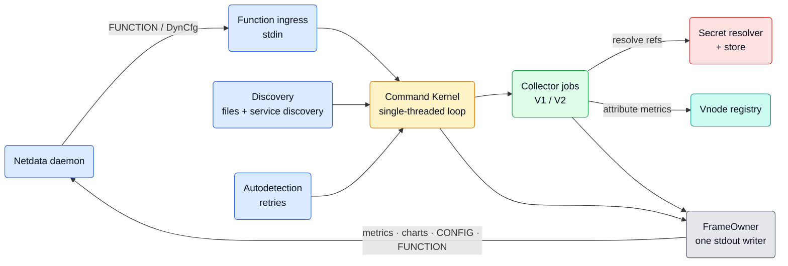
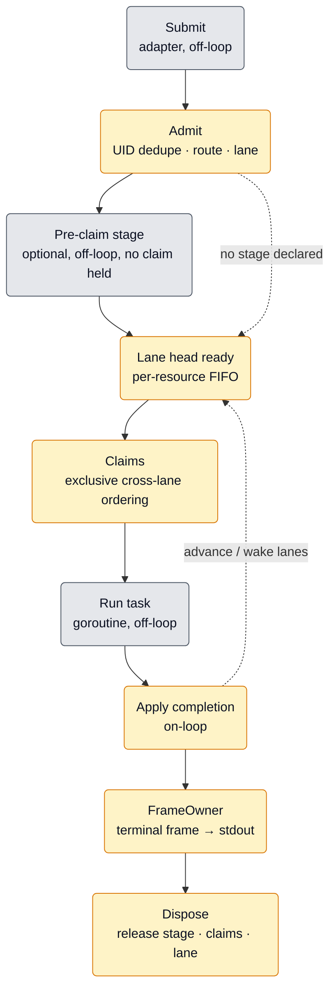
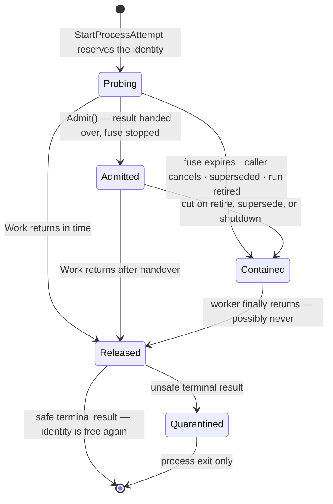
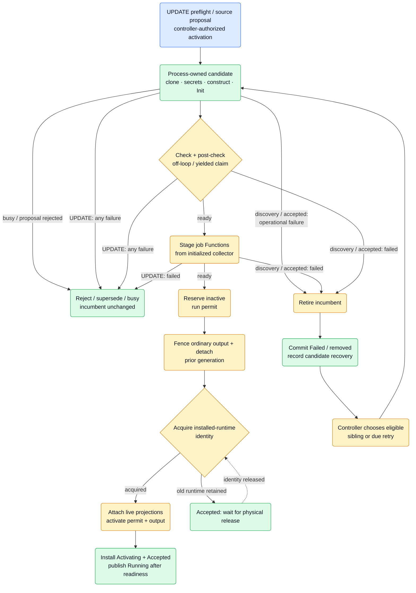
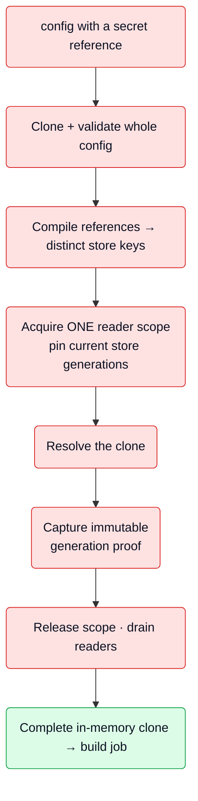
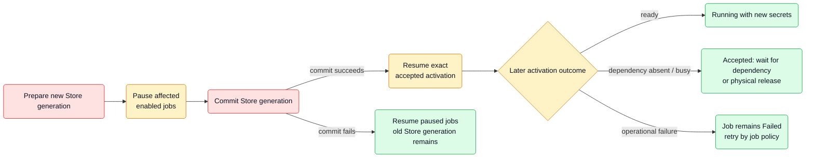
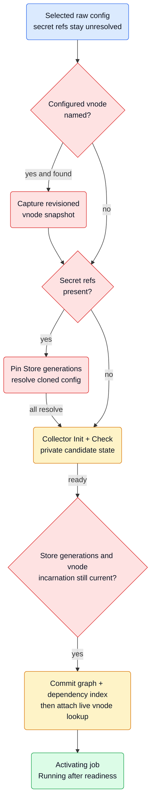
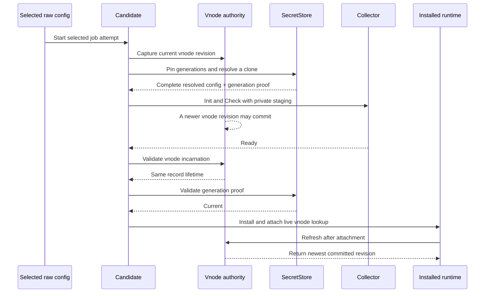
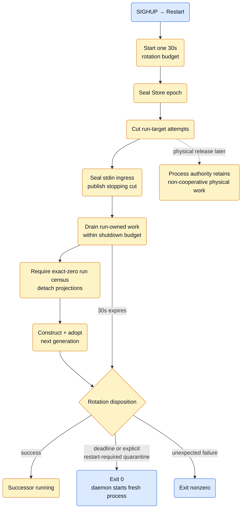

# Job Manager Architecture

This is a maintainer-oriented guide to the Job Manager (`jobmgr`), written to be read top to bottom. It builds up in
four passes: where Job Manager sits, the machine that orders all work, the things that machine orchestrates, and how
the process restarts and shuts down. The reference tables at the end are for coming back later.

It intentionally leaves collector internals opaque. How a specific collector walks SNMP, scrapes Prometheus, or
renders charts lives in that collector and the framework packages it uses; Job Manager only orchestrates their
lifecycle.

**Path convention.** Code references are relative to `src/go/plugin/agent/jobmgr/`, except those starting with
`plugin/`, `cmd/`, or `pkg/`, which are relative to `src/go/`.

## Contents

**Orientation** — [Short Version](#short-version) | [Where Job Manager Sits](#where-job-manager-sits) |
[The Big Picture](#the-big-picture)

**The machine** — [The Concurrency Model](#the-concurrency-model) | [Process Containment](#process-containment)

**What it orchestrates** — [Jobs](#jobs) | [Secrets](#secrets) | [Vnodes](#vnodes-virtual-nodes) |
[Jobs With Dependencies](#jobs-with-dependencies) | [Service Discovery](#service-discovery) | [Functions](#functions)

**Process lifetime** — [Restart and Shutdown](#restart-and-shutdown) | [Runtime Metrics](#runtime-metrics)

**Reference** — [Package Map](#package-map) | [Where To Change Things](#where-to-change-things) |
[Validation](#validation)

## Short Version

Job Manager is the orchestration boundary for a Go data-collection plugin process (`go.d`, `ibm.d`, `scripts.d`). It
takes everything that wants to start, stop, reconfigure, or query a collector job and turns it into an ordered, safe
stream of lifecycle commands run by **one single-threaded command kernel**.

Three things can drive it:

- **Function calls** arriving on the plugin's stdin from the Netdata daemon — including dynamic configuration (DynCfg)
  commands to add / edit / enable / disable / test / remove jobs.
- **Discovery** — file configs and service discovery proposing jobs to run.
- **Autodetection retries** — jobs that failed to detect their target, retried later.

Everything a plugin writes back — metrics, charts, Function registrations, config state, keepalives — leaves through
**one serialized stdout writer**.

The whole process runs **one active "run generation"** at a time. A reload (SIGHUP) rotates that generation without
rebuilding the process when the rotation completes cleanly. If rotation cannot complete safely within its deadline,
the plugin exits successfully so the daemon starts a fresh process.

## Where Job Manager Sits

Every plugin binary follows the same startup path.



- `cmd/*plugin/main.go` builds a `RunModePolicy`, registers discovery providers, and calls `agent.New`.
- `cmd/internal/agenthost/host.go` hosts one process-lifetime Agent and maps OS signals to acknowledged controls:
  **SIGHUP → `Restart`** (30s), **SIGINT/SIGTERM → `Terminate`** (10s).
- `plugin/agent/agent.go` loads config and modules, then calls `composition.NewProcess` and `process.Run(ctx)`.

**Run modes** (`plugin/agent/policy/runmode.go`) flip a few gates:

- **Long-lived agent** (production, not a terminal): service discovery on, runtime charts on, discovered jobs wait for
  the daemon's enable command.
- **Terminal / debug** (attached to a TTY): service discovery off, runtime charts off, discovered jobs auto-enable so
  a developer sees output immediately.

## The Big Picture

Once running, Job Manager is a funnel: several sources of intent on the left, one ordered kernel in the middle, one
stdout stream on the right.



A useful mental split for the rest of this document:

- The **kernel** orders commands and owns their resource/claim lifetime. The collector controller chooses which
  configuration an enabled job may attempt.
- **Adapters** (`functions`, `joboutput`, `secrets`, `discovery`) know *how* to do the collector-specific work, behind
  narrow ports.
- **`lifecycle`** provides the neutral machinery the kernel delegates to (UID ownership, tasks, permits, framing, run
  control, and the shutdown budget).
- **`containment`** owns collector-derived work that may outlive a run because it does not cooperate with
  cancellation.
- **`composition`** wires them all together.

## The Concurrency Model

The ordering boundary is **one goroutine — the `CommandKernel` run loop — which owns mutable command-ordering
state** and is the only thing allowed to change it.
Adapters prepare domain transitions off-loop and apply them through the owning resource lane. Blocking work runs
separately and reports its exact outcome back through a command.

Think of an **air-traffic control tower with a single controller**:

- Aircraft (commands) queue on **runways** (lanes); one moves per runway at a time, in arrival order (FIFO).
- Before taxiing, a flight reserves **airspace corridors** (claims), always requested in the same order so two flights
  never deadlock waiting on each other.
- The controller never leaves the tower. **Pilots** (off-loop task goroutines) fly the actual missions and radio back
  completions. The controller only reads radios and updates the board.

### The command lifecycle



1. **Submit** (off-loop) — an adapter validates a `Request`, attaches a prepared Job Manager plan or submits an
   unresolved Function request, pushes it onto a submission queue, and wakes the loop. `command_ports.go`,
   `kernel_ingress.go`. If shutdown completes before the caller observes admission, an already-published admission
   result takes precedence over a stopping rejection. An accepted prepared-command waiter then observes its terminal
   result; shutdown cannot relabel that accepted work as an admission failure.
2. **Admit** (on-loop) — the loop dedupes the command's UID, resolves the route, derives the lane key, and installs
   the operation on its lane. Duplicate UIDs and invalid routes are rejected here. `kernel_admission.go`,
   `lifecycle/uid.go`.
3. **Pre-claim stage** (off-loop, optional) — see [below](#pre-claim-staging). The operation sits queued on its lane
   and holds **no claim** while process-owned preparation runs.
4. **Lane** — same-resource commands share one FIFO lane; only the lane head runs while the lane is active. Different
   lanes advance independently.
5. **Claims** — cross-lane exclusion; see [below](#lanes-versus-claims).
6. **Run task** (off-loop) — cooperative run-owned work executes through `TaskSupervisor`; collector-derived work that
   may ignore cancellation executes through the process containment authority. Neither executes on the kernel loop.
   `lifecycle/task.go`, `containment/authority.go`.
7. **Apply completion** (on-loop) — the task radios its result back; the loop seals it and advances the lifecycle.
8. **Frame** — the terminal response is committed to stdout through `FrameOwner`.
9. **Dispose** — the stage, the claims, and the lane slot are released, waking any blocked lanes.

### Lanes versus claims

The two are easy to confuse, and they solve different problems.

| | Lanes | Claims |
| --- | --- | --- |
| Guarantee | Per-resource **ordering** (FIFO) | Cross-resource **mutual exclusion** |
| Granularity | One lane per resource identity | One key per shared authority, e.g. `dyncfg:jobs` |
| Effect | Same-resource commands never interleave | Two independent lanes still serialize if they declare the same key |

Claim rules:

- Every claim is exclusive; there are no shared/read modes.
- Claims are acquired in a **stable global key order**, so the design is deadlock-free.
- Waiters are **FIFO per key**, so the design is starvation-free.
- `claim_authority.go`.

Two consequences worth remembering:

- A resource-less Function call gets a **unique lane per invocation**, so concurrent calls to the same Function run in
  parallel — unless the resolved plan declares claims. `command_ports.go`.
- Declaring a claim is how an adapter opts into serialization it cannot express with a lane.

### Pre-claim staging

Some preparation is slow, and some of it is collector-authored code that may ignore cancellation. Running it while
holding `dyncfg:jobs` would stall unrelated jobs. A plan may therefore declare a `PreClaimStage` (`kernel_plan.go`,
`kernel_stage.go`):

- **When it starts** — at admission, immediately after the operation is queued on its lane.
- **What it holds** — nothing. No claim has been acquired yet.
- **How the kernel waits** — the lane head is not marked ready while the stage is pending; `Ready()` closing wakes it.
- **Who owns the work** — the process containment authority, not the run, so a non-cooperative worker cannot pin the
  kernel or the run generation.
- **Cleanup** — disposal calls `Release()`; cancellation and deadlines call `Cancel(cause)` first.
  `kernel_disposal.go`.

### Yielding a claim during preparation

Staging solves the problem before claims are taken. The mirror-image mechanism handles preparation that must happen
*inside* a transaction that already holds claims (`claim_yield.go`, `claim_yield_kernel.go`):

- **What is yielded** — only the transaction's *acquisition-suffix* claim, and only while bounded preparation runs. It
  must be reacquired before preparation completes.
- **Why it is still safe** — the transaction's resource lane stays active, so another command for the same resource
  cannot overlap the yielded work.
- **Priority** — reacquisition outranks ordinary waiters on that key.
- **Composite parents** — a composite declares the resource lanes its children may use. If one conflicts with an
  active yielder, the parent is parked *before* it acquires any claim; an already-waiting parent releases its prefix
  claims but retains its original ticket. Unrelated work stays serviceable on the otherwise-free claim, which prevents
  both child/lane cycles and head-of-line blocking.
- **Children of a running composite** — when such a child yields, only the matching admission-fence claim is
  suspended; the parent's other claims remain held.

Which mechanism each command surface uses:

| Command surface | Mechanism | Declared in |
| --- | --- | --- |
| SecretStore DynCfg `add` / `update` / `test` / `remove` | Pre-claim stage | `composition/secret_adapter.go` |
| Accepted SecretStore acquisition | Outside the resource lane; short completion transaction | `secrets/pending.go` |
| Collector UPDATE and RESTART preflight | Claim yield on `dyncfg:jobs`; RESTART observation uses an independent invocation lane | `composition/dyncfg.go`, `joboutput/dyncfg_restart.go` |
| Collector ADD, disabled UPDATE, ENABLE, DISABLE and REMOVE | Short transaction; ENABLE arms accepted activation | `joboutput/dyncfg_prepare.go` |
| Collector source inventory and candidate outcomes | Short controller transactions; probes run outside the resource lane and graph claim | `composition/discovery.go`, `joboutput/candidate_execution.go` |
| Autodetection deadline | Short transaction asks the controller to choose eligible work | `joboutput/candidate_execution.go` |
| Dependent pause/resume children of a Store change | Short acknowledged transactions | `joboutput/secret_restart.go` |

### Who owns what

- **On-loop (exclusive to the `CommandKernel` run loop)** — every lane, operation, deadline, claim transition, and
  counter. The loop is the sole mutator. `architecture_test.go` pins that on-loop actions are dispatched through the
  sanctioned kernel ownership funnel.
- **Run-owned off-loop** — cooperative tasks and permits belong to one run generation and must drain before that run
  can quiesce.
- **Process-owned off-loop** — contained attempts own their physical worker, per-identity exclusion, and final cleanup
  across run rotation.

Shutdown barrier, run finalizer, and Function cleanup work share the kernel-local `oneShotTask` handshake
(`kernel_one_shot.go`). It validates request-to-task starts, the sequence-1 no-value completion, and the expected
sequence-2 terminate/abandon acknowledgment. A terminal action is recorded only after the supervisor accepts it;
replayed completion dirties the run without replacing that accepted action. Invalid acknowledgments and failed
release retain ownership. Task references clear only after `TaskSupervisor.Release` succeeds.

Each caller keeps its domain policy: barrier/finalizer errors dirty the run immediately, and their readiness gates
preserve shutdown ordering. Function cleanup stores ordinary work errors until physical release, then acknowledges
the exact catalog cleanup generation and reports errors. Resource stop/finalize and prepare/apply/dispose
transactions retain their separate multi-phase protocols. The shared record is a value in the existing owner or map;
it adds no scheduler, worker, per-task heap object, or population scan.

### Fairness and timeout rules

- **`TaskSupervisor` runs two independent classes** — framework-control work (lifecycle/DynCfg commands) and generic
  Function work — in strict round-robin. One class can never starve the other, and there is **no fixed "N active
  Functions" cap**. `lifecycle/task.go`.
- **An ordinary timed-out run task keeps run ownership.** The kernel only cooperatively cancels it; its claims, lane,
  and resource authority stay held until it returns, and repeated overruns can escalate to fail-stop.
- **Queued cooperative deadline work retains its required start.** While the run is active, a Function with
  `CooperativeDeadline` whose deadline the kernel has processed keeps its lane position and starts with
  `context.DeadlineExceeded` when its lane and claims become available. A later cancellation preserves that required
  start. Cancellation processed before timeout removes queued work without starting it and answers `499`.
  `kernel_disposal.go`, `kernel_dispatch.go`.
- **A contained attempt keeps process ownership instead.** Its caller, claims, and run may settle after the
  containment cut because late output and mutation cannot escape the process-owned attempt boundary. The physical
  worker may still finish state private to that attempt; the boundary prevents publication, re-entry, or reuse until
  physical release.
- **A resource transaction that applied answers with its own result.** Cancellation or a deadline before Apply disposes
  the prepared transaction with state unchanged and answers `499`/`504`. Once Apply starts it is not interrupted, and a
  cancellation or deadline that arrives meanwhile does not replace the applied result: answering `499`/`504` for an
  applied change would make the Netdata daemon drop a change the plugin already made. The daemon keeps waiting for the
  reply after a cancellation, but stops one second after the deadline, so an Apply that ends later loses its reply.
  Apply stays short: runtime promotion reports contention immediately, while accepted activation owns the later
  physical-release wait. Collector readiness is settled by a separate exact-generation transaction. `kernel.go`
  (`completeResourceTransactionTask`).

## Process Containment

Go cannot forcibly stop a goroutine. A collector's `Check` can block forever on a socket; a provider's `Init` can
ignore its context. Job Manager therefore separates **logical settlement** (the caller stops waiting) from **physical
release** (the goroutine actually returns).

`process_attempt.go` declares the contract; `containment/authority.go` implements it.

`Cut` and `CutProcessAttempt` publish logical settlement before returning. A caller awaiting that settlement can resume
before the worker records the cut result. Tests that assert such worker observations must wait for an explicit signal
from the worker.

- `StartProcessAttempt` checks caller cancellation while holding the identity-registry mutex. A successful claim
  linearizes at that snapshot: later cancellation follows the caller's normal post-start lifecycle. The caller context
  gates admission only; the worker receives an independent process-owned context.
- `SupersedeProcessAttempt` targets the owner observed during its locked registry snapshot. Its success confirms that
  owner released; it does not reserve the identity against a later successor, so the subsequent start remains
  authoritative.

### The attempt state machine



- **Probing** — the attempt is producing a result and is bounded by the fuse.
- **Admitted** — the attempt has handed its result to the caller and now *holds* something (a running collector loop,
  a prepared Store mutation, a built Function bundle) until the caller decides.
- **Contained** — logically settled and cancelled; late effects cannot escape the attempt boundary. The worker may
  still finish private state and remains physically running.
- **Released** — `Work` and its cleanup returned. Only now is the identity admissible again.
- **Quarantined** — the physical work returned, but its terminal outcome made the identity unsafe to reuse. The
  quarantine is process-lifetime state, not an active attempt, and only process exit clears it.

`Census` reports these counts exactly (`Active`, `Probing`, `Admitted`, `Contained`, `Quarantined`). Containment is
loud and success is quiet: entering `Contained`, releasing a contained worker, quarantining an identity, and a worker
panic each emit a diagnostic event, while an attempt that admits or returns in time emits none. In long-lived mode,
`jobmgr.runtime` also projects the current census as aggregate process-attempt gauges.

Containment fences receive the raw cut cause and execute synchronously before settlement becomes visible. They stay under
the authority lock to preserve that ordering, so they perform only bounded in-memory state changes: they never re-enter
the authority or wait for a worker, I/O, or external cleanup. A panic is redacted as `ErrProcessAttemptFencePanic`, joined
with the original cut cause, and cannot strand the authority mutex.

Terminal outcomes quarantine an identity when an admitted worker fails, ownership remains retained, the worker
panics, or the containment fence panics. Ordinary pre-admission validation failures release the identity normally.

### What the fuse actually bounds

This is the subtlety that catches everyone:

- `DefaultFuse` (**2 minutes**) bounds **producing** a result, not **holding** one.
- `Admit()` atomically stops that fuse while keeping the identity occupied, so long-lived contained work is
  deliberately unbounded. An installed collector runtime that runs for weeks is a normal *admitted* attempt.
- `DefaultSupersessionGrace` (**2 seconds**) is how long a replacement waits for the previous owner of the same
  identity to release before it reports busy.

Who admits, and who does not:

| Attempt | Admits when | Effect |
| --- | --- | --- |
| Job candidate | Construction, `Init`, and `Check` succeeded | Holds the staged candidate until install or reject |
| Installed job runtime | Immediately | The managed collector loop is the held resource |
| Module Function bundle | Bundle built and containment-bound | Holds the plan until the transfer decision |
| SecretStore operation | Validation or mutation prepared | Holds the mutation until commit or abort |
| Service-discovery Function | Opaque callback returned, before result publication | Keeps the callback fuse-bounded; terminal failures quarantine the binding |
| Function availability poll | Never | Stays fuse-bounded |
| Function invocation | Never | Stays fuse-bounded |

`joboutput/candidate_stage.go`, `functions/module_stage.go`, `secrets/store_stage.go`, `functions/bundle.go`,
`composition/service_discovery.go`.

### What the caller sees

- Caller cancellation is propagated first; crossing the fuse or the supersession grace settles the caller and fences
  late results.
- The authority retains the worker and everything it owns until its complete cleanup returns, or until the plugin
  process exits.
- **Persistent** file/discovery state keeps only its latest desired replacement and retries after identity release.
- SecretStore ADD with no live generation acknowledges raw accepted intent before acquisition. Only accepted
  acquisition waits for physical or generation release. UPDATE and ADD over a live generation reject busy preflight;
  rejected candidates are never retained for later application.
- Interactive UPDATE rejects failed preflight while preserving the incumbent. Once accepted, UPDATE and ENABLE
  return `202` without waiting for runtime readiness or predecessor physical cleanup. The accepted activation owner
  retains enabled intent through dependency and identity-release waits. RESTART observes its exact accepted activation
  from a separate invocation lane; its informative response cannot hold the resource lane.
- Cancellation prevents queued service-discovery mutations from starting; it does not roll back work that already
  began while its request context was live.

### No process-wide slot limit

There is intentionally no cap on concurrent attempts: one permanently stuck identity must not block an unrelated job.
The trade-off is explicit — distinct permanently stuck identities can accumulate retained workers, and diagnostics
report that state (including a bounded sample of retained identities at shutdown).

### Namespaces

An identity is a namespace plus a key; at most one physical attempt exists per identity, and unrelated identities
remain independently admissible.

| Namespace | Owns | Key shape |
| --- | --- | --- |
| `job` | Candidate preparation: clone, secret resolution, construction, `Init`, `Check` | digest of canonical job `FullName` |
| `job-runtime` | The installed collector's managed loop, `Stop`, and cleanup | same job-name digest in its own namespace |
| `job-test` | One DynCfg `test` of a raw job config | digest of operation + name + config hash |
| `store` | SecretStore validation and generation preparation | digest of epoch + `kind:name` |
| `store-test` | One DynCfg `test` of a SecretStore config | digest of epoch + `kind:name` + config hash |
| `function-bundle` | An agent-level module's Function handler bundle plan | digest of agent scope + module |
| `function-poll` | One Function availability poll | bundle key |
| `function-invocation` | One Function invocation | bundle key + invocation id |
| `service-discovery` | One service-discovery Function binding invocation | digest of epoch + plugin |

Test identities are derived from the raw config and exist only in memory, so an identical repeated `test` returns busy
instead of multiplying workers.

Attempt keys are built so a long or hostile name cannot exceed containment's internal identity bounds:

- Every variable component passes through domain-separated, length-framed fields and a fixed-size digest. Function
  invocations append only a bounded counter to that digest.
- Public job, Store, module, and service-discovery names are therefore preserved without bound risk.
- Diagnostics keep safe short names, and fall back to bounded generic labels for oversized, invalid-UTF-8, or
  control-bearing values.
- Graph IDs, lane keys, config IDs, and wire-visible names are **unchanged** by this hashing.

## Jobs

A **job identity** is a module plus a job name. Its controller admits one configuration at a time, and at most one
installed runtime may collect for it. Stock/user files, discovery and DynCfg commands supply configurations; the
controller owns activation and recovery.

### The config validation boundary

External configuration is untrusted batch input. Production producers validate successfully decoded entries against
the exact downstream contracts **before** process construction or WorkPlan submission:

- the vnode file loader and DynCfg vnode adapter validate CONFIG identity and source fields, host-emission metadata,
  daemon-compatible UUID syntax, and semantic hostname/GUID uniqueness;
- the secret-store file loader validates each fully stamped config, including kind type and provider support, before
  passing accepted entries to a run generation;
- discovered collector proposals validate their final CONFIG job name and source metadata before graph mutation.

Failure granularity is deliberate:

| Input problem | Consequence |
| --- | --- |
| Invalid decoded file entry | Reported and skipped |
| YAML structural/type error | May reject its containing file, without stopping Job Manager |
| Invalid source proposal | Quarantine its exact membership; consider alternatives under incumbent/source-priority rules |

Strict constructor/controller checks remain as defensive invariant enforcement: programmatic state that bypasses a
production producer is still rejected rather than silently normalized or recovered after admission.

### Configuration source ownership

Go plugin configurations use one source order: **DynCfg > user > discovered > stock > internal/unknown**.

The order is shared, but there is no single generic "configuration manager." Each domain applies the order at the
boundary that owns its lifecycle:

| Configuration domain | Identity | Where the winner is enforced |
| --- | --- | --- |
| Collector job | canonical `FullName` (module + job name) | the per-job candidate controller, applied with the collector graph transaction |
| SecretStore | exposed `kind:name` | initial/pending selection and the Store generation transaction |
| Service discovery | exposed config key | before materialization and pipeline start |
| Configured vnode | vnode name | startup files seed the live registry; a DynCfg upsert replaces that name |

This distinction matters. Collector-job retries and fallback rules do not implicitly apply to SecretStores,
service-discovery pipelines, or vnodes. Configured vnodes do not keep a stack of competing candidates: file config
seeds the registry, a DynCfg upsert replaces that name, and removing the DynCfg vnode does not reveal the old file
value.

A plugin-side DynCfg `add` is replay/upsert-capable because the daemon uses it to restore persisted configurations.
Ordinary user duplicate adds remain create-only at the daemon boundary. Removal targets only the current DynCfg
override and does not immediately reactivate a masked lower-priority source.

### Collector source-priority event flow

One public collector/job name can have several distinct configurations. `discovery/inventory.go` reports one immutable
observation batch per affected `FullName` for each Apply call. The batch retains ordered versions, candidate/source
membership lifetimes, source-slot presence, and passive or automatic source policy. It does not select a runtime.
Identical observations do not create new intent. Malformed replacements preserve per-identity retention; source
presence distinguishes rejection from genuine removal.

`composition/discovery.go` translates a complete batch into one short job-lane transaction. The controller folds its
observations privately and reconciles source authority once against the final inventory. Intermediate inventories
cannot release Init/Check, even when a lower-priority source sorts before a higher-priority source in that same batch.
True disappearance/re-addition still cuts the old lifetime, including equal-UID re-addition; candidate introduction
and disappearance order still determines whether an admitted sibling supersedes a historical grant. These are
ordered source facts, not permission to execute each intermediate state.

Delivery acknowledges the whole batch, not a passed Check or started collector. Failed delivery replays that immutable
batch before later batches for the same name. A compact receipt covers the ordered history as well as the final
inventory, so conflicting replay cannot change admission provenance. Different names deliver independently; a blocked
probe cannot hold up their inventory delivery. Adapters do not import one another.

`joboutput/candidate_controller.go` owns one continuation record per job:

| Controller fact | Purpose |
| --- | --- |
| Applied inventory and consumed source cursor | Current source authority and sticky source decisions, including masked choices |
| Committed binding | One admitted raw config, source provenance, health and listedness exposed through DynCfg |
| Enablement and intent generation | Distinguish passive, enabled and disabled lifetimes independently of health |
| Candidate ledger and finite pass | Admission grants, initial attempts, failure classification and per-candidate retry deadlines |
| Outstanding proposal/work and deadline token | Revoke stale execution without depending on config UID equality |

The highest owning source tier masks lower tiers even after operational failure. Alternatives span source slots at
that tier. An eligible current selection is preferred; remaining candidates use config UID order with source identity
as a tie-breaker. A finite pass tries each member at most once. Initial sibling attempts do not wait for a failed
candidate's retry cadence, including when its cadence is zero or its error forbids retrying that same config.

Every retained Active or Proposal MUST pass the same capability and membership-authority check used by execution.
One membership occupies at most one role. A distinct predecessor Active and successor Proposal may coexist, with the
Proposal owning physical execution. Rejection or authority withdrawal reconciles both slots before occupancy can
suppress progress or coalesce ENABLE. Binding/source admission grants remain separate from executable work validity.
Resume delivery follows the same Proposal-before-Active execution priority. Framework blocks belong to Active;
resuming a tentative Proposal cannot consume that predecessor state or admit the Proposal before validation.

Passive daemon discovery admits one logical job as `accepted` without Init/Check; ENABLE starts the search.
Automatic source mode first checks a tentative proposal while preserving an incumbent. Invalid proposals quarantine
their exact membership. A genuine source proposal retains its persistent-source acceptance boundary, including
source-specific Failed/removal. Ordinary alternative probes keep failures, waits and retry grants private: they do
not replace the public binding or its resource demand. The current binding owns an admission independently of
historical retry grants. New source revisions can supersede obsolete retry-only candidates, but cannot revoke the
unchanged binding or its retry deadline. Replacing the binding releases that protection; source-lifetime removal and
trust withdrawal independently revoke both public and historical authority during inventory folding. A successful
checked alternative uses the existing handoff; runtime readiness closes automatic alternative search.

Failed, blocked and waiting candidate outcomes apply the controller's public binding decision through
`prepareCandidateDecision`, including dependency and physical-release waits. A private wait commits its recovery
state and registers its wake-up without requiring a listed binding or changing the incumbent's lifecycle diagnostics.
Dependency arrival resumes that exact candidate; source withdrawal revokes it before a later notification can restart it.

Common event sequences:

| Event | Outcome |
| --- | --- |
| Higher source is Accepted, Running, Failed, or Disabled | Lower sources remain observed but cannot probe or take ownership. |
| Admitted source proposes only rejected replacements | Its admitted incumbent and authorized recovery survive while that source slot remains; real removal or an accepted replacement revokes them. |
| Owning discovered pipeline withdraws trust | Its trusted execution and recovery authority are revoked during inventory folding, independently of metadata admission. Invalid metadata cannot acquire an exposed binding. |
| An admitted sibling fails and another sibling is adopted | Other still-authorized admission grants retain their immutable config and deadlines; sibling adoption alone is not source replacement. |
| Enabled search has no active attempt and a new eligible sibling arrives | The controller can open a finite pass without resetting prior deadlines or repeating every failed member. Passive, disabled, blocked and readiness-closed searches do not start siblings. |
| A delayed worker or deadline completes | The lane rechecks its exact run, intent and work/schedule capability; stale work cannot adopt, publish or re-enable. |
| DynCfg TEST or a rejected edit probes another config | That config never acquires the admitted binding or source authority. |
| DynCfg override is removed | Its intent/runtime are revoked. The consumed lower-source cursor remains, so unchanged masked sources and irrelevant sibling events do not automatically restore it. |

The last row preserves the existing override-removal boundary tracked by issue #23302. A meaningful later source
change may reconcile, but this continuation model does not add automatic restoration. A masked cursor retains only
observation identity, priority and source lifetime. Source selection carries those history facts separately from its
optional executable ledger member. A protected cursor can outlive that member: it preserves consumed source authority
but cannot construct a collector or create an admission grant. Existing authorized recovery continues independently.
Removal of the actual admitted source is checked independently of that cursor.

Admission of a newly introduced source membership supersedes retained grants that disappeared at or before that
revision of the same source lifetime. Admitting a preexisting surviving sibling preserves those grants. Membership
introduction and disappearance are source facts; later retries and enablement transitions do not rewrite that provenance.

Source policy lives in `joboutput/candidate_controller.go`; `joboutput/candidate_execution.go` applies decisions and
releases execution effects after commit. `joboutput/accepted_activation.go` retains contained execution, dependency
waits and physical-release waits. It does not own another desired-config queue.

Source reconciliation separates arbitration from recovery. Arbitration consumes source history and selects or
proposes ownership; every exit then reconciles the surviving continuation's execution and deadline. A protected
interactive DynCfg binding or masked source choice cannot bypass this recovery step. Grant withdrawal changes only
the affected candidate's authority and retry facts; it does not reset the job's finite pass or another owner's wake.
Revoked pass members are skipped while surviving members keep their position ahead of later arrivals.

### Exposed collector binding

The single DynCfg collector/name describes one logical job and its admitted configuration. Raw GET, CONFIG source
metadata, health and stored-config command targets MUST refer to that same binding. Trying another endpoint does
not admit it: unsuccessful alternatives retain private recovery grants and deadlines without replacing the public
configuration, source cursor or resource-intent owner. If all endpoints fail, the logical binding remains stable.
Failure of that binding updates its health, subject to the existing failed-stock visibility policy.

A successfully checked alternative or genuine accepted source replacement can update the binding. CONFIG CREATE is
needed when the public source metadata changes, an unlisted job becomes visible, or a genuine passive source
replacement needs normal daemon policy. Enabled handoffs with unchanged source metadata need only STATUS because
GET reads the committed raw payload. Failed stock removal can leave enabled controller recovery
alive while the public job is unlisted. A later successfully admitted alternative recreates its binding and metadata.

GET reads the exposed graph binding and preserves unresolved raw references without Init/Check.
Inner RESTART selects and pins the exposed stored config in its resource lane; its outer response observer uses an
independent invocation lane. SCHEMA comes from the module registry. USERCONFIG and TEST use caller payloads. Tentative
proposals, rejected edits and late old outcomes cannot acquire exposure.

`joboutput/{dyncfg_jobs,dyncfg_prepare,dyncfg_restart,candidate_execution}.go` and `composition/dyncfg.go` own these
command and projection boundaries.

### Candidate lifecycle

Two different guarantees apply during replacement:

- **While the candidate is preparing and probing, the incumbent keeps running.**
- **For persistent sources, the selected desired state wins once a valid candidate settles.** Success installs it; a
  transient construction failure or probe failure retires the incumbent and commits the source-specific `Failed` or
  removed outcome.
- **Interactive UPDATE rejects every failed preflight.** Retry policy cannot authorize adoption of a failed edit;
  see [DynCfg reply contract](#dyncfg-reply-contract).

A proposal rejected before it establishes desired state leaves the incumbent unchanged. Preflight identity contention
rejects interactive UPDATE; contention after its accepted retirement becomes an activation wait. Unaccepted discovery
replacements remain tentative controller proposals with an exact predecessor. ENABLE and accepted replacements release
controller-authorized work through the executor below.



1. **Stage config** — validation, DynCfg `test`, and configuration rendering run as contained operations. A same-job
   validation supersedes the prior candidate; an identical DynCfg test has its own raw-config-derived, memory-only
   identity and returns busy rather than multiplying workers. `joboutput/config_stage.go`.
2. **Prepare candidate (non-disruptive)** — the process authority reserves the canonical `job` identity before cloning
   and secret resolution, then owns collector construction, configuration application, `Init`, `Check`, post-check
   validation, Function staging, and rejection cleanup. Function staging runs only after `Init` and `Check` succeed,
   because instance handlers may be initialized by those callbacks. The candidate has inactive output and private V2
   runtime/vnode staging, but no run permit and no live run service. **The incumbent keeps running.**
   `joboutput/candidate_stage.go`, `joboutput/runtime_staging.go`.
3. **Settle autodetection** — caller cancellation is propagated and the transaction temporarily yields the global
   `dyncfg:jobs` claim.
   - The process-owned fuse bounds logical waiting even if the collector never returns, and late success cannot be
     admitted after a cut.
   - A normal detection failure commits `StatusFailed` or stock removal for background activation. Interactive UPDATE
     rejects it. Missing named dependencies and physical contention after acceptance retain enabled intent; unaccepted
     discovery replacement retains its token-scoped tentative proposal.
   - **One bad collector cannot dirty Job Manager.** A normal `Init`, `Check`, validation, or Function-staging failure
     is isolated to that candidate once rejection cleanup completes. Only a *failed or unprovable* cleanup retains
     process ownership and fails the run closed.
   - A collector creator may expose one diagnostic configuration-lifecycle hook. For an accepted/running/failed graph postimage,
     Job Manager projects a credential-free baseline directly from the accepted configuration, so failures before
     runtime construction still have a row. When construction succeeds, Job Manager binds an opaque exact-config
     identity before `Init` and captures one detached value after probing and before rejection cleanup. Reconciliation
     occurs only after the matching graph commit, or after a successful transaction confirms that the fallback graph
     already matches. A runtime is passed only when readiness commits Running; failed candidates leave no runtime reference behind. Replacement/removal reconciles
     the prior incarnation from the graph preimage. Hook panic is fail-open and cannot change candidate, graph, or
     cleanup behavior. This is a latest-state projection, not an event bus or retry history.
4. **Accept and retire** — after every admission step that yields graph claims (including structural
   configuration validation), revalidate the candidate's process ownership, Store snapshot and vnode lifetime before preparing
   graph adoption. A stale candidate is released and follows the same source-specific failure
   policy as preflight: interactive rejection preserves the incumbent; discovery retains its dependency wait or
   pending rebuild policy. A successful preflight candidate remains process-owned while a short transaction commits
   Accepted and transfers it to accepted activation. Replacement fences the incumbent's ordinary output and detaches
   its run projections immediately; its physical managed loop, `Stop`, Function drain, and collector cleanup remain
   process-owned until they return. An aborted acceptance releases its candidate without replacing the incumbent.
5. **Promote, attach, and start** — accepted activation waits for the predecessor's physical release, then binds its
   retained candidate to a fresh resource generation and permit. Ordinary replacement does not repeat `Init`/`Check`.
   Candidate probing may overlap the incumbent, but two installed runtimes for one job cannot.
   - Promotion publishes its owner transition before entering the attempt authority, then releases the owner lock for
     runtime-identity start and admission. This removes the reverse edge against the authority's synchronous
     containment callback. Successful admission transfers process ownership even when containment wins before promotion
     settlement; pre-admission failure remains candidate-owned.
   - Attachment reports whether ownership transferred. The process owner adopts every transferred wrapper and partial or
     completed Function lifecycle even when retirement already won, so rejection finalizes them exactly once. A
     no-transfer failure is never inferred from cleanup fields and never triggers adoption.
   - Runtime/vnode projections attach outside the staged-owner lock because they call external registries. The owner then
     linearizes retirement against output-gate activation, permit activation, and accepted-cleanup freezing in that order.
   - Retirement before an otherwise-valid attachment bind returns the exact process-attempt cause even when that
     retirement already finalized the candidate. Independent duplicate, decided, or invalid transitions remain
     fail-closed.
   - Runtime-attempt containment synchronously records the first retirement cause and revokes new output admission before
     the authority cut returns. The worker later drains output leases and performs detach/cleanup outside the authority
     lock. A later stopped/retired cut never overwrites an earlier structural failure.
   - Start eligibility and retirement arbitrate under the process owner. The worker rechecks that decision after receiving
     the start request, so sending it cannot launch `StartManaged` after containment has won.
   - Once output and permit acceptance wins and start remains eligible, the managed loop starts.
   - The resource transaction owns this successor until installation acknowledgement. An apply failure aborts it when
     possible, or returns the still-live retained generation to the kernel for fail-closed ownership.
   - A retained candidate is checked again for process cancellation and Store generation validity before binding.
     A later preflight may invalidate it even if that later edit is rejected; the still-current accepted activation
     rebuilds from its committed configuration. Disable, remove, replacement and shutdown release retained candidates.
   - If runtime acquisition still reports contention, activation keeps the desired configuration and waits for release.
     A fresh prepared handoff always replaces an older activation token, including same-UID installed markers that
     have no worker. Repeated ENABLE coalesces only with an owner that can still perform activation.

   Rotation interacts with this step deliberately. Rotation cuts run-target attempts *before* draining the run, so a
   non-cooperative startup cannot consume the reload budget:

   | When the cut arrives | Result |
   | --- | --- |
   | Before installation reservation | The transaction aborts the pending generation and graph mutation, then returns the exact unchanged/removed disposition |
   | After reservation begins | Retirement cannot invalidate the short internal commit; run shutdown retires the installed generation afterward |

   Only a pure target-retired/process-stopped error tree counts as normal cancellation. Any mixed, cleanup, graph,
   panic, or ownership error stays fail-closed.
6. **Emit** — resource acceptance activates the generation output gate. Two capabilities exist, and both serialize whole
   frames through the process's one `FrameOwner` (`joboutput/output_gate.go`):
   - **Ordinary collection output** is run-owned. Retirement first atomically revokes new write admission, then drains
     write leases outside the attempt-authority lock before detaching projections. A write admitted before the cut may
     finish; a write presented after the revocation cannot interleave with the successor.
   - **Accepted V1/V2 cleanup output** is process-owned, because physical cleanup may outlive a rotation. It emits
     terminal chart-obsoletion frames only after the managed loop and Function handlers physically quiesce.
   - The `job-runtime` identity stays occupied through cleanup, so a same-job successor cannot start before those
     terminal frames complete.

### Collector runtime readiness and terminal outcomes

The optional V2 `Run(ctx, ready) error` hook acquires resources after runtime promotion, which requires predecessor
physical release. `ManagedRun` serializes readiness, startup error, cancellation and timeout; only accepted readiness
starts collection and running availability. Non-Runner V1/V2 jobs signal readiness directly. The process-owned
`stagedJobOwner.finish` worker starts a separate startup timer when it receives the managed-run start request, using
`jobmgr.DefaultProcessAttemptFuse` for its two-minute duration. Runtime admission has already stopped the preparation
fuse; neither timer limits the successfully started runtime lifetime.

`AcceptStart` initiates startup and installs an Activating generation under an `accepted` graph record. Its exact
readiness notification queues a short transaction that rechecks the live outcome, publishes scheduler/Functions only
when ready, and commits `running`. A late readiness notification cannot overwrite a failure, disable, or replacement.
Transactions admitted while another transaction temporarily owns the current resource queue behind that lane; physical
retirement authority remains fenced.

A typed `runtimeStartupFailure` carries an operational startup outcome into that settlement transaction. The graph
becomes `failed`, diagnostic snapshots retain the reason, and the controller applies the candidate's startup recovery
policy or advances its open same-tier pass. Stock configs remain visible after runtime startup failure. Readiness
closes sibling search even if failure is observed before the Running publication. Failure after readiness requires an
explicit command; neither a timer nor a sibling arrival reopens that search. Settlement uses `ManagedRun.AfterReady`,
not graph status, to preserve this boundary.
Mixed ownership, cleanup, graph, or panic errors still fail closed; they are not hidden by an operational error elsewhere
in the error tree. Startup does not delay the earlier UPDATE/ENABLE acceptance reply.

### Activation failure classification

`joboutput/activation_error.go` owns the error classification shared by discovery, synchronous DynCfg activation,
accepted-job activation, and SecretStore-dependent restarts. Candidate preparation returns that classification with
the original error. Config-only validation and runtime activation fallbacks use the same classifier.

The classification distinguishes invalid proposals, transient dependencies, busy physical identities, stale Store
snapshots, superseded attempts, containment deadlines, quarantine, and other operational failures. These are failure
facts, not a universal retry policy: synchronous UPDATE preserves its incumbent on busy/stale preparation, while an
already-applied ENABLE retains activation authority through named dependency and physical-release waits. External
provider failures retain configured timed recovery or manual retry. Runtime fallback handles busy
and quarantine only; a stale Store snapshot is rejected during candidate preparation.

Background callers keep their graph disposition and recovery policy explicit; DynCfg commands derive theirs, and their
reply, from the [DynCfg reply contract](#dyncfg-reply-contract). Caller cancellation and retained ownership take
precedence over ordinary recovery. The classifier preserves the original error tree so those lifetime decisions remain
available; a provider's own canceled operation does not by itself mean its caller was canceled. Managed probe failures
carry the collector's class (`collectorapi.ClassifyLifecycleError`) and retry metadata. Recovery is armed only in
`AfterApply`, after the corresponding graph mutation commits.

### DynCfg reply contract

The daemon updates saved configuration or enabledness for user `add`, `update`, `enable` and `disable` commands
on a completed 2xx reply; successful `remove` deletes the saved configuration. It replays saved configuration when
the plugin restarts. Echo replies update status or record rejection without replacing the saved payload.
`joboutput/dyncfg_reply.go` owns collector-job result construction.

- **Completed mutation outcomes.** A 2xx means the plugin accepted the requested state. A completed rejection preserves
  the incumbent, payload, and recovery. A lost reply or structural failure can leave the outcome indeterminate; plugin
  GET proves its current state, not that the daemon persisted it. This contract does not provide crash durability.
- **Passive admission.** ADD and disabled UPDATE validate identity, container structure, literal field types, source
  authority, and reference syntax without vnode, Store, or provider lookup. They retain the original raw configuration;
  active secret-reference field types are checked when the reference resolves. ADD remains passive until ENABLE.
- **Interactive UPDATE.** Every failed preflight rejects regardless of `autodetection_retry`: invalid configuration is
  `400`, permanent/unclassified collector failure `422`, and temporary or unavailable work `503`. Successful preflight
  permits replacement and returns `202` with `accepted`; predecessor physical cleanup and new runtime readiness do not
  hold the reply. The accepted replacement has no incumbent fallback. An identical running DynCfg payload retains its
  current runtime and returns `200`.
- **ENABLE.** An already-enabled job preserves its intent independently of health and caller provenance, returning
  `202` while health is Accepted and `200` otherwise, including Failed. Repeated policy notifications preserve its
  public configuration, active work, finite pass, retry deadlines and exact/source scope. Passive or disabled
  configurations accept enabled intent (`202`) through a short transaction. That actual transition starts a fresh
  same-tier alternative search for source-owned jobs; DynCfg-owned config remains exact.
  Changed enabled identities with named activation dependencies first require pure raw validation. Construction,
  readiness and health settle afterward. Explicit RESTART targets the stored configuration when an immediate
  recovery attempt is needed.
- **Other mutations.** Disabled UPDATE, DISABLE and REMOVE return `200` when applied. Runtime quarantine discovered
  after an accepted UPDATE is reported through later failed status and diagnostics; the mutation reply remains `202`.
- **Informative commands.** TEST preserves its validation/error codes and never adopts its payload. RESTART probes
  the exposed stored config only; it cannot sweep source siblings on failure. It runs a response-free resource transaction
  from an independent Function invocation lane, then observes the accepted continuation and exact installed generation. It
  returns `200` only after readiness/publication commits, or the classified failure. Stop/replacement invalidates the
  receipt; a later retry cannot satisfy it. Caller timeout/cancellation detaches observation without undoing adoption.
- **Restart observation ownership.** Pending observation follows `{run, intent, candidate}` across fresh physical
  attempts. Executor replacement, dependency waits and preflight interruption do not settle it. Committed controller
  transitions complete classified terminal outcomes before retry effects, or retire observation when its semantic
  authority disappears. Successful installation moves the receipt to the exact runtime identity. Run stop drains both
  pending and installed observations, including interrupted continuations with no executor.
- **Retirement.** A mutation rolled back before graph commit returns `503`; unapplied work cannot claim acceptance.

Health is reported through CONFIG status and lifecycle diagnostics. `TestDynCfgJobMutationAdoptionAndRestartPreflight`
covers plugin mutation outcomes; composition RESTART tests exercise the outer reply, blocked startup, concurrent disable,
cancellation, and deadlines through the actual kernel. `composition/candidate_echo_test.go` feeds automatic daemon
replies through real Function ingress; candidate-only tests cannot detect a CREATE/ENABLE feedback loop.

### Accepted-job activation

`accepted` covers passive registration and enabled work that is staging, waiting, or starting. The candidate controller
owns enablement; the graph and executor registry are projections. A passive registration never starts merely because
a dependency appears.

Collectors with named activation dependencies require structural validation of each changed enabled binding.
This admission gate covers discovery, Enable and failure adoption, independently of missing dependencies
or a quarantined candidate. Pure configuration validation runs in a separate contained operation outside the graph
claim, so it does not supersede a candidate awaiting handoff. Candidate validity is checked again after admission
before any graph or incumbent change. Cancellation and failed claim reacquisition reject the result; process
containment retains late validation and cleanup until they physically return. Same-job mutations remain serialized
while unrelated graph work can proceed. Unchanged enabled bindings and retirement do not repeat validation callbacks.
An owning discovery pipeline's trust withdrawal retires the trusted binding during inventory commit, even when
replacement metadata is invalid.

If admission validation is busy or times out, the controller retains unaccepted work until that
exact admission attempt releases, preserving the incumbent. A quarantined admission identity rejects that revision.
Interactive commands reject unavailable admission without changing state. Neither path adopts a changed binding before
validation completes. No dependency lookup, reference resolution, Init or Check is part of this admission proof.

- Controller work carries `{run epoch, intent generation, attempt sequence, candidate incarnation}`. A tentative
  proposal also pins its predecessor intent. Short lane transactions commit the controller and graph together before
  releasing work. The executor builds/probes outside the Function request, graph claim and resource lane.
- Fresh construction waits for predecessor runtime release and any Store resume gate. Checked stages transfer
  ownership across acceptance without repeating Init/Check. Executor registrations and transport command UIDs remain
  distinct from policy tokens, so a handoff cannot reuse a still-active command UID.
- Missing named vnode/Store/runtime dependencies and physical contention retain revocable waits; they do not consume a
  candidate retry or permit sibling work around an occupied identity. Dependency registration precedes lookup and
  post-commit events wake only affected enabled intent. Containment/quarantine remains framework failure with its
  existing origin-specific release/retry policy, not evidence that another endpoint should be tried.
- Successful staging installs an Activating generation under Accepted. Exact live readiness/failure transactions
  settle health and the continuation separately. Operational failure preserves source-specific stock removal and
  per-candidate retry/manual policy; readiness closes alternative search.
- Store rotation pauses the exact committed config under a fresh exact intent, quiesces the old generation,
  commits/restores the Store, then requests a token-scoped controller resume. A pending RESTART observation of that
  predecessor transfers to the paused intent before its executor or installed runtime retires. Child commands do not
  probe or await startup. Deadline
  recovery retains only that scoped resume; disable/remove/replacement revokes it. Passive jobs are excluded.
- Interactive preflight can interrupt physical execution without changing the predecessor's logical recovery facts.
  Every terminal non-adoption path retains an acknowledged predecessor-scoped resume obligation, including rejection,
  cancellation, deadline, disposal and aborted acceptance. Delivery outlives the request context and waits for its
  acknowledgment outside the originating lane, avoiding a command waiting behind itself.
- A rejected or withdrawn source proposal also restores an interrupted admitted predecessor when no runtime owns it.
  The resume rechecks the surviving exact token in the job lane; a queued DISABLE or removal revokes that permission.
- Disable, removal, supersession and run stop revoke work and publication authority. Late workers cannot publish stale
  status or restore old payloads. Function Detach revokes admission promptly; Finalize drains admitted callbacks before
  collector cleanup. The process-owned runtime identity remains occupied through physical cleanup.

There is no independent desired-config pending queue. The controller retains source selection, admission grants and
recovery facts; the executor retains physical handles and exact completion ownership. Unexpected current delivery,
application or cleanup failure fails the run closed. Pure retired/stopped outcomes settle quietly.

`joboutput/{candidate_controller,candidate_execution,accepted_activation,candidate_resume,secret_restart}.go` own
these transitions.


### Job generations and fencing

Every job carries a monotonic **generation** number, and a staged result is consumed only by the matching transaction
and run epoch. Three fences enforce that:

- **The process-owned attempt target** rejects late work from a retired run.
- **The per-generation output gate** allows ordinary frames only after installation, and fences them at logical
  retirement.
- **The accepted-cleanup capability** is process-owned rather than run-owned, because physical cleanup may outlive a
  rotation. Process termination fences it terminally before finalizing the output service, suppressing cleanup that
  arrives after the bounded shutdown budget.

### V1 vs V2

Job Manager orchestrates both collector contracts identically; only the runtime adapter differs
(`joboutput/runtime_adapter.go`, `plugin/framework/jobruntime`):

- **V1** declares `Charts()` and returns `Collect() map[string]int64`.
- **V2** writes to a `metrix.CollectorStore`, supplies `ChartTemplateYAML()` (rendered by the chart engine), and is
  wired to the runtime service. Each V2 scope owns its last successful host definition; the shared vnode registry only
  diagnoses conflicting metadata after successful output.

### Autodetection retries

The controller records each candidate's own retry eligibility and absolute logical deadline. A finite pass contains
pending initial candidates plus retries due when that pass opens; each member is attempted at most once. New arrivals
and newly due work wait for the next finite pass rather than extending the active pass indefinitely. An operational
failure is not permanent proposal rejection. Zero cadence, permanent failures, and unclassified Init failures prevent automatic
retry of that candidate, while eligible siblings may still receive their initial attempts.

`joboutput/autodetection_retry.go` retains one earliest wake per job in the existing per-run map, heap and dispatcher:

- The process's one-second tick advances a logical clock.
- Heap entries carry job identity, due time and `{run epoch, intent generation, schedule generation}` only; they store
  no config and cannot select a candidate.
- A due wake submits a short lane transaction in `joboutput/candidate_execution.go`. The controller checks the capability and
  enabled/open search, chooses eligible work, and commits its state before releasing an executor effect. Waiting for
  a collector's Check never blocks deadline delivery for an unrelated job.
- Identical inventory, sibling changes and rejected proposals do not reset another candidate's cooldown. An actual
  enablement transition resets attempt facts; disable/removal/supersession/run retirement revokes old deadline capabilities.
- Exact DynCfg recovery uses its admitted binding; source alternatives use the admitted continuation's tier. While
  a higher-source proposal is pending, its predecessor keeps its own recovery scope until admission. Removing a
  historical earliest grant recomputes the surviving deadline even when the proposal prevents immediate execution.
  An unchanged deadline retains its wake capability. A consumed due wake is not rearmed while a proposal blocks
  execution; candidate due facts remain available when the proposal resolves.
- Passive, disabled, readiness-closed and manual-stop continuations have no ordinary wake. Framework retry keeps
  its authorized Active candidate's exact deadline; dependency waits and quarantine cannot start sibling recovery.
  The pending-proposal deadline scan runs during source reconciliation, outside readiness and wake settlement.
- Readiness closes automatic recovery, including after-ready failure observed before Running publication. Exact
  RESTART and dependency resume stay pinned to their stored config rather than opening sibling search.

## Secrets

Secrets are an optional, process-fixed host capability. `composition.Config.Secrets == nil` omits file-configured
Stores, epoch authority, run controller, Store dependency index and SecretStore DynCfg routes. The host Agent skips
`ss/` loading in this mode. All collector sources preserve secret-looking strings literally, including malformed
syntax and dollar escapes; collector validation, vnode dependencies, Functions and general cleanup remain active.

Enabled hosts supply a resolver and Store creator catalog together. Empty catalogs are enabled; incomplete inputs
fail construction. `NewProcess` copies the capability and clones its initial Store configurations. Concrete defaults
are selected by go.d, ibm.d and scripts.d command roots; StatsD leaves the capability absent.

Secrets keep credentials out of collector configs. A config value can carry a **reference** instead of a literal:

- `${store:kind:name:key}` — looked up in a SecretStore (Vault, AWS Secrets Manager, Azure Key Vault, GCP Secret
  Manager).
- `${env:...}`, `${file:...}`, `${cmd:...}` — resolved from the plugin process's own environment variables, files, or
  command output.

`policy.SecretReferencesAllowed` permits references for `stock`, `user`, and `dyncfg` collector sources. A discovered
source requires the strict boolean `__trust_discovered_targets__` stamp. The discovery pipeline overwrites that stamp
on every rendered job using its own `trust_discovered_targets` option (default false); rendered content cannot grant
itself authority. It also stamps `__discovery_pipeline_id__` from the manager-owned pipeline key, independently of
target source text. Enabled discovered trust and its pipeline ID participate in `confgroup.Config.Hash` so changing
the setting or trusted owner reconciles jobs even when their other values are unchanged. Absent/false trust stamps
preserve the default hash. Cloning and graph payload serialization preserve both stamps.
Permission withdrawal belongs to the controller's inventory ingress, before executable metadata admission. A newly
observed discovered membership with false trust and a nonempty pipeline ID revokes that pipeline's current and
historical trusted memberships, work and retry grants. If it owns the exposed binding, the same transaction removes
that binding, runtime, dependencies and acquisition intent. Metadata quarantine cannot bypass this withdrawal.
Invalid metadata remains unpublishable; a metadata-valid replacement whose literal preparation fails can subsequently
be exposed as Failed/manual source revocation. Unrelated or unidentified pipelines cannot withdraw the incumbent's
permission. Historical-only withdrawal preserves an unrelated exposed binding and its remaining recovery deadlines.
Those deadlines belong to the surviving continuation, including an interactive exact DynCfg override; source masking
cannot skip recovery projection before executor effects commit.

The controller consumes permission facts by membership incarnation against the preceding complete inventory, including
each ordered observation in a batch. Repeated full snapshots cannot reapply an old opt-out against a later legitimate
grant. A withdrawn trusted membership stays fenced while observed, so ENABLE, exact commands, resume and stale runtime
outcomes cannot restore it; its fence is pruned on absence. A fresh incarnation follows ordinary source arbitration.
Protected cursor history and the source-revoked manual hold preserve existing masking: withdrawal does not itself open
automatic sibling search or a lower source tier. A valid replacement in the protected slot or real source removal can
reconcile normally. Outcome processing classifies preparation failure from recorded withdrawal provenance; it does
not independently withdraw permission. That provenance expires on admission or loss of its source lifetime.
Rejected discovered candidates are scoped by pipeline ID too, so a competing candidate's rejection cannot suppress
a later opt-out from the actual owner, even when their untrusted hashes match.

The run-scoped `plugin/agent/secrets.ConfigResolver` combines capability presence with this source policy.
`joboutput/config_factory.go`, accepted-activation dependency extraction and `secrets/dependency.go` share it for
validation, resolution and Store references. Untrusted discovered, empty, and unknown sources keep every string literal,
including malformed reference syntax, and create no SecretStore dependencies. Their application still uses the
resolver's bounded literal clone. The pipeline option does not resolve discovery connection credentials.
DynCfg adoption re-stamps the complete submitted configuration as `dyncfg`, enabling reference resolution throughout
that payload when the host supplies secrets. Operators must review the whole configuration when adopting a
discovered job.

Resolution happens only in memory, only when a job is built. The key property is that it is **atomic — all references
resolve, or none do**. Picture a notary: photocopy the whole document, list every blank, check out the referenced
files under one pass, fill every blank on the copy, check the files back in, and hand back a fully-filled copy or
nothing at all.



The resolver lives in `plugin/agent/secrets/resolver`; it never mutates the input config and returns `nil` on any
error, so a half-resolved config can never reach a collector.

### Redaction after a secret is applied

Once a configuration containing secret references has been applied to a collector, two layers scrub its errors:

- **At the Job Manager boundary** — lifecycle failures are replaced with a generic redacted error before they are
  logged or published.
- **Inside the collector's own logger** — messages and newly attached attributes are sanitized, so an internally
  logged request error cannot bypass the runtime boundary.

What survives redaction: cancellation, the collector's lifecycle error class, panic classification, and
retained-ownership state.
What does not: the raw collector cause.

### Changing a store restarts its jobs

Backing stores are managed live over DynCfg (`add` / `update` / `remove`). The store
(`plugin/agent/secrets/secretstore`) keeps **numbered, immutable generations** per `kind:name`. Each run receives a
fresh Store epoch, but the process owns that epoch's preparations, generations, and reader scopes
(`composition/secret_epoch.go`).

1. **Separate acceptance from acquisition.** With no live generation, ADD checks available field types and reference
   syntax without external acquisition, rejects unsupported Store-to-Store references, publishes `202` and an `Accepted`
   config, then starts its exact accepted owner. Initial file configs use the same publication gate. Their structural
   publication completes before process ingress is attached; startup does not wait for provider acquisition.
   Different Store identities can acquire concurrently, and GET, REMOVE and replay remain available while accepted
   work is pending.
   The owner prepares outside the kernel resource lane, then submits a short completion transaction. Successful
   acquisition publishes `Running`; operational failure publishes `Failed` with a redacted diagnostic and retains the
   accepted raw config for explicit retry. Ordinary environment/provider failures do not start polling.

   UPDATE of changed intent in every state, and ADD over a live generation, prepare before adoption. An identical
   UPDATE of a pending DynCfg Store joins its current accepted acquisition with 202; it starts no second attempt.
   A concurrent completion to Running satisfies that same request with 200. UPDATE after Failed still preflights,
   including unchanged payloads. Exact raw payload and current ownership are checked before coalescing.
   Invalid or busy preflight preserves accepted config, generation and pending work; it never retains the rejected
   candidate. A successful replacement commits its prepared generation by compare-and-swap. The predecessor accepted
   revision and Store generation are both rechecked, including transitions where the generation remains zero.
   Candidate preparation cannot cancel an accepted owner. Accepted replacement/removal cancels only its exact old
   owner; stale completion cannot reinstall
   it or fall back to an obsolete file config. Busy accepted acquisition retries on physical/generation release.
   A containment deadline also leaves the Store `Accepted`; it waits for the cut attempt's physical release before
   retrying, so a permanently stuck attempt cannot produce overlapping acquisitions.

   GET returns raw provider payload with unresolved references and without Store identity/source metadata. Authored
   representations such as duration strings remain unchanged rather than being normalized through provider types.
   Same-content file-to-DynCfg edits still convert ownership; raw content equality is not proof of resolved
   credential equality.
   Initial, wire and retry commands share the exact named Store resource identity, including `kind == name`.
   `secrets/commands.go`, `secrets/initial.go`, `secrets/pending.go`, `secrets/store_stage.go`.
   - A DynCfg `test` creates the same temporary configured Store but never publishes it. If the Store implements
     `dyncfg.Testable`, its context-aware operational check runs inside the test's config-hash-specific contained
     attempt. The shared Store Test boundary rejects caller cancellation before temporary construction and makes its
     cause take precedence after configuration/`Init` and after the optional provider Test callback. Providers classify
     their configured timeouts but need not repeat caller cancellation checks.
   - A Store without that optional capability remains configuration-valid, and the response explicitly says that the
     result was validation-only. Configuration failures return 400, operational failures return 422, and
     busy/contained attempts return 503.
   - Provider failures retain their private causes. A marked `dyncfg.PublicError` may append only static,
     code-authored detail to Test 400/422 and add/update preparation 400 responses; unmarked failures remain generic,
     and every rendered SecretStore operator message stays within the existing 4 KiB bound.
   - Vault performs one real authenticated `GET /v1/auth/token/lookup-self` through the same token, namespace, client,
     TLS/proxy, timeout, and cancellation path used for secret resolution. HTTP 200 is operational success by status; its
     body is not inspected. An exact permission-only HTTP 403 body returns `dyncfg.ErrTestUnsupported` and becomes explicit
     validation-only success because the response cannot reliably prove token validity across Vault versions and
     authentication restrictions. Invalid-token, ambiguous, malformed, or oversized HTTP 403 bodies fail, as does every
     other status. The Test reads no secret and does not prove secret-path permission, that Vault accepted the token, or
     that an intermediary preserved the namespace header. It buffers at most 1 MiB plus one size-detection byte of a
     classified 403 body. When the request reaches Vault, it creates audit/activity evidence and can consume the final use
     of a limited-use service token. Vault token files use the shared regular-file-only 1 MiB configured-file reader.
   - AWS Secrets Manager Test calls the exact production credential-source dispatcher and discards the credentials. `env`
     performs no network I/O; ECS performs one logical task-metadata GET; IMDS performs token PUT, role GET, and credential
     GET sequentially. Metadata redirects and proxies are disabled. The bodyless GETs preserve Go's transparent retry after
     a qualifying reused-connection failure; Test adds no application retry. Each response is strictly capped at 1 MiB,
     each request uses the configured/default three-second client timeout, and IMDS can approach three sequential timeout
     periods before the outer caller bound. Success proves only non-empty access-key and secret-key acquisition; session
     tokens remain optional. It does not call Secrets Manager, STS, or KMS and therefore does not prove AWS acceptance,
     credential freshness, region correctness, secret access, or KMS permission.
2. **Pause and resume enabled dependents as one composite command.** Running jobs and enabled `Accepted` jobs
   that depend on the Store key are logically stopped and given an exact paused activation token. The parent
   retains `dyncfg:dependency-graph` across pause → Store commit → resume. Resume is a short acknowledged command;
   construction and startup run later under the accepted activation owner. Physical retirement can finish after
   the Store command returns. `secrets/restart.go`, `secrets/transaction.go`, `joboutput/secret_restart.go`.
3. **Retire the old generation last.** The superseded generation is retired only after its last reader scope drains,
   so an in-flight resolution never sees credentials vanish mid-read. Accepted acquisition waits on that key's
   mutation-readiness signal before retrying; rejection-capable commands return busy without retaining the proposal.
4. **Seal on reload.** Reload seals the old epoch before retiring its run. Sealing rejects new scopes and late
   mutation commits, while already-pinned immutable generations remain readable. The old epoch closes after its exact
   retained-state census drains; it does not enter or dirty the retired run's census.



A replacement Store reply confirms its own committed change and dependent resume admission, without waiting for
collector health. A no-live ADD reply confirms accepted raw intent; its acquisition outcome follows asynchronously.
The change remains committed if a later activation fails. Missing named dependencies and physical retirement
leave the job `Accepted` until their event wakes its exact activation token. Operational construction or startup
failure publishes `Failed` and follows the collector's retry policy. A later disable, removal, replacement, or run stop
revokes the token and retry. A resume captured before that revocation cannot resurrect the job. Invalid proposals and
quarantine do not gain a timed retry. `joboutput/secret_restart.go`, `joboutput/accepted_activation.go`,
`joboutput/autodetection_retry.go`.

Two rules that surprise people:

- A Store update resumes `Running` and enabled `Accepted` dependents, including jobs still starting or waiting.
  Passive, disabled, and failed configs keep their raw references and resolve the current generation when next started.
- Removing a Store is rejected while **any graph config** references it, running or not. Only DynCfg-sourced Stores
  are removable.

## Vnodes (Virtual Nodes)

A single job often monitors many *remote* things — one job scraping 50 switches, or one cloud collector pulling
hundreds of resources. Netdata wants each to appear as its own **node** in the UI, with its own hostname and charts,
not collapsed under the agent's host. A **vnode** is a lightweight, agent-declared "virtual host" (name, hostname,
GUID, labels) that a job can attribute its metrics to.

Think of **name badges at a conference**: the agent prints a batch up front and can print more on demand. When a job
reports a metric it wears a badge, so the dashboard files it under that identity instead of "the agent."

- **Configured vnodes** are loaded from `vnodes/` config files at startup and passed once as `InitialVnodes`
  (`plugin/agent/setup.go` → `plugin/agent/agent.go` → `composition`). At startup they are published to the
  daemon as DynCfg config entries.
- **Runtime vnodes** can be added, edited, or removed live through a DynCfg vnode Function (`composition/vnodes.go`).
- The vnode authority (`discovery/vnode.go`) is **revision-versioned and live-merged**: a job's `vnode:` name is
  resolved against the current set of file-configured *and* runtime vnodes, not a frozen startup snapshot. The
  resolved snapshot is attached to the job so its runtime emits under that virtual host.
- A vnode cannot be removed while a job references it (`409`), and only runtime (DynCfg-sourced) vnodes are removable
  (`405`).

## Jobs With Dependencies

A job may use no external dependency, secrets, a configured vnode, or both. This diagram shows successful candidate
construction. Failure disposition follows the [DynCfg reply contract](#dyncfg-reply-contract) and
[accepted activation ownership](#accepted-job-activation), rather than dependency type alone.



### Secret-dependent job

- The collector graph stores the **raw config with references**, never resolved credential values.
- Candidate preparation resolves a clone atomically: either every reference is resolved under one pinned Store scope,
  or no resolved config reaches the collector.
- Before releasing that scope, resolution captures the exact numbered Store generations used by the clone. After
  `Init` and `Check` finish and the job-graph claim is reacquired, installation validates all captured generations
  under one Store lock.
- A generation changed or removed during construction makes the candidate stale. It is cleaned without installation;
  synchronous DynCfg returns retryable `503` and preserves the incumbent, while persistent discovery retains only its
  latest desired config for retry.
- A missing named Store retains enabled accepted intent until a Store event. Provider or reader-scope unavailability
  follows operational retry policy. Interactive UPDATE rejects either failure before adoption. Invalid references or
  resolved configuration reject an interactive proposal and fail an already-accepted activation.
- The raw dependency set and the graph mutation commit together. This prevents a running job from becoming invisible
  to a later Store update.
- The generation check also covers a brand-new job and a replacement that introduces a new Store reference before
  either dependency postimage exists. Store mutation never waits for a non-cooperative candidate `Check`; the stale
  candidate may finish physically later, but it cannot install.
- `${store:...}` dependencies participate in live Store restart orchestration. `${env:...}`, `${file:...}`, and
  `${cmd:...}` are resolved at build time but have no live Store generation to watch.

### Vnode-dependent job

- A named configured vnode must exist when the candidate is built. Interactive UPDATE rejects a missing vnode;
  passive admission does not look it up. Enabled accepted activation waits for it independently of retry policy.
- The candidate uses a private, revisioned vnode snapshot during `Init` and `Check`. Only a successfully installed job
  switches that lookup to the live vnode authority. Adoption checks that the same vnode incarnation still exists;
  removal and re-creation invalidate it even when the replacement's metadata and revisions are identical.
- Updating a vnode does **not** restart its jobs. Running jobs adopt a newer revision at their runtime refresh point
  and re-emit host metadata when needed.
- Committing a previously missing vnode wakes affected accepted activations. Passive registrations remain passive.
- A collector-supplied vnode takes precedence over a configured vnode. The runtime advances past configured revisions
  without replacing the collector-owned identity.

### Job that uses both secrets and a vnode

The two dependencies are staged independently, then join the same candidate. This matters when a vnode update overlaps
a slow collector `Check`:



Consequences:

- A Store update restarts the job from its raw graph config. The replacement resolves the new Store generation and
  captures the current vnode snapshot.
- A Store update or removal that overlaps candidate `Init` / `Check` invalidates the generation proof, so the
  candidate is rejected before installation and follows its source-specific retry contract.
- A vnode update alone does not restart the job or re-resolve secrets.
- A vnode update during `Check` is not lost: the candidate sees its staged snapshot while detached, then the installed
  runtime catches up through the live revisioned lookup.
- Removing or recreating a vnode during `Check` invalidates the candidate. Interactive UPDATE preserves the incumbent
  and rejects; discovery accepts the desired configuration and waits or rebuilds through accepted activation.
- If either dependency cannot be prepared, no half-resolved or half-attached candidate becomes live.

`joboutput/config_factory.go`, `joboutput/runtime_staging.go`, `secrets/dependency.go`, `secrets/restart.go`,
`discovery/vnode.go`, `plugin/framework/jobruntime`.

## Service Discovery

Service discovery uses the shared [prepared DynCfg handler](../../framework/dyncfg/README.md). Structural validation
and enabled UPDATE materialization run before adoption. ADD and disabled UPDATE remain structural; ENABLE accepts
enabled intent and constructs the pipeline afterward. Successful enabled adoption returns 202 with Accepted status;
it does not establish runtime health. Rejected preflight preserves the exact incumbent, including file-to-DynCfg conversion.

- The SD event loop owns desired configuration, runtime publication authority and source removal. Apply only adopts
  prepared intent and revokes prior authority; it never waits for construction, discovery or physical cleanup.
- Composition yields the global SD claim during contained preparation and read-only calls, then reacquires it before
  Apply. Mutation attempts use plugin/resource/command identities. Read-only attempts exclude conflicting work per
  plugin/resource, and each invocation captures its own result by UID until its handler physically returns, including
  after cancellation. A blocked UPDATE or TEST cannot occupy an unrelated configuration's command path.
- Pipeline construction is contained by its stable input: logical and origin identity, source type/source, and payload.
  A different revision may prepare while accepted activation is still constructing, without revoking the incumbent
  before adoption. Retrying identical retained construction cannot bypass containment; runtime exclusion remains
  logical/origin-scoped independently of construction identity.
- Apply rechecks the exact immutable predecessor. Its result and notification batch belong to the command. The actor
  pauses commands, runtime events and discovered output until composition publishes the reply and notifications,
  then releases activation. Publication failure ends the generation without releasing activation; shutdown remains selectable.
- Each desired revision carries epoch and generation. Its slot retains the current runtime or finite snapshot, a
  prepared successor, and grace sources. Desired and incumbent logical identities have separate indexes: file rename
  retains the incumbent during preparation, and takeover of its old name retires only that incumbent while preserving
  the renamed desired work. A retained incumbent's failure removes its sources without overwriting successor health.
  File deletion follows the file-origin slot even when a renamed configuration was rejected by source priority or failed preparation.
- Every physical pipeline reserves its logical identity; file pipelines also reserve their origin. Admission ends
  the startup fuse before discovery begins. Busy alias acquisition releases the logical reservation before waiting,
  and release wakes only the current desired revision. Process ownership survives logical retirement until `Run`
  and its pipeline, accumulator, Kubernetes informer and queue children have actually exited.
- Command retirement revokes output immediately in actor Apply. Process containment cancels physical work promptly;
  its tokened actor event is the publication cut, not the return of process `Cut`. The actor drops unsent old output
  after that cut. Source snapshots coalesce by source, with required removals ahead of successor updates; a blocked
  downstream consumer cannot block command acceptance. Finite HTTP/SNMP completion retains its successful snapshot.
  Empty-source removals leave active membership immediately, while their queued removals survive retirement until sent.
  Routine retirement cancels the worker and joins it through process ownership without reporting a containment failure.
  Desired construction carries a normal retirement cause on replacement, disable and generation shutdown; cancellation
  cuts its exact preparation attempt promptly while retaining physical ownership until the constructor returns.
- DynCfg `test` builds a complete temporary pipeline under a payload-specific test identity and never submits it to the
  pipeline manager. It invokes `dyncfg.Testable.Test(ctx)` sequentially on every discoverer that provides the optional
  capability. After each callback returns, the shared Pipeline Test boundary makes the caller's cancellation cause take
  precedence over the discoverer result. Discoverers classify their configured timeouts but need not repeat caller
  cancellation checks.
- A Testable discoverer can return `dyncfg.ErrTestUnsupported` when the resource type has an operational test but the
  configured instance cannot run it safely. The pipeline continues testing later discoverers and reports the aggregate
  as validation-only; the sentinel does not turn real failures into success.
- Resource-authored parsing, construction, and operational failures retain their causes internally but cross one
  sanitized response/diagnostic boundary. Unmarked failures render only their generic phase. A `dyncfg.PublicError`
  may add static, code-authored detail; its public message must never derive from submitted/resolved values, endpoints,
  credentials, backend errors, or response bodies. Resource callbacks return failures rather than logging raw
  configuration or endpoint material.
- A discoverer without the capability produces an explicit validation-only success. Configuration/construction
  failures return 400, operational failures return 422, and busy/contained attempts return 503.
- Operational guarantees are discoverer-specific. Docker performs a one-item container-list query. `net_listeners`
  executes and parses one production helper snapshot. HTTP performs one production fetch only for empty/default or exact
  `GET`: it uses the configured request/client path, requires HTTP 200, enforces the 10 MiB response limit, and parses all
  targets. Redirect handling permits at most ten actual requests. These tests discard targets without rule rendering,
  cache reconciliation, publication, or installation. A non-empty HTTP method other than exact `GET`, plus Kubernetes
  and SNMP, remains validation-only. Local-listener process count and elapsed time are bounded to one invocation and the
  caller/configured timeout; its work and buffered output still scale with the host socket/process inventory.
- Busy/contained materialization keeps the latest desired revision in its slot and waits for physical release. Replaced,
  disabled or removed revisions cannot reactivate from a late preparation or release event. Structural failure keeps
  the existing process-quarantine behavior.

`plugin/agent/discovery/sd/materialization.go`, `plugin/agent/discovery/sd/dyncfg_handoff.go`,
`plugin/agent/discovery/sd/pipeline_manager.go`, `composition/service_discovery.go`.

## Functions

### Stable handler bundles

Collector callbacks are not called while rebuilding the shared Function catalog. Instead, each job (and each
agent-level module) stages one stable process-owned handler bundle outside controller locks:

- immutable catalog generations acquire cheap references to an existing bundle;
- replacing one job never reconstructs handlers for its siblings;
- retirement closes route admission first, then cleanup waits for every catalog and in-flight callback reference to
  drain;
- availability polling and handler invocation run as contained attempts outside the controller and process-control
  loops;
- a handler invocation or availability poll that settles while its callback remains physically live quarantines only
  its bundle; new callbacks for that bundle are rejected until every callback covered by quarantine physically
  returns, while unrelated bundles remain available.
- containment runs the bundle fence before logical settlement becomes observable, so admission cannot race ahead of
  quarantine while an `Await` caller is waiting to be scheduled.
- a panic from a handler invocation is recovered at the bundle boundary and permanently closes that bundle. Later
  requests receive an unavailable response without re-entering the handler or accumulating one process-lifetime
  quarantine tombstone per request.

`functions/bundle.go`, `functions/module_stage.go`, `functions/controller.go`, `containment/authority.go`,
`process_attempt.go`.

Availability callback, contained-attempt, and asynchronous reconciliation failures emit separate fixed diagnostic
categories through the process observer. Events contain the run generation, sanitized bundle identity, and a safe
failure/panic classification; callback error text and recovered values are omitted. The production logger limits
each category to one message per hour across all bundles and run generations. Pure cancellation, retirement,
supersession, and process-stop results remain quiet; mixed failures remain observable. Existing containment events
and synchronous reconciliation error propagation keep their separate roles.

Run finalization passes its caller's context through `FunctionAssembly.FinalizeRun` and `Controller.Stop` to any
remaining bundle cleanup waits. Wait expiry does not complete physical cleanup or reopen publication. Agent-module
owners are released without waiting in the run finalizer; their process attempts keep ownership until the handler
actually returns. Physical handler cleanup retains its process-owned context. Normal kernel shutdown detaches job
handles before finalization; the cancelable waits also cover retained job bundles at the assembly boundary.

### DynCfg is not a published Function

- DynCfg `config` prefix routes are **private catalog routes**, not Function publications. Netdata owns the global
  `config` Function that serves the tree and delegates per-config operations; go.d emits `CONFIG` object frames but
  never `FUNCTION GLOBAL "config"` or its withdrawal.
- Go `CONFIG` emission fails closed at the shared `pkg/netdataapi` boundary. Bare protocol identities remain strict;
  single-quoted metadata accepts ordinary internal backslashes (including Windows paths) but rejects controls, the
  quote delimiter, and a trailing escape that would consume the closing quote.

## Restart and Shutdown

The command-root host returns `agenthost.Result{Err, ExitRequired}`. An unfinished restart recovery
can require a successful process exit before `Agent.RunContext` returns. Command roots check `Err` first
and exit with status 1 on failure, then use `os.Exit(0)` when `ExitRequired` is true. Explicit exit contains
remaining work and skips deferred resource cleanup. Only `Err == nil && !ExitRequired` permits closing
process-shared resources: the host has observed successful completion of the Agent run. A completed
failed run may still retain work, so `ExitRequired == false` alone is insufficient.

`ProcessServiceFinalizer` joins its own service and finalizes before jobs retire. It must not close a
resource still used by jobs or Functions. Such resources belong to the command root and close after a
clean host result. Collectors and services remain responsible for joining their own domain workers,
including external processes; host completion does not cover detached work.

Job Manager separates two lifetimes:

- **The process is the building.** Built once by `composition.NewProcess`, it survives every reload: the stdin reader,
  the one `FrameOwner`, the accepted-cleanup output capability, the UID ledger, the frozen module registry, the secret
  resolver, the process-attempt and Store epoch authorities, the vnode registry, and the runtime metrics service.
- **The run generation is the current tenant.** A complete, self-contained occupant built by `composition/run.go`: the
  kernel and its loop, the task supervisor, the run supervisor, the DynCfg graph, the run-owned SecretStore
  controller/dependency projections, Function catalog projections and publications, the job factory, the accepted-job
  activation owner, the autodetection scheduler, and the `jobmgr.runtime` metrics.

Secrets-specific authorities and projections in these lifetimes exist only for enabled hosts. With secrets absent,
rotation skips epoch creation/sealing and Store projection cleanup; all other fencing and finalization still run.

A **SIGHUP reload tries to evict the whole tenant and move a fresh one in without touching the building.** The host
gives the complete rotation one 30-second budget. If it expires, or a quarantined agent-module identity makes an
in-process successor unsafe, the plugin exits with status 0 and the daemon rebuilds the process. Unexpected
construction, cleanup, validation, and invariant failures remain failures and exit nonzero.



The rotation is an acknowledged sequence (`composition/process.go`, `retireForSuccessor`):

1. **Seal the old Store epoch**, so no new old-run mutation can commit.
2. **Cut every process attempt targeting the retiring run.** Their callers settle immediately; their physical workers
   stay process-owned. A discovery reconciliation can observe this cut before its inherited pipeline is cancelled.
   The decision index leaves pure process-retirement results unacknowledged and keeps discovery alive until cancellation;
   mixed errors and independent failures from other jobs in the batch remain failures. This also applies to termination.
3. **Seal stdin ingress** and arm the run shutdown budget from the remaining caller-owned rotation deadline before
   stopping the run.
4. **Drain run-owned work** — tasks, claims, permits, retries, Function publications, and projections — then drain
   paused ingress. A process-owned worker that ignores cancellation remains in the process census, not the retired run
   census.
5. **Require a fully drained run authority census** and finish the run finalizer.
   - A failure observed during task dispatch restarts the loop in shutdown mode before it waits for another event.
     Otherwise an idle run could miss cancellation and finalization until its shutdown deadline.
   - Live run-owned leftovers still make the terminal state dirty.
   - Process-owned retained work does not fabricate run ownership.
   - If an ordinary frame write is the only remaining owner, the kernel arms one shutdown-only idle notification
     before sleeping. Frame completion wakes it to recensus, and the terminal decision validates *that same snapshot*
     rather than taking a racy second census.
6. **Construct, start, and adopt the next generation.** Restart acknowledges only after the successor run is running.
   Startup uses the rotation context, but the accepted kernel uses the process context — so cancelling an acknowledged
   restart cannot stop the new run.
7. **Classify an incomplete rotation at the host boundary.** See the table below.

An incomplete rotation is never left half-applied: there is no degraded generation and no second shutdown phase after
the rotation deadline. The host maps the outcome to an exit status:

| Rotation outcome | Exit status | Why |
| --- | --- | --- |
| Successor running | — | Normal reload; the process keeps running |
| Rotation deadline expired | 0 | Recoverable: the daemon starts a fresh process |
| Explicit process-restart-required identity quarantine | 0 | Recoverable the same way; see the note below |
| Mixed or unexpected failure | 1 | Construction, cleanup, validation, or invariant failure stays visible |

Two rules keep that classification honest:

- **Typed causal provenance.** Deadline-generated kernel, terminal-census, and run-non-quiescence errors are
  recoverable *only* when the same complete error tree also contains the rotation deadline. Any independent error leaf
  fails closed.
- **Acknowledge before finalizing.** A known unexpected transition failure is acknowledged before process
  finalization, so a slow finalizer cannot let the deadline relabel a real failure as recovery.

An old installed collector runtime that is still retained leaves its job unavailable/pending in the new run until the
physical identity releases. Agent-level module Function bundles are different: their identity is canonical across
generations. A released-but-quarantined module bundle cannot be reconstructed safely in the same process, so rotation
requests a fresh process instead of bypassing the quarantine with an epoch-specific key.

The process command receiver exists during initial startup and rotation. `Terminate` can cancel an active transition
instead of waiting behind its startup barrier.

**Termination** (SIGINT/SIGTERM) follows the same retirement path with no successor, then begins process-authority
shutdown:

- **One budget, not two.** The host spends a single 10-second budget on both the `Terminate` acknowledgement and the
  wait for the run loop; it never starts a second 10-second wait.
- **Report, don't block.** Retained physical work is reported once the budget expires rather than waited on forever.
  Only actual process exit can reclaim a permanently blocked goroutine.
- **Fence cleanup output last.** After the authority drains or the budget expires, the process terminally fences
  accepted-cleanup output before finalizing the output service. A contained collector that returns later still
  releases its resources, but cannot emit a late terminal frame.

## Runtime Metrics

In long-lived agent mode, one component — `jobmgr.runtime` — projects live orchestration counts
(`composition/runtime_metrics.go`):

- process attempts: active, probing, admitted, contained, and quarantined identities;
- operations: admitted, active, rejected, timed out, duplicate-UID rejected, shutdown-rejected, results disposed;
- claims: keys tracked, waiters, oldest wait age;
- tasks: active, queued, oldest wait age, panics;
- jobs: active jobs, active Function invocations;
- frames: commits and failures;
- runs: dirty runs; plus the oldest live operation age.

Mutation owners write metric-owned atomics; the producer snapshots those atomics and the process authority's exact
attempt census once per update. It never reads kernel-private state.

The component is registered before external admission opens and unregistered (with a final projection) when its
generation retires, strictly before the successor re-registers. Run-owned samples do not cross a reload. Process-attempt
gauges deliberately can: the authority survives reload, so a new run continues to expose an older physically retained
attempt until it releases.

## Package Map

| Package | Responsibility |
| --- | --- |
| `jobmgr` (root) | Command ports, the `CommandKernel` run loop, lanes, claims, pre-claim stages, composite child commands, containment ports |
| `jobmgr/lifecycle` | Neutral authorities: UID, operation, task, long-lived permit, frame, run, shutdown budget, resource, transaction, on-loop ownership funnel |
| `jobmgr/containment` | Process-lifetime attempts, per-identity exclusion, logical cuts, retained-work census |
| `jobmgr/functions` | Function ingress, stable handler bundles, routing catalog, invocation containment, publication |
| `jobmgr/joboutput` | Per-job candidate policy and exposed bindings, contained execution, installed runtimes, output fencing, deadline dispatch and vnodes |
| `jobmgr/secrets` | Secret dependency index, store command adapter, Store materialization, pending retries, dependent-restart transaction |
| `jobmgr/discovery` | Versioned source inventories with membership lifetimes, ordered delivery, and configured-vnode authority |
| `jobmgr/composition` | The only assembler; process construction and run-generation rotation |
| `plugin/framework/functions` | Passive Function values and the stdin input capsule |
| `plugin/framework/dyncfg` | The dynamic-configuration `Graph` |
| `plugin/framework/jobruntime` | V1 / V2 job runtime and host/vnode scope |
| `plugin/framework/hostoutput` | Process-owned host publication and contributor lifetimes |
| `plugin/agent/secrets/resolver` | Atomic config clone, reference compilation, scoped resolution |
| `plugin/agent/secrets/secretstore` | Frozen creator catalog and process-owned Store epoch generations |
| `plugin/agent/discovery` | Provider catalog and the discovery pipeline generation |

### Dependency rules

The layering is enforced by `architecture_test.go`, not just convention:

- **`lifecycle` is neutral.** It imports no sibling, no adapter, and no Agent or collector package — only the standard
  library. Domain policy (which frame is a keepalive, when to go dirty) is supplied by the caller.
- **Adapters do not import each other.** `containment`, `functions`, `joboutput`, `secrets`, and `discovery` may
  import the root command ports and `lifecycle`, but never a sibling adapter.
- **`composition` is the only assembler.** It is the single package allowed to join adapters, break construction
  cycles, and own the process/run-generation split. It is also the only package that imports `containment`.

`architecture_test.go` additionally checks the shipped-root/composition construction boundary and that on-loop actions
are dispatched only through the sanctioned kernel funnel. Behavioral ownership guarantees belong in focused or
black-box tests rather than an exact private-type or source-file manifest.

## Where To Change Things

| Goal | Start here |
| --- | --- |
| Add or change a Function surface, routing, or publication | `functions/` (catalog, controller, publication, protocol) |
| Change collector source selection, enablement or retry policy | `joboutput/{candidate_controller,candidate_execution}.go` |
| Change collector execution, lifecycle or deadline transport | `joboutput/` (factory, generation, transaction, accepted_activation, candidate_resume, autodetection_retry) |
| Change secret reference syntax or resolution | `plugin/agent/secrets/resolver` |
| Change how a secret store commits or restarts dependents | `plugin/agent/secrets/secretstore`, `secrets/` (store_stage, restart, transaction, dependency, pending) |
| Change source observations or configured vnodes | `discovery/` (inventory, vnode), `composition/{discovery,vnodes}.go`; collector selection belongs to the job controller |
| Change the ordering model (lanes, claims, staging, acceptance, deadlines) | `kernel*.go`, `claim_authority.go`, `lifecycle/` |
| Change process-lifetime containment, same-identity exclusion, or retained-work accounting | `containment/authority.go`, `process_attempt.go` |
| Change how the process is assembled, reloaded, or shut down | `composition/` (process, run, public) |
| Change a package dependency or production construction boundary | Update the durable checks in `architecture_test.go` in the same change |

## Validation

Useful focused checks after changes:

```text
cd src/go
env GOCACHE=/tmp/netdata-go-build-cache go test -count=1 ./plugin/agent/jobmgr/...
env GOCACHE=/tmp/netdata-go-build-cache go test -race -count=1 ./plugin/agent/jobmgr/...
env GOCACHE=/tmp/netdata-go-build-cache go vet ./plugin/agent/jobmgr/...
```

Job Manager is concurrency-sensitive: the `-race` run is not optional for changes to the kernel, claims, staging,
tasks, or the run/shutdown paths.

When a change touches shared framework code that Job Manager consumes (`plugin/framework/jobruntime`, `pkg/metrix`,
the chart engine), also build and test a couple of representative real collectors so the change is proven against real
users, not only against Job Manager's own tests.
