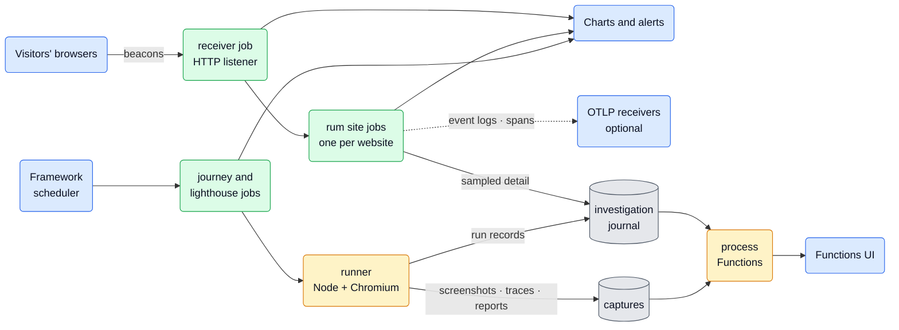
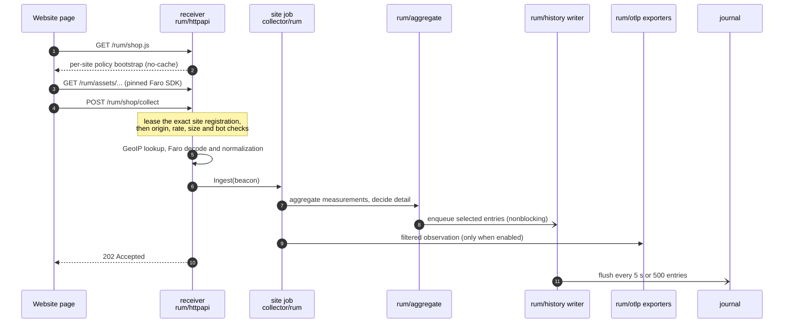
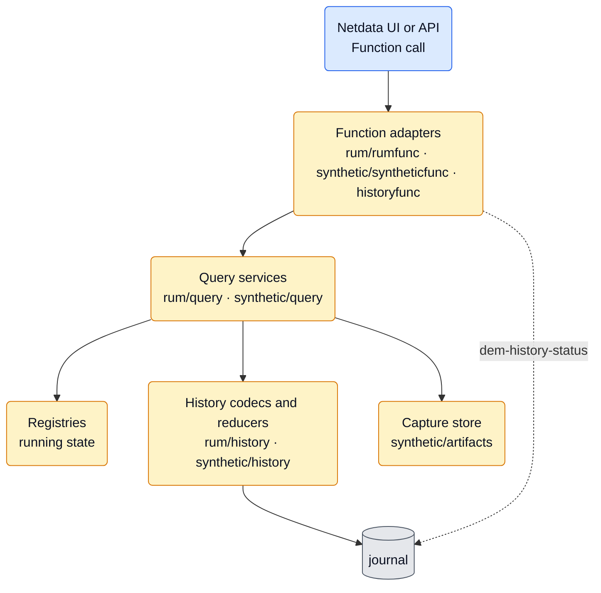
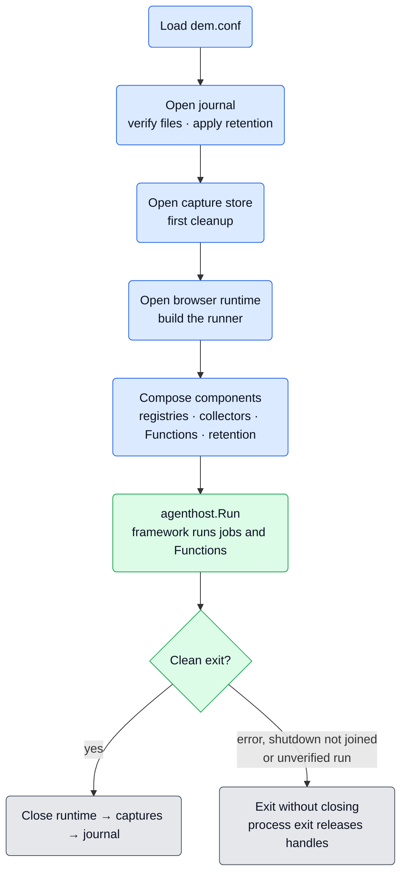
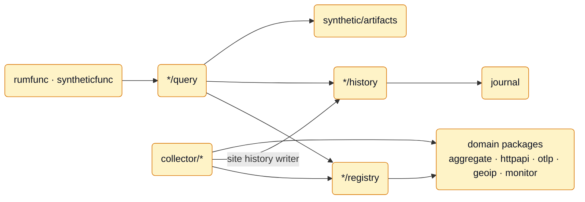

# DEM plugin architecture

This guide explains how `dem.plugin` (Digital Experience Monitoring) is built. Read it from top to bottom: it starts
with what DEM does and one picture of the whole plugin, follows the data along each path, and ends with the design
contracts that maintainers MUST preserve. The last part is reference material to come back to.

Operator setup, configuration options, Function arguments and troubleshooting live in the [README](README.md) and in
each collector's `metadata.yaml`. This guide links there instead of repeating it.

**Path convention.** Code paths are relative to `src/go/plugin/dem/`, except paths starting with `cmd/`, which are
relative to `src/go/`.

## Contents

**Orientation** — [Short version](#short-version) | [What DEM measures](#what-dem-measures) |
[The big picture](#the-big-picture) | [Who owns what](#who-owns-what)

**How data moves** — [Journey 1: a browser report](#journey-1-a-browser-report) |
[Journey 2: a synthetic run](#journey-2-a-synthetic-run) | [Journey 3: investigation](#journey-3-investigation)

**What lives where** — [Storage and retention](#storage-and-retention) |
[Startup and shutdown](#startup-and-shutdown) | [Package map](#package-map)

**Design contracts** — [Package boundaries](#package-boundaries) |
[Process and framework ownership](#process-and-framework-ownership) | [RUM contracts](#rum-contracts) |
[History contracts](#history-contracts) | [Synthetic contracts](#synthetic-contracts)

## Short version

- `dem.plugin` measures how websites behave for the people using them. It remains experimental and is included
  in default Linux builds; `ENABLE_PLUGIN_DEM=OFF` disables it. Browser runtime installation is separate and explicit.
- It has two independent pipelines in one process:
  - **RUM** (real user monitoring): visitors' browsers *push* reports to a built-in HTTP receiver.
  - **Synthetics**: the plugin *pulls* by running scripted browsers on a schedule (Playwright journeys and Lighthouse
    audits).
- Both run on the shared Go plugin framework (`plugin/agent`, `plugin/framework`): four native collector modules,
  configured through DynCfg, scheduled by the framework, publishing charts. Stock alerts cover RUM Web Vitals (LCP,
  INP, CLS), OTLP export failures and loss, and journey failures.
- Beyond charts, DEM keeps sampled investigation detail in a journal and optional screenshots/traces/reports on disk. Process
  Functions expose both when a corresponding job is active or retained data has been observed. Retained-data access
  works with every collector disabled; already-announced Functions remain callable for that framework generation.
  An empty fresh installation announces only `dem-history-status`.
- The command (`cmd/demplugin`) owns the shared stores. Jobs only borrow them, and the stores close only after a clean
  shutdown.

## What DEM measures

| Capability | Collector module | Question it answers | Data comes from | Needs a browser runtime |
|---|---|---|---|---|
| Real user monitoring | `receiver` + `rum` | How fast and error-free is the site for real visitors? | Reports sent by visitors' browsers | No |
| Journeys | `journey` | Does a scripted user flow (login, checkout) still work? | A Playwright Test script run on a schedule | Yes |
| Lighthouse audits | `lighthouse` | What is the page's desktop lab performance? | A Lighthouse audit run on a schedule | Yes |

A few words used throughout this guide:

| Term | Meaning |
|---|---|
| Site | One monitored website: one `rum` job, identified by its native `name`. |
| Beacon | One browser POST to `/rum/<site>/collect`, decoded into a normalized `beacon.Beacon`. |
| Measurement | Rolling-window populations and counts (Web Vitals, timings, errors) published as charts. |
| Investigation detail | Sampled per-event entries saved to the journal and read back by Functions. |
| Run | One journey or Lighthouse execution. Once it pins the browser runtime, it saves a start record before launch and a completion record when it finishes. |
| Capture | A screenshot, trace ZIP or HTML report published for one run. |
| Browser runtime | The Node + Chromium bundle that executes synthetic runs. RUM never needs it. |
| Job generation | One admitted instance of a job's runtime state. Replacing or restarting a job starts a new generation. |
| Framework generation | One run of the framework inside the process. A framework restart (for example on SIGHUP) starts a new one while the command keeps the stores open. |

## The big picture



How to read it:

- Data flows from left to right: inputs, collector jobs, storage, then the investigation Functions.
- **Green** boxes are collector jobs. The framework creates, schedules and retires them like any `go.d` job.
- **Yellow** boxes are process services. They exist once per process, independently of which jobs are enabled.
- **Grey** cylinders are on-disk stores, owned by the command for the whole process lifetime.
- **Blue** boxes are outside DEM's own code: external systems and the shared framework scheduler.
- The receiver and the site jobs are separate: one receiver serves every site, and each site keeps its own state.
- Not drawn: the retention worker and the browser runtime store (see [Storage and retention](#storage-and-retention)).

## Who owns what

DEM splits responsibility between three kinds of owner. Most contracts at the end of this guide keep them apart.

| Owner | Lives for | Owns | Example |
|---|---|---|---|
| Framework (`plugin/agent`) | The process; jobs come and go | Desired configuration, preflight, scheduling, admission, retries, status and DynCfg | Enabling a site; calling `Collect` every `update_every` |
| Collector jobs (`collector/*`) | One job run | The runtime objects of that job and the metrics it publishes | The receiver's listener; a site's aggregator |
| Command (`cmd/demplugin`) | The whole process | Shared stores and services: journal, captures, browser runtime, execution admission, retention | The journal survives every job reload |

Two **registries** connect running jobs to each other and to Functions. `rum/registry` and `synthetic/registry` hold
only what is actually running (admitted sites, receiver availability, active synthetic jobs). `rum/registry` also leases
the exact admitted site to the receiver for each request. The registries hold no desired configuration, so Functions
report what really runs; consumers join native DynCfg state to show disabled or failed configurations.

The four collector modules (the journeys below show them in action):

| Module | Job shape | Defaults | Owns while running |
|---|---|---|---|
| `receiver` | Single instance (`dem:collector:receiver`) | Listens on `127.0.0.1:19938`, `update_every: 10` | HTTP listener, GeoIP resolver, receiver availability |
| `rum` | One job per website (`dem:collector:rum:<name>`) | 5-minute measurement `window`, `update_every: 10` | Aggregator, route, history writer, optional exporters, transport counters |
| `journey` | One job per journey script (`script` or `script_path`) | Checks every 900 s, 120 s timeout; charts every 10 s | Prepared request, monitor session, registration, metric store |
| `lighthouse` | One job per audited URL | Checks every 1800 s, 180 s timeout; charts every 10 s | Prepared request, monitor session, registration, metric store |

### Site vnode identity

A DEM site is a configured vnode. RUM, journey and Lighthouse use the standard optional `vnode` reference and
framework-owned resolved snapshot. The reference is a lookup name, not a public GUID option. Normal framework routing
places charts on the vnode; charts MUST NOT duplicate that identity in a GUID label. With no reference, metrics stay
on the collecting Agent and observations are unassigned to a site. A synthetic-only site requires no RUM job.

Keep these identities distinct:

| Identity | Purpose |
|---|---|
| Collecting Agent | Function registration, access policy, receiver, executor and retention owner |
| Native module and job name | Configuration, lifecycle and chart-instance owner |
| RUM `site` / job name | Beacon route and physical RUM history namespace |
| Synthetic `kind:name`, run ID | Monitor identity and individual execution/artifact ownership |
| `vnode` reference | Configured vnode lookup name, independent of physical job identity |
| Recorded `vnode_guid` | Canonical resolved node identity captured for observations and attempts |

The framework delivers configured vnode snapshots before initialization and on revision changes before collection.
Long-lived RUM ingestion and synthetic attempt work MUST reconcile those updates with their admission boundaries.
History queries MUST use captured GUIDs, not current configuration. Session/error reductions retain physical identity
and recorded GUID so reassignment cannot merge evidence. Saved and buffered investigation records retain their old GUID.
A changed RUM GUID starts a fresh rolling measurement window and Pages view; metadata-only hostname/label edits do not.
Transport and history counters remain job-wide. Old evidence lacking a captured GUID remains unassigned: no
current-config backfill or speculative migration is performed.

DEM Functions remain process-owned on the collecting Agent with existing public names and Agent-level permissions.
All six RUM Functions and `synthetics-checks`, `synthetics-runs`, and `synthetics-artifacts` accept either `vnode` or
`vnode_guid`. The detail Functions `synthetics-run` and `synthetics-artifact` retain their existing parameters.
Neither selector is an authorization boundary. Omitting both, or supplying only an empty `vnode_guid`, preserves
all-vnode and unassigned reads. Empty or unknown `vnode` names and requests containing both selectors MUST fail,
even if either value is empty.

The `vnode` selector is the exact configured resource name used by collector jobs, not the display hostname.
Resolve it once per request through the framework's read-only current configured-vnode authority, independently of
active job registries. Lookup MUST work with disabled jobs or no jobs, use an in-memory name-to-canonical-GUID lookup,
and perform no I/O or job/history scan. Renamed or removed names have no aliases; name reuse resolves only the current
GUID. Keep `vnode_guid` as the canonical UUID fallback for earlier identities, including after configuration removal.
Name selection MUST NOT rewrite captured GUIDs or add stored name history.

Apply the resolved GUID filter before row limits and cursor advancement, retaining physical job, session, run and
capture ownership checks on every evidence read. No Function registration or host-context protocol extension per vnode
is part of this contract. Retained history remains available with all collector jobs disabled or a vnode archived.

Frontend consumers retain collecting-Agent identity, vnode GUID, module and job name. Desired native configuration
includes disabled and failed-startup jobs that active registries omit. Guided site setup creates/selects a configured
vnode through `dem:vnode` or file configuration, then submits independent native job operations with visible outcomes.
There is no parent configuration, generated child ownership, atomic site save or shared deletion lifecycle. Equal vnode
references on different Agents do not create deployment or failover authority. File definitions use the standard
Netdata configuration directory's `vnodes/` YAML format; DEM supports static configured vnodes.

### Capacity remains process-owned

Journey and Lighthouse share the process Executor and configured browser concurrency. Vnode association MUST NOT
allocate a separate executor or browser pool. Scheduling is fair between ready jobs; vnode placement does not define quotas.
Native `Run` owns due times and a bounded pending occurrence, while `Collect` publishes scalar latest observations. This avoids
losing due occurrences when framework publication ticks are skipped. Retirement cancels and joins the session before
native predecessor release; a replacement cannot inherit its pending work or completed observation.

Warm browser reuse additionally needs explicit worker lifetime, runtime leases, per-attempt cancellation and browser
state cleanup. A live shared worker cannot be considered reaped after each attempt. Preserve verified completion at the
appropriate boundary and qualify Playwright and Lighthouse separately. The current fail-stop on unverified process
drainage also stops RUM; independent jobs do not provide process isolation. These are separate execution changes that
need measurement and validation, not promises made by vnode placement.

## Journey 1: a browser report

A website installs one script tag. From then on, every sampled visitor's browser sends reports to the receiver, and each
report travels through the plugin like this (for an example site named `shop`):



### Receiver endpoints

| Route | Purpose |
|---|---|
| `GET /rum/<site>.js` | Per-site policy bootstrap that loads the SDK. Private, no-cache, ETag derived from its body. |
| `GET /rum/assets/{asset}` | Pinned Faro SDK bundles and license notices, with immutable content-identified URLs. |
| `POST /rum/<site>/collect` | Beacon collection. |
| `OPTIONS /rum/<site>/collect` | CORS preflight for collection. |
| `GET /rum/ping` | Reachability check from a viewer's browser. Reveals nothing about sites. |
| `GET /rum/demo` | Test page carrying the bootstrap of an admitted site (`?key=`, default `demo`). |

### Collection request steps, in order

The first failing step decides the response. The body is read only after step 5 and decoded only after step 7.

| Step | Check | On failure |
|---|---|---|
| 1 | An admitted site registration exists for `<site>` | 404 |
| 2 | Request origin is allowed for the site | 403, recorded as the site's last rejected origin |
| 3 | Per-IP and per-site rate limits | 429 |
| 4 | Declared body length is within the receiver limit | 413 |
| 5 | Bot user agent or `?bot=1`, unless the site includes bots | 204, intentional exclusion |
| 6 | Body reads completely within the limit | 413 or 400 |
| 7 | The site's `measure_sample_rate` is 0 | 204, nothing decoded |
| 8 | GeoIP lookup for public client addresses, unless geolocation is `off` | Never rejects; location fields stay absent |
| 9 | Faro payload decodes and normalizes | 400 |
| 10 | The site processor ingests the beacon | 202 Accepted |

The README explains what operators should do for each status code.

### Inside the site

The site processor first aggregates, then hands a filtered observation to each enabled exporter. One beacon can feed
five outputs, each selected by a different policy:

| Output | Produced by | Selected by | Kept |
|---|---|---|---|
| Charts (measurements) | `rum/aggregate`, published by `collector/rum` | `measure_sample_rate` (browser session sampling) | In memory, rolling `window` |
| Live feed (`rum-live`) | `rum/aggregate` live ring | Same as measurements | In memory |
| Investigation history | `rum/history` writer | `investigate.sample_rate` plus `always_keep` problems | Journal budget |
| Event logs | `rum/otlp` logs exporter | Investigation sampling, `event_logs.enabled` | The OTLP destination |
| Browser spans | `rum/otlp` trace exporter | Investigation sampling, `tracing.enabled` | The OTLP destination |

Each site job builds its own objects; nothing is shared between sites:

| Object | Package | Built in | Notes |
|---|---|---|---|
| Aggregator | `rum/aggregate` | `Init` | One site's rolling measurements and investigation state, behind one lock |
| Redactor | `internal/redact` | `Init` | Masks configured credentials in stored and exported text; handed to the route and exporters |
| Route | `rum/httpapi` | `Run` | The site's policy, processor, redactor and last rejected origin, admitted through the registry |
| History writer | `rum/history` | `Run` | Queued, batched journal appends |
| Event-log exporter | `rum/otlp` | `Run` | Only when `event_logs` is enabled |
| Browser-trace exporter | `rum/otlp` | `Run` | Only when `tracing` is enabled |

## Journey 2: a synthetic run

Journey and Lighthouse jobs own background monitor sessions in `Run`. Each session schedules browser attempts using
`check_every`; framework `Collect` publishes a small latest-observation snapshot every `update_every`:

```mermaid
sequenceDiagram
    autonumber
    participant FW as Framework scheduler
    participant Job as journey or<br/>lighthouse job
    participant Eng as synthetic/runner
    participant RT as browser runtime
    participant Proc as nd-run<br/>Node + Chromium
    participant Art as synthetic/artifacts
    participant J as journal

    Job->>Job: Run: occurrence becomes due
    Job->>Eng: ExecuteScheduled(request)
    Note over Eng: state "waiting":<br/>shared configured admission slots
    Eng->>RT: BeginUse (execution pin)
    Eng->>J: start record
    Eng->>Art: Begin (private work directory)
    Note over Eng: state "running"
    Eng->>Proc: request over private stdin
    Proc-->>Eng: reporter events (private pipe)
    Proc-->>Eng: whole process tree drained (verified)
    Eng->>Art: Finalize captures
    Eng->>J: completion record
    Eng-->>Job: Execution(run, drained)
    Job->>Job: count admitted outcome; publish only if association epoch matches
    FW->>Job: Collect (independent publication cadence)
    Job->>Job: write latest snapshot and cumulative counters
```

Key points of this path:

- **Shared admission.** `browser.concurrency` bounds active attempts across monitoring, rehearsals and in-process
  qualification, defaulting to one. Ready jobs take turns; one logical job cannot run overlapping attempts. Waiting
  time is separate from execution time, and cancellation while waiting starts no browser. Qualification uses a
  separate internal identity, so a user job name cannot collide with it.
- **A fresh browser per run.** Runs share no browser state.
- **Installation is explicit.** An administrator installs and qualifies a complete runtime, or supplies a sealed
  preload. The process acquires its release at startup; each run pins that already prepared release for its duration.
- **Proof of completion.** The Node adapter and its browser start through `nd-run`, the Agent's unprivileged launcher,
  acting as a Linux subreaper. A run finishes only when that supervision proves the whole child process tree has
  exited. Only then are captures published and the admission slot released.

How a run can end:

| Situation | Outcome | Journal records | Effect on the plugin |
|---|---|---|---|
| Journey tests all pass, or the Lighthouse audit completes | `success` | Start and completion | None |
| A declared check fails | `failed` | Start and completion | None |
| Skipped, expected-failure, empty or incomplete suite | `inconclusive` | Start and completion | None |
| The overall deadline passes | `timeout` | Start and completion | None |
| The run is cancelled | `cancelled` | None when cancelled while waiting | None |
| An admitted monitor cannot load or run | `error`, still counted in metrics and the registry | Start and completion, including preparation failures | None |
| Process-tree completion cannot be verified | No outcome published | A saved start record stays `unknown` | Admission is poisoned and the plugin fail-stops |

The README defines the full outcome semantics.

## Journey 3: investigation

Charts answer "is something wrong?". Functions answer "what exactly happened?". Each Function call flows down through
the same layers:



| Provider | Functions | Reads |
|---|---|---|
| `rum` | `rum-sites`, `rum-pages`, `rum-live`, `rum-sessions`, `rum-errors`, `rum-session-events` | Site snapshots from `rum/registry`, retained events from the journal |
| `synthetics` | `synthetics-checks`, `synthetics-runs`, `synthetics-run`, `synthetics-artifacts`, `synthetics-artifact` | Active jobs from `synthetic/registry`, run records from the journal, captures from the store |
| `dem-history` | `dem-history-status` | Journal status and the retention worker's policy reload error |

What makes this layer predictable:

- **Plan-gated viewing.** Every DEM Function (`rum`, `synthetics` and `dem-history-status`) publishes access `0x0017`
  (signed in, same Space, paid Space, sensitive data): viewing Real User Monitoring, browser tests and DEM history
  status requires a paid plan or an active trial. Collection, journeys, audits and history storage run on every plan.
  Every handler also requires member access (`0x1b`) for data, and `synthetics-artifact` bytes require administrator
  access (`0x7b`); `info` stays available for discovery. The access masks, the permission test and the member check
  are in `internal/rawfunc`; `synthetic/syntheticfunc` applies the administrator check to artifact bytes.
- **Independent of collector selection.** Disabling `rum` or `journey`, or every collector, keeps retained history
  queryable while the plugin itself is enabled.
- **Fresh handlers.** Each framework run generation gets new handler instances; the stores they read stay open.
- **Read-only and short leases.** Functions copy running state quickly and do their disk reads on their own journal
  snapshots or through the capture store. No Function ever waits for a browser run.

## Storage and retention

| Store | Location | Default budget | Holds | Maintained by |
|---|---|---|---|---|
| Investigation journal | `${NETDATA_LIB_DIR}/dem/journal` | 30 days, 1 GiB | RUM investigation entries and synthetic run records | Retention worker, at startup and hourly |
| Captures | `${NETDATA_LIB_DIR}/dem/artifacts` | 7 days, 2 GiB | Screenshots, trace ZIPs and HTML reports, one set per run | Retention worker, at startup and hourly |
| Browser runtime store | `${NETDATA_LIB_DIR}/dem/runtime` | 4 GiB; selected release retained until uninstall/replacement; 7-day soft grace for most recently used unprotected obsolete release | Complete browser runtimes and preparation workspace | Runtime host worker, at startup and hourly; explicit installer |
| In-memory site state | Memory | Measurements: per-site `window` (5 minutes by default); investigation context: bounded session and entry counts | Rolling populations, live feed, investigation context | The site job; lost on restart |

- The journal and capture budgets live in `dem.conf`. The retention worker reloads them before each sweep, so valid
  edits apply at the next hourly sweep, without a restart. Runtime settings and newly installed releases apply after
  restarting the plugin process, including the first installation.
- Budgets are targets, not physical disk caps. The README explains what can exceed them.
- Terminal and debug runs use a private temporary journal and capture store and leave live history and captures
  untouched. The browser runtime store is shared with normal operation: it still uses `runtime.cache_path` or
  `${NETDATA_LIB_DIR}/dem/runtime`.

## Startup and shutdown

The command loads `dem.conf`, then `dem.Open` (`process.go`) builds the process in a fixed order; the command tears it
down only after a clean exit:



- The journal opens first, and the configured history budget applies before any producer can append.
- The browser runtime is either a host holding the managed or native startup selection or an administrator preload.
  The host maintains storage but never downloads or changes its selection. The runner owns the shared configured
  admission allowance.
- Unusable retained history stops the plugin at startup, before any Function registers.
- An initial capture cleanup failure does not stop startup; the retention worker retries it.
- Browser runtime setup problems (missing installation, unsupported platform, bad preload) never stop startup. Synthetic
  jobs see the runtime as unavailable, and RUM keeps working.
- The runner can signal a fatal, unverified process tree (from a run or a preflight probe) at any time. The command
  then exits without closing stores, so nothing deletes files a surviving child might still use.

## Package map

The root `dem` package composes the plugin and owns its process-level policy: it loads and validates `dem.conf`
(`config.go`), opens the journal, capture store, browser runtime and runner in order and closes them (`process.go`), runs
the retention worker (`retention.go`), and wires native collectors, process Function providers, query services and
retention (`plugin.go`). It does not decode domain journal records, reduce investigation results or serialize Function
tables. The command parses its arguments, runs the Agent across framework generations and closes the process only after
a clean exit.

Shared and process-wide packages:

| Package | Responsibility |
|---|---|
| `collector/{receiver,rum,journey,lighthouse}` | Native lifecycle, configuration, scheduling callbacks and metric publication; journey and lighthouse embed the shared synthetic job and keep request building and their own metrics |
| `collector/internal/syntheticjob` | Synthetic job lifecycle shared by journey and lighthouse: browser `Executor`, preparation, registration, monitor session, vnode association and attempt metrics |
| `journal` | Shared root policy, SDK admission and inventory, independent snapshots, retention status and close |
| `historyfunc` | Read-only process history status presentation behind a narrow store dependency |
| `internal/rawfunc` | Request and response plumbing shared by the three Function packages: access masks and the permission check, strict arguments, vnode selectors, cancellation, the row bound, method declarations and table responses built from ordered column lists |
| `internal/redact` | DEM text and credential redaction |
| `config/` | Installed configuration files; not a Go package |

RUM packages, in data-path order. RUM processing is separate from investigation queries and Function presentation:

| Role | Package | Responsibility |
|---|---|---|
| Processing | `rum/beacon` | Normalized browser observation model: event kinds, device and vital names, reject reasons |
| Processing | `rum/config` | Receiver/site declarations, validation and effective capture and sampling policy |
| Processing | `rum/faro` | Faro wire decoding and input policy (normalization, redaction, error fingerprints, bot classification), spans, event classification and pinned bootstrap rendering/assets |
| Processing | `rum/httpapi` | HTTP endpoints, exact route leases, origin/proxy/body/rate policy, last rejected origin, caching and demo responses |
| Processing | `rum/aggregate` | One site's rolling measurements, Core Web Vitals ratings, session sampling and investigation state, behind one lock |
| Processing | `rum/otlp` | RUM log/span mapping, export queues, transport and drainage |
| Processing | `rum/geoip` | Receiver-owned geographic sources, snapshots and validated lookups |
| Running state | `rum/registry` | Admitted sites, exact-generation request/read leases and receiver availability |
| History | `rum/history` | RUM record encoding, retained-event reducers and the per-site queued writer |
| Read side | `rum/query` | Copied site observations, live cursors, redaction and active/retained investigation results |
| Read side | `rum/rumfunc` | Function methods: declarations, method arguments, column lists and responses over `internal/rawfunc` |

Synthetic packages:

| Package | Responsibility |
|---|---|
| `synthetic` | Shared request, run, event, capture and optional-output status values with their vocabularies, plus request and job ID validation |
| `synthetic/monitor` | One active job's cadence and state: schedule status, current state, latest run, freshness and queue age |
| `synthetic/registry` | Index of active monitor sessions for Functions; keeps no copy of their state |
| `synthetic/query` | Active-first run lookup, retained runs and manifest-owned artifact membership/availability |
| `synthetic/history` | Synthetic record encoding and run reduction |
| `synthetic/syntheticfunc` | Function methods: declarations, method arguments, column lists and responses over `internal/rawfunc` |
| `synthetic/runner` | Prepared browser execution, admission, process supervision and private reporter protocol |
| `src/dem-runtime` (outside the Go plugin) | Independently versioned adapters, component pins and semantic conformance tests |
| `synthetic/runtime` | Signed release and archive verification, installation inventory, process/execution protection, automatic retirement and native package admission |
| `synthetic/runtimehost` | `runtime:` configuration and modes, process runtime opening, fixed startup selection, runner sources, dependency readiness, process maintenance and automatic update preparation |
| `synthetic/artifacts` | Work directories, verified publication, immutable captures, reads and retention |

Deeper package guides: [runtime store](synthetic/runtime/README.md), [runtime host](synthetic/runtimehost/README.md),
[capture store](synthetic/artifacts/README.md), [runtime release](../../../dem-runtime/README.md) and
[Faro assets](rum/faro/assets/README.md).

## Design contracts

The rest of this guide is reference material for maintainers. Each section lists the rules for one area. Treat them as
invariants: change one only together with the code and tests that rely on it.

### Package boundaries



Dependency direction:

- RUM and synthetic Function adapters call only query services. They also use shared value types: RUM values come
  through `rum/query`, while synthetic Functions use `registry.Job`, `history.RunFilter`/`RunPage` and
  `artifacts.Filter` directly. `dem-history-status` (`historyfunc`) instead reads journal status through its narrow
  store dependency. All three use `internal/rawfunc` for request and response plumbing; it imports no domain package.
- Query services combine registry snapshots, domain history and artifact reads. They do not import Function adapters
  or acquire browser execution admission.
- The history adapters borrow one `journal.Store`. They cannot close it or independently apply retention.
- Journal knows SDK fields and snapshots, not RUM or synthetic schemas.
- Shared Go interfaces live with their consumers. Pure synthetic values do not define executor, persistence or
  transport interfaces.
- HTTP never imports the registry or collectors; its small `Processor` and `Routes` interfaces describe its consumers.
- Faro is an I/O-free protocol adapter that owns input policy. Its embedded bootstrap template requires no frontend
  build.
- Configuration policy does not read the hostname or generate UI prose. The sites query derives the fallback install
  address and Functions own presentation.

File layout within packages:

| Package | Files are split by |
|---|---|
| `rum/aggregate` | State/construction, ingestion/results, activity, snapshots/ranking, vital statistics and cohesive topic operations, without creating extra state owners |
| Function packages | Each method keeps its ordered column list, which defines both the column map and every row, beside its row reader |
| History packages | Record codecs are separate from reducers |
| `synthetic/runner` | Execution phases (`engine`), admission, runtime source and checks, process ownership, the reporter stream (`wire`, `sink`, `redact`, `stream`), optional-output decoders (`extension*`) and capture publication; tests are named after the file they cover; tests that need the unix process harness use an `_engine_test` suffix, except `engine.go`'s own tests in `engine_test.go` |
| `synthetic/artifacts` | Work creation, publication, reads, retention and filesystem checks |

- Pure DEM helpers stay under their domain or `internal/`.
- Moving code to the repository `pkg/` requires a real shared contract and consumers outside DEM.

### Process and framework ownership

Command-owned resources:

- The command owns the investigation journal and the plugin-wide retention service.
- It closes the journal only after `agenthost.Result` reports `Err == nil` and `ExitRequired == false`.
- An error or a recovery requiring process exit may leave consumers alive; process exit owns their handles.
- Process-service finalizers run before job retirement and cannot close resources used by jobs.
- The command creates its history directory as the service account under the existing writable Agent state root.

Framework-owned behavior:

- The framework owns desired configuration, preflight, scheduling, admission, retries, status and DynCfg.
- The constructor injects domain registries into collectors and query services into process Function providers.
- Providers construct fresh handlers for each contained framework run generation, independently of collector selection.
  `dem-history-status` is unconditional. RUM/synthetics declarations use `Available` to wait for a corresponding
  admitted job or retained data; the framework keeps announced methods callable for the rest of that generation.
- Availability uses registry length checks and store-owned atomic presence hints, never per-tick history or capture
  scans. Journal startup seeds hints from indexed kind counts; successful appends set them thereafter. Artifact startup
  probes one published-directory entry, and successful publication sets its hint. Unclassified published entries or
  enumeration errors also expose catalogue diagnostics without bypassing manifest validation. Workspaces alone do not.
  Hints stay true across framework generations during the store lifetime; process restart derives them from disk again.
- The RUM registry contains actual admitted site registrations and receiver availability. It has no desired config
  mirror, scheduler or job status.

Collectors:

- Each package in `collector/` is a registered native collector. Its lifecycle methods show acquisition, readiness,
  collection and retirement; its metric definitions show the measurements it publishes.
- Fixed instruments are prepared once.
- Publication uses typed metrix snapshots and static chart templates, with no V1 map bridge.

## RUM contracts

### Receiver and site lifecycle

Receiver:

- Receiver `Init` / `Check` validate and prepare without binding.
- `Run` binds the listener, publishes availability and signals readiness.
- Receiver replacement preserves site aggregation and pending investigation/export queues.
- Receiver and OTLP TLS preparation use the shared context-aware TLS helper, so native preflight cancellation reaches
  credential-file reads.

Sites:

- Each site initializes its immutable policy, then independently admits its aggregator, route (carrying the site
  redactor) and runtime generation.
- Site readiness does not depend on receiver readiness.
- One RUM job constructs one aggregator, route and history writer. It also constructs an event-log
  exporter when `event_logs` is enabled and a browser-trace exporter when `tracing` is enabled. Both default to
  disabled.
- These objects have no site inventory or reconfiguration API.
- The registry admits references to those exact owners; it does not construct them.
- The route records the last rejected origin; a replacement runtime starts without it.
- One site job feeds only its own aggregator, exporters and history writer, so they do not re-check the site name.
- Native `Name` identifies the site; `DisplayName` is presentation metadata.

### Installation bootstrap

- Setup Functions use the explicit site `public_url`, then the receiver `public_url`, or return no install URL.
- They do not derive addresses from listeners/headers, contact websites or parse CSP.
- The browser derives sibling asset/collect URLs from its synchronously captured external script element `src`,
  preserving proxy prefixes; redirects do not change that `src`.
- The native `Document` getter obtains the executing script without trusting shadowing named HTML elements.
- Faro's exact published bundles and consolidated notices are embedded, content-identified and served as public
  assets.
- The policy bootstrap stays private/no-cache with a body-derived ETag. It changes when the effective browser policy
  changes.

### HTTP admission and request leases

- An HTTP request acquires one exact site registration containing both policy and its processor.
- Bootstrap, preflight, demo and beacon endpoints use this same admission.
- Retirement removes future admission, cancels admitted request contexts and joins their leases.
- Cancellation interrupts socket reads through a response-controller deadline before closing bodies. Closing a
  net/http request body alone can wait behind a stalled read.
- Cancellation callbacks join before leases release.
- Concurrent body reads can complete out of receipt-time order. Rolling-window reads filter every expired observation;
  session activity and deduplication keep the newest receipt time without rewriting event timestamps.
- HTTP rejection accounting reaches aggregation only.

### Capture policy and privacy

- Each site owns immutable capture policy.
- Config materializes country-only geolocation and disabled frustration heuristics without mutating the stored input.
- The browser bootstrap limits instrumentation and outgoing metadata. The receiver independently enforces the same
  policy and normalizes supported URLs, paths and text before aggregation, retained history or enabled exports.
- Site redaction covers stored/exported payloads and remote OTLP diagnostic messages.

| Geolocation mode | Lookup | Live observations | Journal and OTLP |
|---|---|---|---|
| `off` | Skipped; HTTP IP admission remains active | No location | No location |
| `country` (default) | Performed | Country only | Country only |
| `city` | Performed | Country plus approximate city/coordinates | Country only; never city coordinates |

- City mode adds approximate city/coordinates to live observations only. Journals and OTLP never receive city
  coordinates.
- Disabled frustration has no instruments or page counts.
- Application-provided user IDs use bounded text normalization without path-style numeric/UUID substitution.
- Per-event user attribution and retained observed-ID membership are distinct from display summaries.
- These targeted transformations do not constitute general privacy or consent enforcement.

### GeoIP

Ownership and timing:

- The receiver owns one stable `rum/geoip` resolver, including while no database is available.
- Composition injects the Agent cache and stock data roots through `pluginconfig`. The resolver and collector do not
  read environment variables.
- `Init` and `Check` validate configuration without database I/O.
- `Run` checks sources after listener setup, then every 60 seconds, and joins its worker before `Cleanup` releases
  readers.
- HTTP lookup does no filesystem or network work.
- Candidate opens occur outside lookup locks; publication and reader retirement use the resolver's RWMutex.
- DEM owns no downloader, network acquisition or runtime NetFlow dependency.

Source selection:

- The resolver accepts only the documented geographic database types, with framing/metadata checks. It validates
  fields during lookup without scanning every record at load.

| Mode | Preference order |
|---|---|
| Automatic | Accepted current cache, then stock, then a previous snapshot whose source was not confirmed removed |
| Explicit | Remains within its configured source |

- File identity, size and modification time detect replacements. An unchanged accepted source is not reopened.
- Missing or rejected sources are retried and do not prevent receiver startup.
- New receiver generations never adopt an old configuration's snapshot.

Status:

- Source status is copied into the registry with generation fencing and projected through query/Functions.
  Retirement clears current availability.
- The worker publishes refresh/fault changes, and collection publishes source-generation lookup counts.
- Neither copied status nor database build time proves freshness or coverage.

Fault containment for memory-mapped databases:

- MMDB mappings are privately owned before reader construction.
- Only mapped construction/lookup reads use `SetPanicOnFault`, with the prior goroutine-local setting restored on exit.
- Recovery is limited to runtime faults whose address is inside the owned mapping; unrelated panics propagate.
- A fault discards partial output and taints the snapshot before releasing the lookup read lock.
- A nonblocking wakeup prompts worker fallback. Tainted mappings cannot be retained as previous snapshots.
- Windows opens permit delete sharing for atomic replacement.
- Atomic replacement remains the required consistency contract: fault containment cannot detect readable torn content
  or guarantee that all in-place writes are recoverable.

### Faro SDK integration

Sampling and metadata:

- Faro's `beforeSend` runs before its session sampling hook.
- Browser shaping clones metadata and preserves the `isSampled` session attribute until the SDK consumes it; removing
  it early silently drops telemetry.
- Session lifecycle and `view_changed` envelopes carry metadata even on quiet pages, so they stay on the wire.
- Native history suppresses generic session lifecycle rows and uses explicit view events to preserve transitions
  between identically normalized routes.
- The pinned-SDK capture and sampling fixtures exercise the real metadata providers and transport hooks, including
  selected/excluded session rollover. SDK upgrades MUST verify this ordering against the new bundle.

Decoding:

- The decoder targets the pinned SDK's measurement `values` map.
- Legacy experimental scalar `value.duration` and `value.value` payloads are unsupported; no compatibility adapter is
  retained.
- Faro classifies protocol event names into domain kinds without changing their original names for presentation.

Page identity and transport:

- Faro page metadata captures a frozen activation ID and document-entry URL before queueing.
- A persisted `pageshow` starts a new activation before SDK BFCache reports are generated.
- Custom metadata providers retain SDK browser/OS/sdk fields; raw `setPage` cannot replace the frozen document scope.
- The `FetchTransport` subclass changes only its ignore-URL matcher to an escaped, anchored collector URL; inherited
  delivery/batching/retry behavior stays intact. Raw URL strings become regular expressions in the pinned SDK and
  otherwise mis-handle bot query strings or prefix matches.

Report identity and replay suppression:

- The WebVitals instrumentation wrapper attaches increasing revisions in measurement context, never changing metadata
  for every measurement: Faro groups by metadata, so per-item metadata would destroy default batching.
- Explicit document/view/session lifecycle events and performance entries receive identities before transport;
  retries preserve identical IDs/revisions.
- Identity evidence lasts 30 minutes unless the site job restarts, is replaced, or changes its vnode association.
  The SDK has no finite maximum delivery delay, so this is best-effort replay suppression.
- Unidentified errors, logs, spans and ordinary custom events have no replay suppression.

Vital attribution:

- Filtered vital reports carry `Vital.Origin` with frozen page/browser/device/country/version dimensions.
- User identity, view label and view occurrence remain per-report attributes. These MUST NOT be frozen at the first
  metric report, because login/logout and SPA transitions can occur before later revisions.
- History promotion retains each report's original attributes.
- Native live/history and enabled exports preserve the same experience/metric/revision identity.

### Processing, sampling and export

Processing order:

- The collector's processor calls aggregation and then each enabled exporter directly.
- Aggregation leaves the normalized Beacon unchanged and returns page-view/detail decisions plus a filtered
  observation containing only newly eligible reports.
- Exporters consume that filtered observation, including when it is empty. They MUST NOT fall back to the input batch.
- History enqueue remains nonblocking under the aggregate lock and does not call back into it.

Sampling:

- Eligible measurements and live rows are independent of detail selection. Investigation sampling controls retained
  history and OTLP export.
- Config owns omitted/null defaults. The aggregator receives literal effective rates, including zero.
- Receiver collection zero acknowledges otherwise admissible requests before decode, geo lookup or processing.
  Bootstrap zero avoids SDK startup.

History promotion:

- History promotion replays preceding bounded context with each event's original attribution, then emits current
  entries independently of the live ring cap.
- Poor-vital entries do not require element attribution.

OTLP export:

- Each enabled exporter owns its complete destination, gRPC connection, bounded queue and worker. Disabled signals
  create none of these resources.
- The destinations have identical security options and do not inherit from each other.
- OTLP exports only newly selected observations. Prior exports and asynchronously arriving spans are not reconstructed.
- The trace exporter preserves each beacon's trace resource attributes.
- The history writer and each enabled exporter account for their own queues in the site job's transport counters.
  The counters live outside the aggregator, so a vnode change that resets measurements leaves them intact.
- Shared receiver/site policy and destination declarations belong to `rum/config`. `rum/otlp` implements transport
  security, signal mapping and drainage.
- Runtime export failure does not stop native aggregation or history.

### Aggregation state

What `rum/aggregate` stores:

- One canonical latest observation per `(experience, vital)`.
- Separate time-retained activation, view/resource identity, activity and observed-session records.
- Resource observations and replay evidence have separate retention from document/vital activity.
- Canonical measurements remain exact for the configured receipt window (five minutes by default); replay evidence
  retains its 30-minute identity horizon. No independent aggregate count/byte cap or approximation applies.
- Restarting or replacing the site job, or changing its vnode GUID, resets canonical measurements and replay evidence.
  Retained investigation evidence keeps its original vnode GUID.
- Measurement retention is independent of the investigation-session LRU and the live ring.

How reads derive results:

- Facet distributions and top-N complements derive from canonical populations at read time.
- Each read captures owned values/counts and matching configuration under the site mutex, then releases it before
  percentile sorting, ranking and result construction. Sorting consumes those private arrays without another copy.
- Resource API eligibility is classified once on admission using the same first-party decision as resource counters;
  reads reuse that immutable classification.
- Host/error grouping is bounded by those retained observations and folded only after ranking.
- Pages reads expose all retained page groups rather than chart top-N only.

Cost:

| Operation | Cost |
|---|---|
| Receipt-ordered retention | O(log retained) per changed entry, without scanning retained measurements during ingestion |
| Snapshots | Scan window-retained state and sort populations for percentiles and ranking |
| Sites summary | Scans only its required activity and session populations |

Retention and resources:

- Canonical receipt heaps expire elapsed entries during accepted ingestion using Agent time, with work proportional
  to entries actually expiring. Original receipt timestamps and inclusive window boundaries remain unchanged.
- Read-side cleanup also expires idle state and retains transport/detail housekeeping. Receiver activity timestamp
  slices are additionally compacted at most once per minute during ingestion, amortizing diagnostic cleanup when
  publication is delayed. Ingestion MUST NOT scan retained measurements or the detail-session LRU for each beacon.
  No background expiry worker is required.
- Memory is O(admitted distinct state and retained bytes over each horizon), plus detail and query state. Heap/map
  backing allocations may retain high-water capacity after entries expire. This is not a hard process-memory limit
  or evidence of a qualified full-scale workload.
- Investigation-session LRU, event/live rings and history/export queues retain their separate limits and actual loss
  diagnostics. Invalid measurements and receiver rejections remain independently counted.

### Metrics and alerts

Instruments:

- Site labels are bound to fixed instruments during initialization.
- Dynamic breakdown handles are not retained in an unbounded cache. Dynamic series use ephemeral metrix handles and a
  separate bucket label for pooled Other.
- Top-N window counts are gauges, not cumulative counters with changing membership.

Publication:

- Collector gauges expose exact current retained population counts on every eligible collection cycle.
- Percentile gauges are omitted for empty populations; measured zero remains valid.
- Measurement gauges are omitted when collection is zero or ingress is unavailable.

Alerts:

- Stock native health templates own alert policy and attach independently to each site's charts.
- Site jobs publish measurements only. They do not write health configuration, invoke health reload or recover
  generated files.
- Stock quality alerts read coherent fresh population dimensions directly, require 30 observations, and compare
  threshold counts without averaging percentiles.
- Missing/stale/partial populations yield undefined, not a synthetic healthy zero.

### Site diagnostics

- Site runtime generation owns receipt/rejection evidence, not browser policy freshness: older pages can report into a
  replacement runtime.
- The Function publishes generation, collection policy and timestamped facts without inferring an installed/healthy
  state.
- Last accepted time reuses the aggregator's existing receipt state.
- Origin rejection remains one observation, including failed preflight.
- The receiver's bound `Listen` address is internal state, not a published diagnostic or installation URL.
- There is no outbound setup probe worker.

### Function reads

- Function reads lease domain state only while copying snapshots.
- Historical queries own independent journal snapshots and check caller cancellation between files and rows.
- Live queries merge per-site stream heads by receipt time while preserving each stream's sequence prefix; concurrent
  receipt and ingestion order can differ.
- All-site Errors, Pages and Sessions use a separate site-scoped row key without replacing their filter values.
- Session events merge the live ring with persisted history by counting equal rows. Both sources project the same
  history record through one function, so an event present in both compares equal.

### Site retirement and history writes


- A retiring site joins its HTTP and Function readers before cancelling the history/export worker context.
- Export queues drain using one shared fixed shutdown budget.
- Accepted history events flush under one detached five-second admission budget.
- Every event is self-contained: there are no session/group parent records or cumulative deltas.
- A cancelled admission leaves only unattempted entries pending for final drain. Attempted appends are never
  replayed, including when an error or cancellation races them.
- Appends, sync, snapshot construction and retention serialize SDK `Log` access. The SDK disk operation itself is not
  interruptible.
- A non-quiescent exit uses the existing host fail-stop boundary.
- Snapshot scans release writer admission and copy SDK payloads before their borrowed lifetime ends.

## History contracts

### Time axis

| Domain | History time | Journal field |
|---|---|---|
| RUM | Original Agent receipt | `ObservedUS` / `DEM_OBSERVED_US` |
| Synthetic | Immutable attempt start | `DEM_STARTED_US` |

- Inclusive whole-second ranges are checked against decoded microsecond clocks after index selection, without
  overflowing second-to-microsecond multiplication.
- RUM counts and spans describe selected retained activity. User-ID membership filters summaries after aggregation.
- Session order uses the exposed `last_observed_us` before limiting.
- Identity timelines use session/run postings across all retained time, then verify domain and site/job identity. RUM
  preserves its occurrence-aware pending/retained union.
- Saved-time retention stays independent of these query clocks.

### Schema and index

- The shared append boundary derives `DEM_SCHEMA=1` and one canonical decimal minute field: `DEM_RUM_MINUTE` or
  `DEM_SYNTHETIC_MINUTE`, computed as floor(domain microseconds / 60,000,000).
- Callers cannot supply envelope metadata.
- Domain decoders check required scalar multiplicity, identity and timestamp agreement.
- Each snapshot captures both bucket FIELD heads and schema posting counts while admission excludes
  append/rotation/retention. The current schema must cover every committed entry.
- Opening owns bounded SDK buffers rather than a vector of all ENTRY offsets.
- Exact minute lookups serve narrow ranges; broader ranges enumerate existing minute values. The crossover changes cost
  only.
- No saved-time seek, file pruning, candidate cap or hidden full-scan fallback is used.
- Payload views end with their callback. Reducers retain only domain summaries or requested timeline output.

### Query cost and failures

| Phase | Cost follows |
|---|---|
| Snapshot capture | Retained file count |
| Selection | Native bucket/hash traversal plus selected postings |
| Reduction | Selected records and distinct summary keys |

- Broad queries still decode all selected evidence.
- Error fingerprint details additionally retain distinct session/page/browser sets.
- Query failures return errors instead of silently labeling corrupt or quarantined history as complete.
- Damaged `.journal~` files remain for operator investigation and are outside the SDK retention policy.

### Journal recovery and failure

| File kind | Startup check |
|---|---|
| Every preexisting active `dem.journal` | SDK strict index verifier during recovery, before `NewLog` can mutate history |
| Nonempty finalized `dem@…journal` archive | Archived header state and complete current-schema coverage |
| Empty finalized archive | Strict verification, because it has no encoder marker |

- `StrictSystemdNaming` and default archive sync separate active files from `dem@…journal` finalized archives.
- Under the supported single-owner lifecycle, these finalized archives avoid a whole-graph startup scan. A schema marker
  alone does not certify arbitrary external modifications.
- Verification uses graph-sized memory and fails closed without repair/deletion.
- An SDK uncertain-write sentinel poisons the shared store: new reads, writes, sync and retention return the failure.
  SDK cleanup releases resources without rewriting clean metadata.
- Private temporary history is also preserved on failure.
- Measurements/exports remain independent. An existing startup failure stops the plugin when retained history cannot
  be opened.

### History retention and status

Retention worker:

- One process worker applies the shared history policy in place, including retained machine identities, even with all
  collectors disabled.
- The SDK owns validated filename/header inventory, file-length accounting and tail-saved-time whole-file pruning.
- DEM selects a fixed 24-hour file span and applies policy at startup and hourly. Size rotation also maintains the
  budget.
- Sweeps do not force archives or reopen the writer. Expired idle active files are sealed only when needed, and
  next-file creation remains lazy.
- Failed cleanup retries after five seconds without failing healthy appends.
- Uncertain writer mutation still makes the store unavailable for reads and writes. Status retains separate writer and
  cleanup facts.
- Invalid config reloads preserve the last valid policy and an independently locked reload error.
- Neither retention nor history scans hold a live site lease across disk work.

`dem-history-status` (`historyfunc`):

- It borrows the store's status interface and the worker's reload error accessor.
- Each Agent generation receives a fresh handler; it never closes the process store.
- Metadata performs no I/O.
- Explicit status requests use header-only inventory, never scan records, and report unknown inventory on failure.
- The effective policy comes from the store, not a worker policy that has yet to apply.
- File bytes include preallocation but do not measure filesystem blocks or open unlinked files.
- Whole-file age and byte targets cannot promise complete observed-time history or exact record TTLs.

## Synthetic contracts

### Synthetic jobs and the runner

Job ownership:

- Journey and Lighthouse each own their prepared request, metric store, product instruments and explicit execution
  flow.
- They share an executor, pure request validation and the common outcome/duration instrument helper.
- `synthetic/monitor` owns due times in native `Run`; framework scheduling only refreshes metric snapshots.
  The command owns shared execution admission, artifact store and journal.
- A session has one executor call in flight and one latest pending occurrence. A new due replaces the pending
  occurrence without requeuing a waiting call. Elapsed occurrences are counted arithmetically in constant time.
  The admission callback consumes the latest due time and preserves the original queue timestamp in the run.
- Bootstrap is immediately eligible. Recurring cadence starts one interval plus a deterministic JobID phase after
  activation, then advances at a fixed rate. Delayed bootstrap cannot hide scheduled occurrences.
- Every admitted, verified completion updates job-activation outcome counters, including obsolete-association results.
  Only current-association completions update the value-only metric projection. `Collect` copies no reporter events
  or captures, and repeated snapshots never increment attempt counters. Missing/stale measurements remain gaps;
  known chart identities disable cycle expiry. The latest outcome becomes `stale` after two check intervals.

Activation checks coalesce only while a contract probe is in flight for the exact runtime source view. Their caller
deadlines remain independent; the last departing caller cancels and joins physical completion before a replacement
probe can start. A later check probes again. Running and candidate runtime consumers have separate probe ownership,
but share the fatal execution owner. Probes stay outside browser-attempt slots to preserve short startup deadlines;
deployment resource sizing must include them. The concurrency setting does not impose a host-wide or CPU/RAM limit.

Draft rehearsal:

- Explicit journey DynCfg `Test` uses resolved submitted configuration after `Init`; activation still uses `Check`.
- `Engine.Rehearse` shares the installed source, admission and fail-stop owner with scheduled execution. It uses
  an explicitly unrecorded view, as runtime qualification does, and a private temporary artifact store with capture
  disabled. The monitoring engine cannot be constructed without its history and artifact owners; standalone runtime
  administration qualifies through its own one-slot scope instead.
- Rehearsal never calls collector `Run` or `Collect`, registers a monitor session, or writes metrics.
  After verified drainage, it closes the temporary store and returns only an error/pass result; no result registry
  or polling API exists.
- Caller deadlines include admission waiting. Unverified drainage signals the shared fatal owner and preserves
  uncertain live work, even if the configuration request has already timed out.

Registration:

- `Run` registers its monitor session before readiness. The registry indexes sessions and keeps no copy of their state.
- The session owns schedule status, current state, the latest verified run and last success/failure times. `Collect`
  and `synthetics-checks` read its scalar snapshot; active-first run detail copies only the requested latest run.
- Session owns a monotonic association epoch under its mutex. At execution-queue submission it captures both the
  prepared request (including vnode GUID) and epoch by value. Later admission may choose a newer pending due time,
  but MUST NOT replace the captured identity. History and artifacts retain this GUID regardless of reassignment.
- A GUID change increments the epoch, updates the next request and clears current latest observations, state and
  success/failure timestamps. Same-GUID hostname/label updates preserve them. Old-epoch state/completion callbacks
  MUST NOT refill current observations, including A-to-B-to-A transitions. Changes count when delivered by the
  framework's configured-vnode snapshot; unobserved intermediate config edits are not association transitions.
- Placement, state and completion updates are serialized under Session's mutex; the registry never holds its own lock
  while reading a session. Physical-job scheduled/admitted/coalesced/outcome counters, pending/active state and queue
  diagnostics continue across reassignment. Obsolete completions still undergo drainage and completion-time
  checks; fencing current publication MUST NOT hide unsafe execution or delete historical evidence.
- Retirement cancels and joins the session and executor call before removing the session from the registry.

Failure handling:

- Ordinary execution errors remain measured outcomes.
- Unverified drainage notifies an active `Run`, while the independent engine fatal signal stops the process even if
  cancellation already finished `Run`.

Functions:

- Process Functions use separate providers, independent of collector selection. Initial publication waits for active
  jobs or retained history/captures, as described under framework-owned behavior above.
- Their narrow source copies active snapshots before independent history I/O. No Function acquires browser admission.

Node adapter and supervision:

- The real Node adapter selects exactly one configured entry with explicit config/tsconfig and a private reporter pipe.
- Standard import mappings target real pinned package entries, never a fake test harness.
- Retry overrides fail before a worker starts.
- Node terminal evidence and Linux process-tree completion are distinct.
- Go joins stdin/stdout/stderr owners after verified supervision. False `Drained` poisons admission and wakes command
  fail-stop before attempting reader joins.
- The command cannot close stores when the host returns forced recovery or the engine reports unverified cleanup.

### Browser runtime installation and process ownership

Fixed startup selection (`synthetic/runtimehost`):

- The host atomically acquires the selected installation and a process claim at construction. It keeps that release
  across monitor changes and internal framework restarts. A missing startup installation remains unavailable until
  the plugin process restarts, even after an administrator installs a runtime.
- Enabling or validating a monitor never downloads executables. Contained structural configuration validation remains
  required before a malformed binding can become a named-dependency waiter; no per-monitor runtime claim is reserved.
- Readiness reads the fixed process state. There is no preparation worker, download retry, import polling or
  installation-driven readiness notification.
- Startup and hourly maintenance retire unprotected old versions independently of enabled monitors. Maintenance
  errors do not invalidate an otherwise usable runtime or change website outcomes.

Explicit installation and protection (`synthetic/runtime`):

- Fresh/empty stores publish an initialization record, complete the private layout under coordination, then durably mark
  it ready before admission. Interrupted initialization is retryable; ready stores never recreate missing safety
  namespaces or locks. A missing selection record or field is damage, not an uninstall.
- Precreated roots, including mountpoints, initialize in place without requiring parent write access. Creating an absent
  path stages its missing suffix and records the parent durability barrier in each created directory. New stores sharing
  those ancestors reconcile that barrier too; successful setup retires the publication records. Interrupted
  publication can leave a small unpublished sibling containing only initial metadata, never payloads. Published roots
  and lock identities are preserved. Preload readers require ready state without modifying it.
- Administrator commands hold candidate protection and serialize installation, update, repair and uninstall.
  Install/update/repair verify and prepare the trusted archive, qualify both a sandboxed journey and Lighthouse,
  then publish the selection. Installation accepts only a `VerifiedRelease`, which only signature verification
  against a trusted keyring produces.
- Selected installation, process claims, candidates and each invocation's durable use pin protect files independently.
  Preparation reservations account for workspace. The selected release never expires for inactivity; process and
  execution protection keep older releases safe after an update.
- Unprotected old releases can retire; the most recently used gets a seven-day soft grace, which pressure can shorten.
  Protected files may prevent a new installation within the configured allowance.
- Diagnostic inventory separates executable metadata validity from independent ownership evidence. Status reports
  selection and generation damage with available bytes and owners; incomplete ownership or I/O inspection is explicit.
  Execution still requires a valid selected release; ordinary installation and automatic retirement do not repair metadata.
- Repair and uninstall refuse live consumers, candidates, preparation and unresolved executions across all generations.
  Complete ownership evidence permits removing generations even when executable metadata is damaged. Missing safety
  structure and operational I/O errors still block removal; neither command recreates lost ownership evidence.
- Repair retires damaged generations plus the requested generation, then uses ordinary import/download, qualification
  and selection. It durably clears a damaged selection or one being rebuilt before retirement. A healthy different
  selection remains protected; other unselected generations remain subject to ordinary retention.
- Uninstall durably clears selection before retiring all generations. Publication uncertainty is reconciled before
  admission, another mutation or cleanup. Neither repair nor uninstall replaces the store root or its locks.
- The runner acquires a use before inspecting runtime files, passes its completion handle to `nd-run`, and releases it
  after supervised drainage and local reader joins.
- Completed preparation releases its local claim and staging locks before coordinated record reclamation.
- Failed local lock closes remain owned for maintenance/final-close retry. Released records are reclaimed by the
  existing dead-owner inventory.
- Cleanup health survives coordination failures and cannot be cleared by an older sweep.
- Unknown execution completion retains protection across process restart. A positively verified host reboot may
  release the old execution pin, because its children cannot remain alive.
- Install/update preparation and qualification errors preserve the previous selection. Repair errors preserve a healthy
  different selection, but cannot restore a cleared selection. Retrying repair is supported after the reported problem
  is resolved; successful repair requires a DEM restart. CLI errors do not produce website observations.
- Repair reports candidate identity/progress separately from the final selected installation. A damaged old generation
  does not make a healthy selection unavailable in status output. Uncertain inventory is reported as unknown.

Protected preloads and shutdown:

- The preload command qualifies a fresh root and seals its trusted descriptor and final location into that root.
  Readers use the sealed metadata without a separate installed manifest.
- Preloads remain private, service-account-owned and outside managed retirement. They can be mounted read-only;
  managed operations refuse their roots. Stop every consumer before replacement/removal and restart DEM to switch.
- Native package payloads have a separate root-owned admission gate and service-owned process/execution proof.
  Package hooks close admission and require drainage before replacing files, then qualify both browser workloads
  before reopening it. The package manager owns those payloads; DEM does not retire or replace them.
- Independent component paths are unsupported.
- Command shutdown closes the host and store only after jobs and contained configuration work have joined. Fail-stop
  paths retain the existing execution evidence.

### Synthetic history records

- Run starts/completions are immutable self-contained journal records carrying the same scalar/JSON start clock.
- Start-time selection includes both phases, even when completion is saved outside the picker.
- Completion wins over start, including positive wall-clock rollback. An unmatched start remains unknown.
- A retained completion does not need its start record.
- Outcome filtering follows grouping.
- Identity detail retains active-first diagnosis.
- Summary reduction is O(selected runs) memory and stores no full timelines. SDK snapshots use bounded buffers per
  retained file.
- Current synthetic observations belong to each monitor session; a new activation or a vnode reassignment starts
  unknown.
- Freshness is two browser check intervals and remains independent of an in-flight attempt. History does not drive current
  incidents.

### Captures

Work directory:

- Chromium receives a short `/tmp/nd-dem-<run-id>` alias for its private work directory, because its profile
  singleton uses Unix sockets with a small pathname limit.
- The artifact owner never adopts an existing alias and removes it only after verified drainage and an exact target
  check.

Publication:

- Artifact publication starts only after verified tree/reader completion.
- A Go-owned synced drained marker grants cleanup permission. Work without it remains protected across restart.
- Captures are constrained beneath output and copied into synced immutable manifests with actual size/digest.
- Final publication, fetch, retention and close serialize at the store.
- Failed publication remains protected for the current owner. A later owner reconciles only marked drained leftovers.
- Nonempty publication records Go-owned JobID, RunID, publication time and artifact membership. Empty captures leave no
  persistent manifest.

Catalogue and fetch:

- Catalogue and fetch use the Go-owned publication record (JobID, RunID, publication time, membership)
  independently of journal survival. History only explains absent sets.
- The catalogue reads metadata and logical file lengths, sorts by publication time/RunID, and exposes bounded keyset
  pages plus an unfiltered global storage snapshot.
- Unknown byte categories carry errors rather than zeroes.

Retention:

- The shared allowance counts all logical file lengths inside trusted published set directories, including manifests.
  Eviction removes whole set directories.
- Unclassified published entries lack trusted set identity and remain separate, along with workspace and pending
  deletion.
- An unreadable trusted set makes retained bytes unknown and defers retention selection until the retained inventory
  is complete.

| Order | Selection rule |
|---|---|
| 1 | Age expiry |
| 2 | Size pressure removes older non-preferred sets before each JobID's newest eligible set |
| 3 | If preferred sets still exceed the allowance, they expire oldest first as well |

- Eviction renames complete sets into `deleting/`, syncs both parents before removal, then syncs the deletion parent
  again.
- Recovery retries this transition without needing surviving manifest bytes. Uncertain ownership blocks deletion.
- Filesystem traversal/retention is linear in files plus finalized-set sorting, without a rescan per victim.
- Publication and current-check Functions do not recursively inventory artifact storage. No metrics collection path
  scans artifact bytes.
