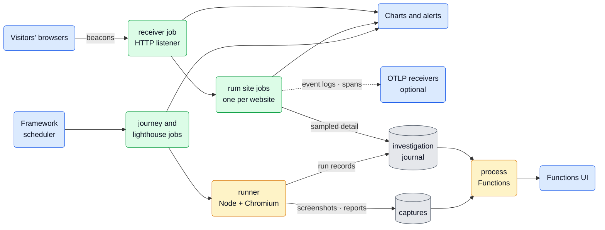
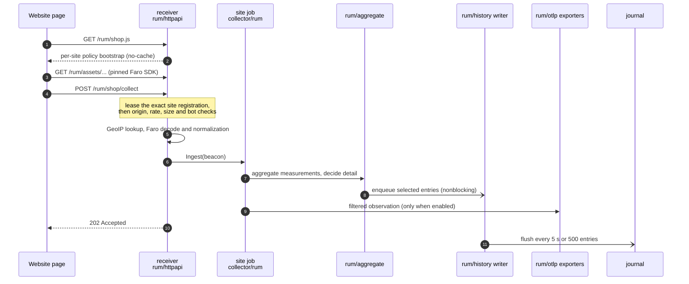
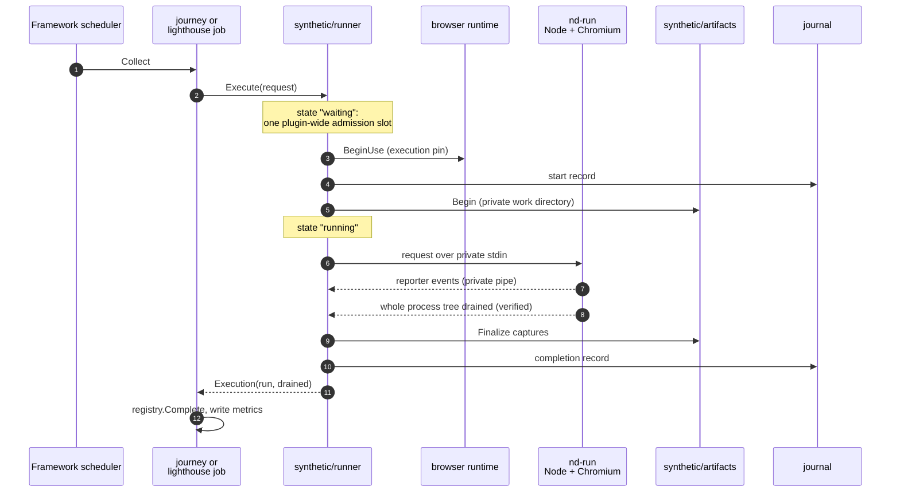
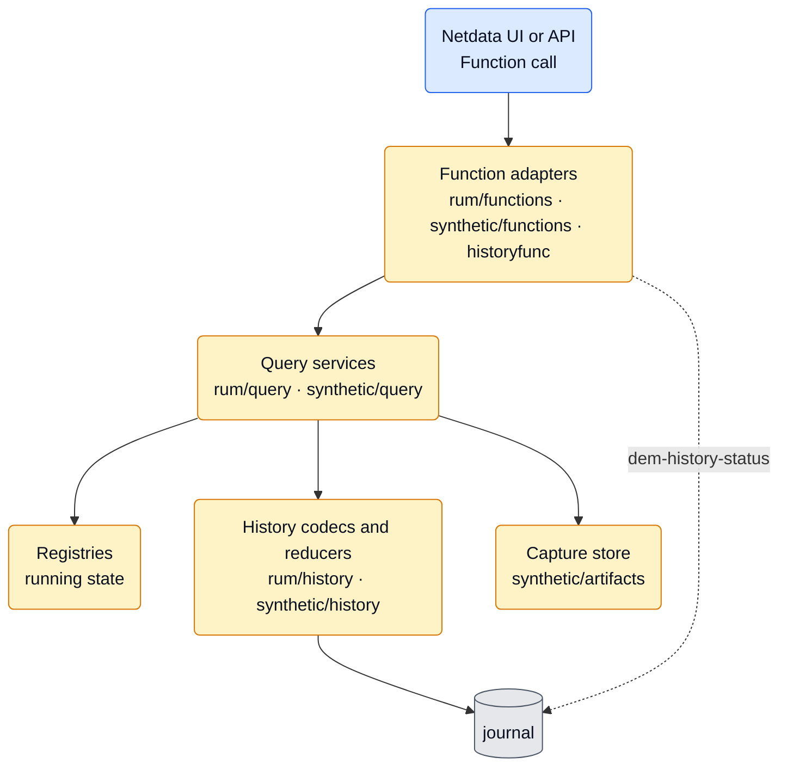
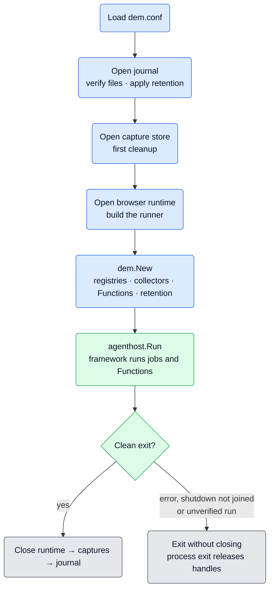
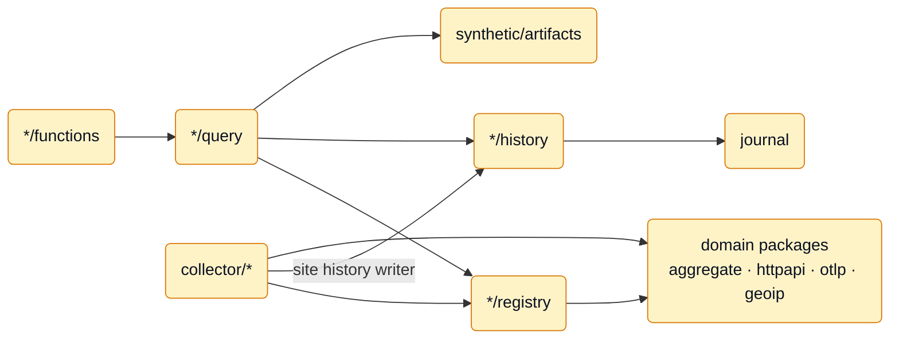

# DEM plugin architecture

This guide explains how `dem.plugin` (Digital Experience Monitoring) is built. Read it from top to bottom: it starts
with what DEM does and one picture of the whole plugin, follows the data along each path, and ends with the design
contracts that maintainers MUST preserve. The last part is reference material to come back to.

Operator setup, configuration options, Function arguments and troubleshooting live in the [README](README.md) and in
each collector's `metadata.yaml`. This guide links there instead of repeating it.

**Path convention.** Code paths are relative to `src/go/plugin/dem/`, except paths starting with `cmd/`, which are
relative to `src/go/`.

## Contents

**Orientation** — [Short version](#short-version) | [What DEM measures](#what-dem-measures) |
[The big picture](#the-big-picture) | [Who owns what](#who-owns-what)

**How data moves** — [Journey 1: a browser report](#journey-1-a-browser-report) |
[Journey 2: a synthetic run](#journey-2-a-synthetic-run) | [Journey 3: investigation](#journey-3-investigation)

**What lives where** — [Storage and retention](#storage-and-retention) |
[Startup and shutdown](#startup-and-shutdown) | [Package map](#package-map)

**Design contracts** — [Package boundaries](#package-boundaries) |
[Process and framework ownership](#process-and-framework-ownership) | [RUM contracts](#rum-contracts) |
[History contracts](#history-contracts) | [Synthetic contracts](#synthetic-contracts)

## Short version

- `dem.plugin` measures how websites behave for the people using them. It is experimental and built only with
  `ENABLE_PLUGIN_DEM=ON`.
- It has two independent pipelines in one process:
  - **RUM** (real user monitoring): visitors' browsers *push* reports to a built-in HTTP receiver.
  - **Synthetics**: the plugin *pulls* by running scripted browsers on a schedule (Playwright journeys and Lighthouse
    audits).
- Both run on the shared Go plugin framework (`plugin/agent`, `plugin/framework`): four native collector modules,
  configured through DynCfg, scheduled by the framework, publishing charts. Stock alerts cover RUM Web Vitals (LCP,
  INP, CLS), OTLP export failures and loss, and journey failures.
- Beyond charts, DEM keeps sampled investigation detail in a journal and optional screenshots/reports on disk. Process
  Functions expose both, and keep working even when every collector is disabled.
- The command (`cmd/demplugin`) owns the shared stores. Jobs only borrow them, and the stores close only after a clean
  shutdown.

## What DEM measures

| Capability | Collector module | Question it answers | Data comes from | Needs a browser runtime |
|---|---|---|---|---|
| Real user monitoring | `receiver` + `rum` | How fast and error-free is the site for real visitors? | Reports sent by visitors' browsers | No |
| Journeys | `journey` | Does a scripted user flow (login, checkout) still work? | A Playwright Test script run on a schedule | Yes |
| Lighthouse audits | `lighthouse` | What is the page's desktop lab performance? | A Lighthouse audit run on a schedule | Yes |

A few words used throughout this guide:

| Term | Meaning |
|---|---|
| Site | One monitored website: one `rum` job, identified by its native `name`. |
| Beacon | One browser POST to `/rum/<site>/collect`, decoded into a normalized `beacon.Beacon`. |
| Measurement | Rolling-window populations and counts (Web Vitals, timings, errors) published as charts. |
| Investigation detail | Sampled per-event entries saved to the journal and read back by Functions. |
| Run | One journey or Lighthouse execution. Once it pins the browser runtime, it saves a start record before launch and a completion record when it finishes. |
| Capture | A screenshot or HTML report published for one run. |
| Browser runtime | The Node + Chromium bundle that executes synthetic runs. RUM never needs it. |
| Job generation | One admitted instance of a job's runtime state. Replacing or restarting a job starts a new generation. |
| Framework generation | One run of the framework inside the process. A framework restart (for example on SIGHUP) starts a new one while the command keeps the stores open. |

## The big picture

How to read it:

- Data flows from left to right: inputs, collector jobs, storage, then the investigation Functions.
- **Green** boxes are collector jobs. The framework creates, schedules and retires them like any `go.d` job.
- **Yellow** boxes are process services. They exist once per process, independently of which jobs are enabled.
- **Grey** cylinders are on-disk stores, owned by the command for the whole process lifetime.
- **Blue** boxes are outside DEM's own code: external systems and the shared framework scheduler.
- The receiver and the site jobs are separate: one receiver serves every site, and each site keeps its own state.
- Not drawn: the retention worker and the browser runtime cache (see [Storage and retention](#storage-and-retention)).

## Who owns what

DEM splits responsibility between three kinds of owner. Most contracts at the end of this guide keep them apart.

| Owner | Lives for | Owns | Example |
|---|---|---|---|
| Framework (`plugin/agent`) | The process; jobs come and go | Desired configuration, preflight, scheduling, admission, retries, status and DynCfg | Enabling a site; calling `Collect` every `update_every` |
| Collector jobs (`collector/*`) | One job run | The runtime objects of that job and the metrics it publishes | The receiver's listener; a site's aggregator |
| Command (`cmd/demplugin`) | The whole process | Shared stores and services: journal, captures, browser runtime, execution admission slot, retention | The journal survives every job reload |

Two **registries** connect running jobs to each other and to Functions. `rum/registry` and `synthetic/registry` hold
only what is actually running (admitted sites, receiver availability, active synthetic jobs). `rum/registry` also leases
the exact admitted site to the receiver for each request. The registries hold no desired configuration, so Functions
report what really runs; consumers join native DynCfg state to show disabled or failed configurations.

The four collector modules (the journeys below show them in action):

| Module | Job shape | Defaults | Owns while running |
|---|---|---|---|
| `receiver` | Single instance (`dem:collector:receiver`) | Listens on `127.0.0.1:19938`, `update_every: 10` | HTTP listener, GeoIP resolver, receiver availability |
| `rum` | One job per website (`dem:collector:rum:<name>`) | 5-minute measurement `window`, `update_every: 10` | Aggregator, route, diagnostics, history writer, optional exporters |
| `journey` | One job per journey script (`script` or `script_path`) | Every 900 s, 120 s timeout | Prepared request, registration, metric store |
| `lighthouse` | One job per audited URL | Every 1800 s, 180 s timeout | Prepared request, registration, metric store |

## Journey 1: a browser report

A website installs one script tag. From then on, every sampled visitor's browser sends reports to the receiver, and each
report travels through the plugin like this (for an example site named `shop`):

### Receiver endpoints

| Route | Purpose |
|---|---|
| `GET /rum/<site>.js` | Per-site policy bootstrap that loads the SDK. Private, no-cache, ETag derived from its body. |
| `GET /rum/assets/{asset}` | Pinned Faro SDK bundles and license notices, with immutable content-identified URLs. |
| `POST /rum/<site>/collect` | Beacon collection. |
| `OPTIONS /rum/<site>/collect` | CORS preflight for collection. |
| `GET /rum/ping` | Reachability check from a viewer's browser. Reveals nothing about sites. |
| `GET /rum/demo` | Test page carrying the bootstrap of an admitted site (`?key=`, default `demo`). |

### Collection request steps, in order

The first failing step decides the response. The body is read only after step 5 and decoded only after step 7.

| Step | Check | On failure |
|---|---|---|
| 1 | An admitted site registration exists for `<site>` | 404 |
| 2 | Request origin is allowed for the site | 403, recorded as the site's last rejected origin |
| 3 | Per-IP and per-site rate limits | 429 |
| 4 | Declared body length is within the receiver limit | 413 |
| 5 | Bot user agent or `?bot=1`, unless the site includes bots | 204, intentional exclusion |
| 6 | Body reads completely within the limit | 413 or 400 |
| 7 | The site's `measure_sample_rate` is 0 | 204, nothing decoded |
| 8 | GeoIP lookup for public client addresses, unless geolocation is `off` | Never rejects; location fields stay absent |
| 9 | Faro payload decodes and normalizes | 400 |
| 10 | The site processor ingests the beacon | 202 Accepted |

The README explains what operators should do for each status code.

### Inside the site

The site processor first aggregates, then hands a filtered observation to each enabled exporter. One beacon can feed
five outputs, each selected by a different policy:

| Output | Produced by | Selected by | Kept |
|---|---|---|---|
| Charts (measurements) | `rum/aggregate`, published by `collector/rum` | `measure_sample_rate` (browser session sampling) | In memory, rolling `window` |
| Live feed (`rum-live`) | `rum/aggregate` live ring | Same as measurements | In memory |
| Investigation history | `rum/history` writer | `investigate.sample_rate` plus `always_keep` problems | Journal budget |
| Event logs | `rum/otlp` logs exporter | Investigation sampling, `event_logs.enabled` | The OTLP destination |
| Browser spans | `rum/otlp` trace exporter | Investigation sampling, `tracing.enabled` | The OTLP destination |

Each site job builds its own objects; nothing is shared between sites:

| Object | Package | Built in | Notes |
|---|---|---|---|
| Aggregator | `rum/aggregate` | `Init` | One site's rolling measurements and investigation state, behind one lock |
| Redactor | `internal/redact` | `Init` | Masks configured credentials in stored and exported text |
| Diagnostics state | `rum/diagnostics` | `Run` | Last rejected origin |
| Route | `rum/httpapi` | `Run` | The site's policy and processor, admitted through the registry |
| History writer | `rum/history` | `Run` | Queued, batched journal appends |
| Event-log exporter | `rum/otlp` | `Run` | Only when `event_logs` is enabled |
| Browser-trace exporter | `rum/otlp` | `Run` | Only when `tracing` is enabled |

## Journey 2: a synthetic run

Journey and Lighthouse jobs do not listen for anything. The framework calls `Collect` on their schedule, and each call
executes one complete browser run:

Key points of this path:

- **One run at a time.** A single plugin-wide admission slot serializes expensive browser runs. Waiting time is
  separate from execution time, and cancellation while waiting starts no browser.
- **A fresh browser per run.** Runs share no browser state.
- **The runtime is prepared elsewhere.** The runtime host downloads or imports the browser runtime in the background,
  or an administrator supplies a preload. A run only pins an already prepared runtime for its duration.
- **Proof of completion.** The Node adapter and its browser start through `nd-run`, the Agent's unprivileged launcher,
  acting as a Linux subreaper. A run finishes only when that supervision proves the whole child process tree has
  exited. Only then are captures published and the admission slot released.

How a run can end:

| Situation | Outcome | Journal records | Effect on the plugin |
|---|---|---|---|
| Journey tests all pass, or the Lighthouse audit completes | `success` | Start and completion | None |
| A declared check fails | `failed` | Start and completion | None |
| Skipped, expected-failure, empty or incomplete suite | `inconclusive` | Start and completion | None |
| The overall deadline passes | `timeout` | Start and completion | None |
| The run is cancelled | `cancelled` | None when cancelled while waiting | None |
| The monitor cannot load or run | `error`, still counted in metrics and the registry | None when it fails before the runtime is pinned and checked | None |
| Process-tree completion cannot be verified | No outcome published | A saved start record stays `unknown` | Admission is poisoned and the plugin fail-stops |

The README defines the full outcome semantics.

## Journey 3: investigation

Charts answer "is something wrong?". Functions answer "what exactly happened?". Each Function call flows down through
the same layers:

| Provider | Functions | Reads |
|---|---|---|
| `rum` | `rum-sites`, `rum-pages`, `rum-live`, `rum-sessions`, `rum-errors`, `rum-session-events` | Site snapshots from `rum/registry`, retained events from the journal |
| `synthetics` | `synthetics-checks`, `synthetics-runs`, `synthetics-run`, `synthetics-artifacts`, `synthetics-artifact` | Active jobs from `synthetic/registry`, run records from the journal, captures from the store |
| `dem-history` | `dem-history-status` | Journal status and the retention worker's policy reload error |

What makes this layer predictable:

- **Independent of collector selection.** Disabling `rum` or `journey`, or every collector, keeps retained history
  queryable while the plugin itself is enabled.
- **Fresh handlers.** Each framework run generation gets new handler instances; the stores they read stay open.
- **Read-only and short leases.** Functions copy running state quickly and do their disk reads on their own journal
  snapshots or through the capture store. No Function ever waits for a browser run.

## Storage and retention

| Store | Location | Default budget | Holds | Maintained by |
|---|---|---|---|---|
| Investigation journal | `${NETDATA_LIB_DIR}/dem/journal` | 30 days, 1 GiB | RUM investigation entries and synthetic run records | Retention worker, at startup and hourly |
| Captures | `${NETDATA_LIB_DIR}/dem/artifacts` | 7 days, 2 GiB | Screenshots and HTML reports, one set per run | Retention worker, at startup and hourly |
| Browser runtime cache | `${NETDATA_LIB_DIR}/dem/runtime` | 4 GiB; 7-day grace for previous, 30-day for idle runtimes | Prepared Node + Chromium bundles | Runtime host worker, at startup and hourly |
| In-memory site state | Memory | Measurements: per-site `window` (5 minutes by default); investigation context: bounded session and entry counts | Rolling populations, live feed, investigation context | The site job; lost on restart |

- The journal and capture budgets live in `dem.conf`. The retention worker reloads them before each sweep, so valid
  edits apply at the next hourly sweep, without a restart. Runtime cache settings apply after a plugin restart.
- Budgets are targets, not physical disk caps. The README explains what can exceed them.
- Terminal and debug runs use a private temporary journal and capture store and leave live history and captures
  untouched. The browser runtime cache is not private: it still uses `runtime.cache_path` or
  `${NETDATA_LIB_DIR}/dem/runtime`.

## Startup and shutdown

`cmd/demplugin/main.go` builds the process in a fixed order and tears it down only after a clean exit:

- The journal opens first, and the configured history budget applies before any producer can append.
- The browser runtime is either a managed host (downloads, imports, retirement) or an administrator preload. The
  runner holds the single plugin-wide admission slot.
- Unusable retained history stops the plugin at startup, before any Function registers.
- An initial capture cleanup failure does not stop startup; the retention worker retries it.
- Browser runtime setup problems (missing manifest, unsupported platform, bad preload) never stop startup. Synthetic
  jobs see the runtime as unavailable, and RUM keeps working.
- The runner can signal a fatal, unverified process tree (from a run or a preflight probe) at any time. The command
  then exits without closing stores, so nothing deletes files a surviving child might still use.

## Package map

The root `dem` package composes the plugin and owns its process-level policy: it loads and validates `dem.conf`
(`config.go`), opens the browser runtime from the installed manifest (`runtime_setup.go`), runs the retention worker
(`retention.go`), and wires native collectors, process Function providers, query services and retention
(`plugin.go`). It does not decode domain journal records, reduce investigation results or serialize Function tables. The
command creates and closes the shared resources across framework generations.

Shared and process-wide packages:

| Package | Responsibility |
|---|---|
| `collector/{receiver,rum,journey,lighthouse}` | Native lifecycle, configuration, scheduling callbacks and metric publication |
| `journal` | Shared root policy, SDK admission and inventory, independent snapshots, retention status and close |
| `historyfunc` | Read-only process history status presentation behind a narrow store dependency |
| `internal/redact` | DEM text and credential redaction |
| `internal/attemptmetrics` | Shared synthetic outcome and duration instruments |
| `config/` | Installed configuration files; not a Go package |

RUM packages, in data-path order. RUM processing is separate from investigation queries and Function presentation:

| Role | Package | Responsibility |
|---|---|---|
| Processing | `rum/beacon` | Normalized browser observations, event kinds and pure sampling and normalization rules |
| Processing | `rum/config` | Receiver/site declarations, validation and effective capture and sampling policy |
| Processing | `rum/faro` | Faro wire decoding, spans, event classification and pinned bootstrap rendering/assets |
| Processing | `rum/httpapi` | HTTP endpoints, exact route leases, origin/proxy/body/rate policy, caching and demo responses |
| Processing | `rum/diagnostics` | Last rejected-origin observation owned by one site runtime |
| Processing | `rum/aggregate` | One site's rolling measurements and investigation state, behind one lock |
| Processing | `rum/otlp` | RUM log/span mapping, export queues, transport and drainage |
| Processing | `rum/geoip` | Receiver-owned geographic sources, snapshots and validated lookups |
| Running state | `rum/registry` | Admitted sites, exact-generation request/read leases and receiver availability |
| History | `rum/history` | RUM record encoding, retained-event reducers and the per-site queued writer |
| Read side | `rum/query` | Copied site observations, live cursors, redaction and active/retained investigation results |
| Read side | `rum/functions` | Function declarations, arguments, permissions, columns and response serialization |

Synthetic packages:

| Package | Responsibility |
|---|---|
| `synthetic` | Shared request, run, event and artifact values plus request validation |
| `synthetic/registry` | Copied active-job observations, generation fencing and freshness |
| `synthetic/query` | Active-first run lookup, retained runs and manifest-owned artifact membership/availability |
| `synthetic/history` | Synthetic record encoding and run reduction |
| `synthetic/functions` | Function declarations, arguments, permissions, columns and response serialization |
| `synthetic/runner` | Prepared browser execution, admission, process supervision and private reporter protocol |
| `synthetic/runner/assets` | Immutable Node adapters and pinned dependency manifests; not a Go package |
| `synthetic/runtime` | Trusted bundle verification, shared cache inventory, demand/use pins and automatic retirement |
| `synthetic/runtimehost` | Accepted enabled demand, asynchronous preparation, readiness notifications and process maintenance |
| `synthetic/artifacts` | Work directories, verified publication, immutable captures, reads and retention |

Deeper package guides: [runtime store](synthetic/runtime/README.md), [runtime host](synthetic/runtimehost/README.md),
[capture store](synthetic/artifacts/README.md), [runner assets](synthetic/runner/assets/README.md) and
[Faro assets](rum/faro/assets/README.md).

## Design contracts

The rest of this guide is reference material for maintainers. Each section lists the rules for one area. Treat them as
invariants: change one only together with the code and tests that rely on it.

### Package boundaries

Dependency direction:

- Function adapters depend on query results and shared domain values.
- Query services combine registry snapshots, domain history and artifact reads. They do not import Function adapters
  or acquire browser execution admission.
- The history adapters borrow one `journal.Store`. They cannot close it or independently apply retention.
- Journal knows SDK fields and snapshots, not RUM or synthetic schemas.
- Shared Go interfaces live with their consumers. Pure synthetic values do not define executor, persistence or
  transport interfaces.
- HTTP never imports the registry or collectors; its small `Processor` and `Routes` interfaces describe its consumers.
- Diagnostics does not depend on HTTP.
- Faro is a pure protocol adapter. Its embedded bootstrap template requires no frontend build.
- Configuration policy does not read the hostname or generate UI prose. Diagnostics derives fallback addresses and
  Functions owns presentation.

File layout within packages:

| Package | Files are split by |
|---|---|
| `rum/aggregate` | State/construction, ingestion/results, activity, snapshots/ranking, vital statistics and cohesive topic operations, without creating extra state owners |
| Function packages | Methods keep their columns beside their row builders |
| History packages | Record codecs are separate from reducers |
| `synthetic/runner` | Configuration, preparation, execution, process ownership and reporter decoding |
| `synthetic/artifacts` | Work creation, publication, reads, retention and filesystem checks |

- Pure DEM helpers stay under their domain or `internal/`.
- Moving code to the repository `pkg/` requires a real shared contract and consumers outside DEM.

### Process and framework ownership

Command-owned resources:

- The command owns the investigation journal and the plugin-wide retention service.
- It closes the journal only after `agenthost.Result` reports `Err == nil` and `ExitRequired == false`.
- An error or a recovery requiring process exit may leave consumers alive; process exit owns their handles.
- Process-service finalizers run before job retirement and cannot close resources used by jobs.
- The command creates its history directory as the service account under the existing writable Agent state root.

Framework-owned behavior:

- The framework owns desired configuration, preflight, scheduling, admission, retries, status and DynCfg.
- The constructor injects domain registries into collectors and query services into process Function providers.
- Providers construct fresh handlers for each contained framework run generation and remain available independently
  of collector selection.
- The RUM registry contains actual admitted site registrations and receiver availability. It has no desired config
  mirror, scheduler or job status.

Collectors:

- Each package in `collector/` is a registered native collector. Its lifecycle methods show acquisition, readiness,
  collection and retirement; its metric definitions show the measurements it publishes.
- Fixed instruments are prepared once.
- Publication uses typed metrix snapshots and static chart templates, with no V1 map bridge.

## RUM contracts

### Receiver and site lifecycle

Receiver:

- Receiver `Init` / `Check` validate and prepare without binding.
- `Run` binds the listener, publishes availability and signals readiness.
- Receiver replacement preserves site aggregation and pending investigation/export queues.
- Receiver and OTLP TLS preparation use the shared context-aware TLS helper, so native preflight cancellation reaches
  credential-file reads.

Sites:

- Each site initializes its immutable policy, then independently admits its aggregator, route, redactor and runtime
  generation.
- Site readiness does not depend on receiver readiness.
- One RUM job constructs one aggregator, diagnostic state, route and history writer. It also constructs an event-log
  exporter when `event_logs` is enabled and a browser-trace exporter when `tracing` is enabled. Both default to
  disabled.
- These objects have no site inventory or reconfiguration API.
- The registry admits references to those exact owners; it does not construct them.
- The route records address/rejection observations in the separate diagnostic state.
- Aggregation and each exporter reject an observation for another site before changing state.
- Native `Name` identifies the site; `DisplayName` is presentation metadata.

### Installation bootstrap

- Setup Functions use the explicit site `public_url`, then the receiver `public_url`, or return no install URL.
- They do not derive addresses from listeners/headers, contact websites or parse CSP.
- The browser derives sibling asset/collect URLs from its synchronously captured external script element `src`,
  preserving proxy prefixes; redirects do not change that `src`.
- The native `Document` getter obtains the executing script without trusting shadowing named HTML elements.
- Faro's exact published bundles and consolidated notices are embedded, content-identified and served as public
  assets.
- The policy bootstrap stays private/no-cache with a body-derived ETag. It changes when the effective browser policy
  changes.

### HTTP admission and request leases

- An HTTP request acquires one exact site registration containing both policy and its processor.
- Bootstrap, preflight, demo and beacon endpoints use this same admission.
- Retirement removes future admission, cancels admitted request contexts and joins their leases.
- Cancellation interrupts socket reads through a response-controller deadline before closing bodies. Closing a
  net/http request body alone can wait behind a stalled read.
- Cancellation callbacks join before leases release.
- Concurrent body reads can complete out of receipt-time order. Rolling-window reads filter every expired observation;
  session activity and deduplication keep the newest receipt time without rewriting event timestamps.
- HTTP rejection accounting reaches aggregation only.

### Capture policy and privacy

- Each site owns immutable capture policy.
- Config materializes country-only geolocation and disabled frustration heuristics without mutating the stored input.
- The browser bootstrap limits instrumentation and outgoing metadata. The receiver independently enforces the same
  policy and normalizes supported URLs, paths and text before aggregation, retained history or enabled exports.
- Site redaction covers stored/exported payloads and remote OTLP diagnostic messages.

| Geolocation mode | Lookup | Live observations | Journal and OTLP |
|---|---|---|---|
| `off` | Skipped; HTTP IP admission remains active | No location | No location |
| `country` (default) | Performed | Country only | Country only |
| `city` | Performed | Country plus approximate city/coordinates | Country only; never city coordinates |

- City mode adds approximate city/coordinates to live observations only. Journals and OTLP never receive city
  coordinates.
- Disabled frustration has no instruments or page counts.
- Application-provided user IDs use bounded text normalization without path-style numeric/UUID substitution.
- Per-event user attribution and retained observed-ID membership are distinct from display summaries.
- These targeted transformations do not constitute general privacy or consent enforcement.

### GeoIP

Ownership and timing:

- The receiver owns one stable `rum/geoip` resolver, including while no database is available.
- Composition injects the Agent cache and stock data roots through `pluginconfig`. The resolver and collector do not
  read environment variables.
- `Init` and `Check` validate configuration without database I/O.
- `Run` checks sources after listener setup, then every 60 seconds, and joins its worker before `Cleanup` releases
  readers.
- HTTP lookup does no filesystem or network work.
- Candidate opens occur outside lookup locks; publication and reader retirement use the resolver's RWMutex.
- DEM owns no downloader, network acquisition or runtime NetFlow dependency.

Source selection:

- The resolver accepts only the documented geographic database types, with framing/metadata checks. It validates
  fields during lookup without scanning every record at load.

| Mode | Preference order |
|---|---|
| Automatic | Accepted current cache, then stock, then a previous snapshot whose source was not confirmed removed |
| Explicit | Remains within its configured source |

- File identity, size and modification time detect replacements. An unchanged accepted source is not reopened.
- Missing or rejected sources are retried and do not prevent receiver startup.
- New receiver generations never adopt an old configuration's snapshot.

Status:

- Source status is copied into the registry with generation fencing and projected through query/Functions.
  Retirement clears current availability.
- The worker publishes refresh/fault changes, and collection publishes source-generation lookup counts.
- Neither copied status nor database build time proves freshness or coverage.

Fault containment for memory-mapped databases:

- MMDB mappings are privately owned before reader construction.
- Only mapped construction/lookup reads use `SetPanicOnFault`, with the prior goroutine-local setting restored on exit.
- Recovery is limited to runtime faults whose address is inside the owned mapping; unrelated panics propagate.
- A fault discards partial output and taints the snapshot before releasing the lookup read lock.
- A nonblocking wakeup prompts worker fallback. Tainted mappings cannot be retained as previous snapshots.
- Windows opens permit delete sharing for atomic replacement.
- Atomic replacement remains the required consistency contract: fault containment cannot detect readable torn content
  or guarantee that all in-place writes are recoverable.

### Faro SDK integration

Sampling and metadata:

- Faro's `beforeSend` runs before its session sampling hook.
- Browser shaping clones metadata and preserves the `isSampled` session attribute until the SDK consumes it; removing
  it early silently drops telemetry.
- Session lifecycle and `view_changed` envelopes carry metadata even on quiet pages, so they stay on the wire.
- Native history suppresses generic session lifecycle rows and uses explicit view events to preserve transitions
  between identically normalized routes.
- The pinned-SDK capture and sampling fixtures exercise the real metadata providers and transport hooks, including
  selected/excluded session rollover. SDK upgrades MUST verify this ordering against the new bundle.

Decoding:

- The decoder targets the pinned SDK's measurement `values` map.
- Legacy experimental scalar `value.duration` and `value.value` payloads are unsupported; no compatibility adapter is
  retained.
- Faro classifies protocol event names into domain kinds without changing their original names for presentation.

Page identity and transport:

- Faro page metadata captures a frozen activation ID and document-entry URL before queueing.
- A persisted `pageshow` starts a new activation before SDK BFCache reports are generated.
- Custom metadata providers retain SDK browser/OS/sdk fields; raw `setPage` cannot replace the frozen document scope.
- The `FetchTransport` subclass changes only its ignore-URL matcher to an escaped, anchored collector URL; inherited
  delivery/batching/retry behavior stays intact. Raw URL strings become regular expressions in the pinned SDK and
  otherwise mis-handle bot query strings or prefix matches.

Report identity and replay suppression:

- The WebVitals instrumentation wrapper attaches increasing revisions in measurement context, never changing metadata
  for every measurement: Faro groups by metadata, so per-item metadata would destroy default batching.
- Explicit document/view/session lifecycle events and performance entries receive identities before transport;
  retries preserve identical IDs/revisions.
- Identity evidence lasts at most 30 minutes, subject to capacity and restart. The SDK has no finite maximum delivery
  delay, so this is best-effort replay suppression.
- Unidentified errors, logs, spans and ordinary custom events have no replay suppression.

Vital attribution:

- Filtered vital reports carry `Vital.Origin` with frozen page/browser/device/country/version dimensions.
- User identity, view label and view occurrence remain per-report attributes. These MUST NOT be frozen at the first
  metric report, because login/logout and SPA transitions can occur before later revisions.
- History promotion retains each report's original attributes.
- Native live/history and enabled exports preserve the same experience/metric/revision identity.

### Processing, sampling and export

Processing order:

- The collector's processor calls aggregation and then each enabled exporter directly.
- Aggregation leaves the normalized Beacon unchanged and returns acceptance/detail decisions plus a filtered
  observation containing only newly eligible reports.
- Exporters consume that filtered observation, including when it is empty. They MUST NOT fall back to the input batch.
- History enqueue remains nonblocking under the aggregate lock and does not call back into it.

Sampling:

- Eligible measurements and live rows are independent of detail selection. Investigation sampling controls retained
  history and OTLP export.
- Config owns omitted/null defaults. The aggregator receives literal effective rates, including zero.
- Receiver collection zero acknowledges otherwise admissible requests before decode, geo lookup or processing.
  Bootstrap zero avoids SDK startup.

History promotion:

- History promotion replays preceding bounded context with each event's original attribution, then emits current
  entries independently of the live ring cap.
- Poor-vital entries do not require element attribution.

OTLP export:

- Each enabled exporter owns its complete destination, gRPC connection, bounded queue and worker. Disabled signals
  create none of these resources.
- The destinations have identical security options and do not inherit from each other.
- OTLP exports only newly selected observations. Prior exports and asynchronously arriving spans are not reconstructed.
- The trace exporter preserves each beacon's trace resource attributes.
- The history writer and each enabled exporter account for their own queues.
- Shared receiver/site policy and destination declarations belong to `rum/config`. `rum/otlp` implements transport
  security, signal mapping and drainage.
- Runtime export failure does not stop native aggregation or history.

### Aggregation state

What `rum/aggregate` stores:

- One canonical latest observation per `(experience, vital)`.
- Separate bounded activation, view/resource identity, activity and observed-session records.
- Resource observations and replay evidence have separate retention from document/vital activity, so resource
  pressure cannot invalidate unrelated measurements.
- Measurement retention is independent of the investigation-session LRU and the live ring.

How reads derive results:

- Facet distributions and top-N complements derive from canonical populations at read time.
- Host/error grouping is bounded by those retained observations and folded only after ranking.
- Pages reads expose all retained page groups rather than chart top-N only.

Cost:

| Operation | Cost |
|---|---|
| Receipt-ordered retention | O(log retained) per changed entry, without scanning retained measurements during ingestion |
| Snapshots | Scan bounded state and sort populations for percentiles and ranking |
| Sites summary | Scans only its required activity and session populations |

Capacity loss:

- Capacity loss conservatively invalidates affected results and remains visible until the newest relevant loss
  expires.
- This constant-space loss episode may include older loss during continuous overload; it is not an exact window-loss
  count.
- The drop counter remains cumulative actual loss.
- Identity loss is scoped to affected measurements. Resource identity loss still invalidates session completeness,
  because resource-only reports can renew session activity.

### Metrics and alerts

Instruments:

- Site labels are bound to fixed instruments during initialization.
- Dynamic breakdown handles are not retained in an unbounded cache. Dynamic series use ephemeral metrix handles and a
  separate bucket label for pooled Other.
- Top-N window counts are gauges, not cumulative counters with changing membership.

Publication:

- Collector gauges expose current retained population counts and loss evidence on every eligible collection cycle.
- Percentile gauges are omitted for empty or incomplete populations.
- Measurement gauges are omitted when collection is zero or ingress is unavailable.

Alerts:

- Stock native health templates own alert policy and attach independently to each site's charts.
- Site jobs publish measurements only. They do not write health configuration, invoke health reload or recover
  generated files.
- Stock quality alerts read coherent fresh population dimensions directly, require 30 observations, and compare
  threshold counts without averaging percentiles.
- Missing/stale/partial populations yield undefined, not a synthetic healthy zero.

### Site diagnostics

- Site runtime generation owns receipt/rejection evidence, not browser policy freshness: older pages can report into a
  replacement runtime.
- The Function publishes generation, collection policy and timestamped facts without inferring an installed/healthy
  state.
- Last accepted time reuses the aggregator's existing receipt state.
- Origin rejection remains one observation, including failed preflight.
- The receiver's bound `Listen` address is internal state, not a published diagnostic or installation URL.
- There is no outbound setup probe worker.

### Function reads

- Function reads lease domain state only while copying snapshots.
- Historical queries own independent journal snapshots and check caller cancellation between files and rows.
- Live queries merge per-site stream heads by receipt time while preserving each stream's sequence prefix; concurrent
  receipt and ingestion order can differ.
- All-site Errors, Pages and Sessions use a separate site-scoped row key without replacing their filter values.

### Site retirement and history writes

- A retiring site joins its HTTP and Function readers before cancelling the history/export worker context.
- Export queues drain using one shared fixed shutdown budget.
- Accepted history events flush under one detached five-second admission budget.
- Every event is self-contained: there are no session/group parent records or cumulative deltas.
- A cancelled admission leaves only unattempted entries pending for final drain. Attempted appends are never
  replayed, including when an error or cancellation races them.
- Appends, sync, snapshot construction and retention serialize SDK `Log` access. The SDK disk operation itself is not
  interruptible.
- A non-quiescent exit uses the existing host fail-stop boundary.
- Snapshot scans release writer admission and copy SDK payloads before their borrowed lifetime ends.

## History contracts

### Time axis

| Domain | History time | Journal field |
|---|---|---|
| RUM | Original Agent receipt | `ObservedUS` / `DEM_OBSERVED_US` |
| Synthetic | Immutable attempt start | `DEM_STARTED_US` |

- Inclusive whole-second ranges are checked against decoded microsecond clocks after index selection, without
  overflowing second-to-microsecond multiplication.
- RUM counts and spans describe selected retained activity. User-ID membership filters summaries after aggregation.
- Session order uses the exposed `last_observed_us` before limiting.
- Identity timelines use session/run postings across all retained time, then verify domain and site/job identity. RUM
  preserves its occurrence-aware pending/retained union.
- Saved-time retention stays independent of these query clocks.

### Schema and index

- The shared append boundary derives `DEM_SCHEMA=1` and one canonical decimal minute field: `DEM_RUM_MINUTE` or
  `DEM_SYNTHETIC_MINUTE`, computed as floor(domain microseconds / 60,000,000).
- Callers cannot supply envelope metadata.
- Domain decoders check required scalar multiplicity, identity and timestamp agreement.
- Each snapshot captures both bucket FIELD heads and schema posting counts while admission excludes
  append/rotation/retention. The current schema must cover every committed entry.
- Opening owns bounded SDK buffers rather than a vector of all ENTRY offsets.
- Exact minute lookups serve narrow ranges; broader ranges enumerate existing minute values. The crossover changes cost
  only.
- No saved-time seek, file pruning, candidate cap or hidden full-scan fallback is used.
- Payload views end with their callback. Reducers retain only domain summaries or requested timeline output.

### Query cost and failures

| Phase | Cost follows |
|---|---|
| Snapshot capture | Retained file count |
| Selection | Native bucket/hash traversal plus selected postings |
| Reduction | Selected records and distinct summary keys |

- Broad queries still decode all selected evidence.
- Error fingerprint details additionally retain distinct session/page/browser sets.
- Query failures return errors instead of silently labeling corrupt or quarantined history as complete.
- Damaged `.journal~` files remain for operator investigation and are outside the SDK retention policy.

### Journal recovery and failure

| File kind | Startup check |
|---|---|
| Every preexisting active `dem.journal` | SDK strict index verifier during recovery, before `NewLog` can mutate history |
| Nonempty finalized `dem@…journal` archive | Archived header state and complete current-schema coverage |
| Empty finalized archive | Strict verification, because it has no encoder marker |

- `StrictSystemdNaming` and default archive sync separate active files from `dem@…journal` finalized archives.
- Under the supported single-owner lifecycle, these finalized archives avoid a whole-graph startup scan. A schema marker
  alone does not certify arbitrary external modifications.
- Verification uses graph-sized memory and fails closed without repair/deletion.
- An SDK uncertain-write sentinel poisons the shared store: new reads, writes, sync and retention return the failure.
  SDK cleanup releases resources without rewriting clean metadata.
- Private temporary history is also preserved on failure.
- Measurements/exports remain independent. An existing startup failure stops the plugin when retained history cannot
  be opened.

### History retention and status

Retention worker:

- One process worker applies the shared history policy in place, including retained machine identities, even with all
  collectors disabled.
- The SDK owns validated filename/header inventory, file-length accounting and tail-saved-time whole-file pruning.
- DEM selects a fixed 24-hour file span and applies policy at startup and hourly. Size rotation also maintains the
  budget.
- Sweeps do not force archives or reopen the writer. Expired idle active files are sealed only when needed, and
  next-file creation remains lazy.
- Failed cleanup retries after five seconds without failing healthy appends.
- Uncertain writer mutation still makes the store unavailable for reads and writes. Status retains separate writer and
  cleanup facts.
- Invalid config reloads preserve the last valid policy and an independently locked reload error.
- Neither retention nor history scans hold a live site lease across disk work.

`dem-history-status` (`historyfunc`):

- It borrows the store's status interface and the worker's reload error accessor.
- Each Agent generation receives a fresh handler; it never closes the process store.
- Metadata performs no I/O.
- Explicit status requests use header-only inventory, never scan records, and report unknown inventory on failure.
- The effective policy comes from the store, not a worker policy that has yet to apply.
- File bytes include preallocation but do not measure filesystem blocks or open unlinked files.
- Whole-file age and byte targets cannot promise complete observed-time history or exact record TTLs.

## Synthetic contracts

### Synthetic jobs and the runner

Job ownership:

- Journey and Lighthouse each own their prepared request, metric store, product instruments and explicit execution
  flow.
- They share an executor, pure request validation and the common outcome/duration instrument helper.
- Framework scheduling owns cadence. The command owns the execution admission slot, artifact store and journal.

Registration:

- `Run` registers one observation generation before readiness.
- `Collect` executes through that exact registration and records terminal outcomes.
- Retirement fences late callbacks without replacing the collector's registration pointer.

Failure handling:

- Ordinary execution errors remain measured outcomes.
- Unverified drainage notifies an active `Run`, while the independent engine fatal signal stops the process even if
  cancellation already finished `Run`.

Functions:

- Process Functions are registered through separate process providers and published independently of collector
  selection.
- Their narrow source copies active snapshots before independent history I/O. No Function acquires browser admission.

Node adapter and supervision:

- The real Node adapter selects exactly one configured entry with explicit config/tsconfig and a private reporter pipe.
- Standard import mappings target real pinned package entries, never a fake test harness.
- Retry overrides fail before a worker starts.
- Node terminal evidence and Linux process-tree completion are distinct.
- Go joins stdin/stdout/stderr owners after verified supervision. False `Drained` poisons admission and wakes command
  fail-stop before attempting reader joins.
- The command cannot close stores when the host returns forced recovery or the engine reports unverified cleanup.

### Browser runtime host and cache

Demand and preparation (`synthetic/runtimehost`):

- The process runtime host owns accepted enabled browser configuration independently of collector activation.
- Graph transactions use contained process work to validate and reserve demand before adoption, outside graph claims
  and host state locks.
- Commit and Abort only transfer in-memory ownership. The existing process worker releases aborted claims and reports
  physical cleanup failures through maintenance health and final Close.
- Late contained results abort once and remain process-owned until joined.
- Disabled/passive configuration never downloads.
- A process worker prepares the selected trusted bundle, retries failures and polls for offline imports.
- Run-scoped subscriptions wake the existing named dependency scheduler.
- RUM and configuration mutation do not wait for a download.

Store and pins (`synthetic/runtime`):

- The managed store serializes reservations, generation publication and retirement across consumers.
- Accepted demand and each invocation's durable use pin protect files independently.
- The runner acquires a use before inspecting runtime files, passes its completion handle to `nd-run`, and releases it
  after supervised drainage and local reader joins.
- Completed preparation releases its local claim and staging locks before coordinated record reclamation.
- Failed local lock closes remain owned for maintenance/final-close retry. Released records are reclaimed by the
  existing dead-owner inventory.
- Cleanup health survives coordination failures and cannot be cleared by an older sweep.
- Unknown execution completion retains protection across process restart. A positively verified host reboot may
  release the old execution pin, because its children cannot remain alive.
- Preparation/maintenance errors do not alter website outcomes.

Startup and preloads:

- Startup does not wait for a saved-configuration replay marker. Unneeded cached files may expire or yield to pressure
  before saved enables arrive; this permits a cache miss, not unsafe deletion during execution.
- A controlled offline preload selects one protected bundle root, validated against installed trust and its final
  location.
- Administrator-owned preloaded bundles use installed trust and stay outside cache retirement. Replacement requires
  stopped consumers.
- Preloaded roots are read-only during use and refused by managed-cache operations.
- Independent component paths are unsupported.
- Command shutdown closes the host and store only after jobs and contained configuration work have joined. Fail-stop
  paths retain the existing execution evidence.

### Synthetic history records

- Run starts/completions are immutable self-contained journal records carrying the same scalar/JSON start clock.
- Start-time selection includes both phases, even when completion is saved outside the picker.
- Completion wins over start, including positive wall-clock rollback. An unmatched start remains unknown.
- A retained completion does not need its start record.
- Outcome filtering follows grouping.
- Identity detail retains active-first diagnosis.
- Summary reduction is O(selected runs) memory and stores no full timelines. SDK snapshots use bounded buffers per
  retained file.
- Current synthetic registry registrations own copied generation observations and reset to unknown on replacement.
- Freshness is two native intervals and remains independent of an in-flight attempt. History does not drive current
  incidents.

### Captures

Work directory:

- Chromium receives a short `/tmp/nd-dem-<run-id>` alias for its private work directory, because its profile
  singleton uses Unix sockets with a small pathname limit.
- The artifact owner never adopts an existing alias and removes it only after verified drainage and an exact target
  check.

Publication:

- Artifact publication starts only after verified tree/reader completion.
- A Go-owned synced drained marker grants cleanup permission. Work without it remains protected across restart.
- Captures are constrained beneath output and copied into synced immutable manifests with actual size/digest.
- Final publication, fetch, retention and close serialize at the store.
- Failed publication remains protected for the current owner. A later owner reconciles only marked drained leftovers.
- Nonempty publication records Go-owned JobID, RunID, publication time and artifact membership. Empty captures leave no
  persistent manifest.

Catalogue and fetch:

- Catalogue and fetch use the Go-owned publication record (JobID, RunID, publication time, membership)
  independently of journal survival. History only explains absent sets.
- The catalogue reads metadata and logical file lengths, sorts by publication time/RunID, and exposes bounded keyset
  pages plus an unfiltered global storage snapshot.
- Unknown byte categories carry errors rather than zeroes.

Retention:

- The shared allowance counts all logical file lengths inside trusted published set directories, including manifests.
  Eviction removes whole set directories.
- Unclassified published entries lack trusted set identity and remain separate, along with workspace and pending
  deletion.
- An unreadable trusted set makes retained bytes unknown and defers retention selection until the retained inventory
  is complete.

| Order | Selection rule |
|---|---|
| 1 | Age expiry |
| 2 | Size pressure removes older non-preferred sets before each JobID's newest eligible set |
| 3 | If preferred sets still exceed the allowance, they expire oldest first as well |

- Eviction renames complete sets into `deleting/`, syncs both parents before removal, then syncs the deletion parent
  again.
- Recovery retries this transition without needing surviving manifest bytes. Uncertain ownership blocks deletion.
- Filesystem traversal/retention is linear in files plus finalized-set sorting, without a rescan per victim.
- Publication and current-check Functions do not recursively inventory artifact storage. No metrics collection path
  scans artifact bytes.
