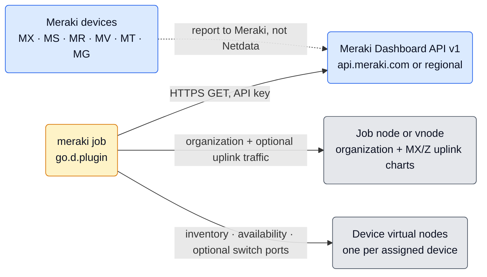
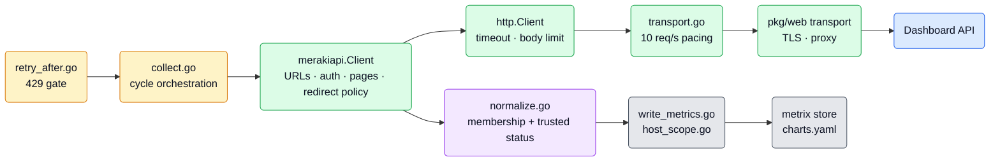
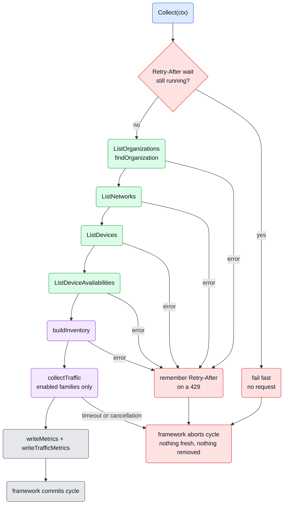
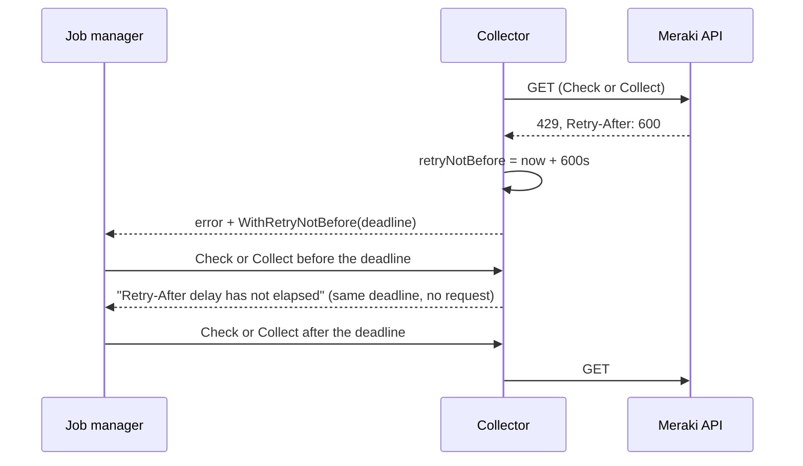

# Cisco Meraki Collector Architecture

This is a maintainer guide to the `meraki` collector, written to be read top to bottom. It starts with what the
collector is and where it sits, follows one collection cycle from start to commit, then covers the machinery around
it (device nodes, startup, the request budget, the API client) and ends with reference tables for coming back later.

**Place in the documentation set.** This file is the one record of the collector's design: the reasons behind limits,
join rules and trust boundaries that the code alone does not explain. A change to collector behavior updates it in the
same PR. Operator-facing behavior (options, permissions, limits, troubleshooting) is owned by `metadata.yaml`, the
source of the integration page.

**Path convention.** Code references are relative to `src/go/plugin/go.d/collector/meraki/`, except those starting
with `src/go/`, which are repo-relative.

## Contents

**Orientation** — [Short Version](#short-version) | [Where The Collector Sits](#where-the-collector-sits) |
[The Big Picture](#the-big-picture)

**The life of a cycle** — [Gate](#stage-1--gate-on-retry-after) | [Read](#stage-2--read-the-four-lists) |
[Join](#stage-3--join-inventory-and-availability) | [Optional Traffic](#optional-traffic) | [Write](#stage-4--write-metrics) |
[Commit](#stage-5--commit-or-abort)

**The machine around it** — [Device Nodes](#device-nodes) | [Startup And Shutdown](#startup-and-shutdown) |
[The Request Budget](#the-request-budget) | [The API Client](#the-api-client)

**Reference** — [Configuration Surface](#configuration-surface) | [Package Map](#package-map) |
[Key Invariants](#key-invariants) | [Where To Change Things](#where-to-change-things) | [Validation](#validation) |
[Sources](#sources)

## Short Version

`meraki` is a go.d framework V2 collector. One job monitors **one Meraki Dashboard organization** through the cloud
Dashboard API v1. It never talks to the devices themselves.

Every `update_every` (300 seconds by default, matching Meraki's availability refresh), one cycle:

1. **Reads** four organization lists completely, page by page: organizations, networks, assigned devices, device
   availabilities.
2. **Joins** them: the assigned-device list decides which devices exist; availability is attached only when it can be
   trusted.
3. **Optionally reads traffic** for the three independently enabled families: switch port traffic, switch port
   packet rates, and MX/Z network uplink usage. All three default to disabled.
4. **Writes** one organization gauge on the job's node, and for every assigned device an inventory gauge and an
   availability stateset on that device's own **virtual node**.

Three properties shape everything else:

- **Atomic core inventory; independent traffic.** No metric is written until every core list has been read and
  joined and optional reads have finished. A failed core request or invalid inventory aborts the cycle, so a partial
  read can never look like removed devices. Optional traffic failures leave affected gaps; a valid context allows
  inventory and successful independent observations to commit. Timeout or cancellation aborts the whole cycle.
- **Inventory decides membership; availability only decorates.** A missing, unknown or contradictory status leaves a
  gap. It is never turned into an offline observation, and an old status is never replayed as fresh.
- **The provider's budget wins.** Requests are paced to 10 per second per job, and after a 429 with `Retry-After` the
  collector sends nothing until the wait ends, including across failed startup attempts.

## Where The Collector Sits



**Framework contract.** `*Collector` implements `collectorapi.CollectorV2` (`collector.go`):

| Aspect | This collector |
| --- | --- |
| `Init()` | Validates options and builds the HTTP client and API client; no network I/O |
| `Check()` | One minimal `getOrganizationDevices` page proves access; no traversal, no metrics |
| `Collect()` | One complete read-join-write cycle, bounded by `timeout` |
| `Cleanup()` | Closes idle connections; safe before `Init` and when called twice |
| Charts | Static `charts.yaml`, context namespace `meraki` |
| State between cycles | Only the Retry-After deadline. No inventory cache, scheduler, background loop or durable state |
| Auto-detection | None. `organization_id` and credentials are required |

## The Big Picture



A useful mental split for the rest of this document:

- **`merakiapi`** decides *how to talk to Meraki safely*: URLs, authentication, pagination, redirects, decoding and
  error text. It knows nothing about metrics and interprets nothing.
- **`transport.go`** decides *how fast*; **`retry_after.go`** decides *when not to talk at all*.
- **`normalize.go`** and **`normalize_traffic.go`** decide *what the data means*: inventory membership, trusted
  statuses, interval selection and unambiguous traffic observations.
- **`write_metrics.go`**, **`write_traffic.go`** and **`host_scope.go`** decide *where it lands*: labels, virtual nodes and identities.
- The **framework** owns everything after the write: cycle commit or abort, chart materialization, host publication
  and retirement.

## The Life Of A Cycle



The whole cycle runs under one context deadline of `timeout` (60 seconds by default). It covers credential-file reads,
every page, every redirect and the pacing waits between them.

### Stage 1 — Gate on Retry-After

`checkRetryAfter` (`retry_after.go`) fails immediately while an earlier 429's wait is still running. No request is
sent, and the error carries the original deadline (see [The Request Budget](#the-request-budget)).

### Stage 2 — Read the four lists

`collect` (`collect.go`) calls the four list operations in a fixed order. Each one returns a **complete** list or
`nil` and an error; it never returns a partial list.

| Order | Operation | What the cycle takes from it |
| --- | --- | --- |
| 1 | `getOrganizations` | The configured organization's name; its absence fails the cycle |
| 2 | `getOrganizationNetworks` | Network names, joined to devices by network ID |
| 3 | `getOrganizationDevices` | Assigned devices: serial, name, model, product type, network ID |
| 4 | `getOrganizationDevicesAvailabilities` | Status and network ID per serial |

`findOrganization` (`normalize.go`) requires the configured ID in the visible list. Duplicate rows for the ID that
disagree fail the cycle rather than picking one.

The lists are read one after another, not as one atomic snapshot: Meraki can change data between requests and
between pages. Stage 3 is designed around that.

### Stage 3 — Join inventory and availability

`buildInventory` (`normalize.go`) produces one `device` per assigned serial. The assigned-device list alone decides
membership; the other lists only add metadata or status.

| Evidence | Result |
| --- | --- |
| Serial in the assigned-device list | Device exists: `device_assigned = 1` on its node |
| Known status (`online`, `alerting`, `offline`, `dormant`) for the same serial, networks compatible | One active availability state |
| No availability row, unknown or empty status | No availability value; device kept |
| Availability rows for the serial disagree | No availability value for that device only |
| Both network IDs set and different (for example, a device moved between list reads) | No availability value; device kept |
| Availability row for a serial that is not assigned | Ignored; it never creates a device |
| Identical duplicate assigned-device rows | Deduplicated |
| Assigned device without a serial, or duplicate rows that disagree | Cycle fails |
| Network belonging to another organization, or duplicate network rows that disagree | Cycle fails |
| Network row without an ID, or a device without a network | Ignored for metadata; never hides a device |

Why so strict about status, and so lenient about metadata: Meraki refreshes availability every five minutes and gives
no sample timestamp, so a status that does not clearly belong to the assigned device could be stale or misattributed.
Reporting it would invent an outage; omitting it leaves an honest gap. Missing metadata, by contrast, only makes a
label empty.

Inventory membership describes assignment, not health. Fields the collector does not read (tags, firmware, addresses)
never become identity.

### Stage 4 — Write metrics

`writeMetrics` (`write_metrics.go`) writes, for the cycle:

| Series | Scope | Value |
| --- | --- | --- |
| `organization_assigned_devices` | Job's default scope (the job node, or `vnode`) | Number of assigned devices; `0` for an empty organization |
| `device_assigned` | The device's host scope | Always `1` |
| `device_availability_status` | The device's host scope | Enum stateset, only when the status is trusted |
| `switch_port_traffic_sent`, `switch_port_traffic_received` | Assigned switch's host scope | Optional provider Kbps gauges per port |
| `switch_port_traffic_interval_age` | Assigned switch's host scope | Seconds since the accepted traffic interval ended |
| `switch_port_packets_sent`, `switch_port_packets_received` | Assigned switch's host scope | Optional provider packets/s gauges per port |
| `appliance_uplink_traffic_sent`, `appliance_uplink_traffic_received` | Job's default scope | Optional requested-window average kilobits/s per network/interface |

Chart labels: `organization_id` and `organization_name` on every series, plus `serial`, `device_name`, `model`,
`product_type`, `network_id` and `network_name` on device series. The number of devices without a usable status is
logged at debug level, once per cycle. Switch port series add `port_id` to device labels. Uplink series carry only
organization and network ID/name plus `interface`, never serial or other device labels.

### Stage 5 — Commit or abort

`Collect` returns a core error or context error when the cycle cannot commit; optional family errors are handled
before writes. On error the framework aborts: no fresh values are published, and missed cycles do not count toward
chart expiry, so a failed core read cannot retire devices. On success the framework commits, and
devices absent from a complete successful inventory stop receiving data and retire through the normal chart
lifecycle.

## Optional Traffic

`collectTraffic` (`collect_traffic.go`) runs after the complete inventory join and before any writes. Each option is
an independent boolean, default `false`; omitted, false and null retain the inventory-only contract. No cache,
background worker, scheduler or durable state is added. A single five-minute window ends at the current UTC time,
truncated to a second; switch history and MX/Z usage receive its explicit `t0` and `t1`. Packet requests use
`timespan=300`. Changing `update_every` changes polling cost, not this source window.

| Option | Source and selection | Meaning and placement |
| --- | --- | --- |
| `collect_switch_port_traffic` | Organization switch-port usage history, all pages at `perPage=50`; only currently assigned switches | Provider downstream/upstream Kbps, as received/sent gauges on the existing switch vnode, keyed by `port_id` |
| `collect_switch_port_packets` | One port packet-status request per assigned switch, in serial order; `Total` packet rates only | Provider `ratePerSec.recv` / `sent` gauges in packets/s on the existing switch vnode, keyed by `port_id` |
| `collect_appliance_uplink_usage` | One organization MX/Z uplink-usage request | Requested-window bytes × 8 / 300 / 1000 as kilobits/s gauges on the default job host or configured `vnode`, keyed by organization, network and interface |

`normalize_traffic.go` keeps measured zero and omits absent, null, negative or non-finite numbers. Byte totals must
also be integers. Unknown devices or networks cannot create telemetry entities. Identical duplicate observations
are deduplicated; conflicting observations for the same identity and source interval are omitted, never summed.
A switch-history row whose network contradicts current assignment suppresses that switch's traffic-history
observations; independent packet requests remain unaffected.

For switch traffic, the accepted interval lasts exactly 300 seconds and ends after `t0` and no later than `t1`.
Provider alignment may put its start before `t0`. The latest accepted interval wins; invalid timestamps, wrong
durations, older or future intervals are omitted. `switch_port_traffic_interval_age` is the elapsed time since the
accepted interval ended. It is not a completeness guarantee. Packet endpoints warn that current five-minute data
may be incomplete; MX/Z usage has no documented refresh delay or returned sample timestamp. All rates are gauges,
not cumulative counters. Charts publish at observation time without backfill or accumulation of overlapping windows.

MX/Z totals are network/interface aggregates. Cisco documents aggregation when multiple devices were active during
the requested window. The result's serial cannot prove ownership across HA failover or appliance replacement, so
serial is deliberately absent from the metric identity and labels; no uplink usage is written to a device vnode.
Current inventory cannot reconstruct historical attribution.

An optional API error produces a bounded warning and leaves gaps for that family, or just the affected switch for
packet errors. Other enabled families continue. A 429 immediately remembers any valid Retry-After and stops further
requests in that cycle, even when no valid wait was provided. Successful core and independent telemetry can commit
only while the whole-operation context remains valid. Core errors retain their all-or-nothing behavior. A whole
operation timeout or cancellation aborts everything, including already collected optional data.

## Device Nodes

Every assigned device is a separate Netdata node (`deviceHostScope`, `host_scope.go`).

**Identity.** The GUID is a SHA1 UUID in the DNS namespace over `meraki:<len(organization ID)>:<organization
ID><serial>`. The length prefix keeps the two opaque IDs from running into each other (`a` + `b:c` differs from
`a:b` + `c`). The GUID is also the scope key. Names and networks are not part of it, so renames and network moves keep
the node.

**Hostname.** The device name when it is wire-safe, `meraki-<serial>` when the device has no name, and
`meraki-<GUID>` when the name contains characters `chartemit.PrepareHostInfo` rejects.

**Host labels.** `_vnode_type=meraki_device`, `organization_id`, `serial`, `device_name`, `model`, `product_type`,
`network_id`, `network_name`.

**Why `device_assigned` exists.** V2 discovers live host scopes from fresh series and publishes a host only when it
has chart actions. Without a series that is always present, a device with no trusted status would have no node at
all. The inventory gauge anchors the node; the availability chart comes and goes with the status.

**No Vec cache.** Device instruments are bound to the host scope and labels inside each cycle instead of living in a
`Vec`. A `Vec` keeps every label tuple it has seen forever, and device and network names change.

**Lifecycle.** Host publication and ownership (including configured host authority), chart expiry and host retirement
belong to the framework. Retirement stops the node's charts; it does not promise deletion of the node's history.

**Cardinality.** One node per assigned serial, each with one inventory chart and, while its status is trusted, one
availability chart. Enabling traffic adds up to three charts per switch port and one chart per MX/Z network
uplink on the default host. There is no device filter.

## Startup And Shutdown

**Init** (`collector.go`, `init.go`):

1. `validateConfig` checks what the client does not: a nonempty `organization_id` without surrounding whitespace and
   other than `.` or `..`, a positive `timeout`, and `tls_cert` together with `tls_key`. Failing here, rather than in
   Check, matters: the framework never retries an Init error.
2. `initClient` builds the shared `pkg/web` transport (TLS files, proxy), wraps it in `pacedTransport`, then in the
   standard `web` client policy (a per-request timeout equal to `timeout`, the default response body limit). TLS files
   are read through the same reduced-authority credential-file helper as the bearer token file.
3. `merakiapi.New` validates the base URL and credentials and installs the redirect policy. Nothing touches the
   network.

Transport errors at this step are replaced by a fixed message, because the underlying text can echo a proxy URL with
credentials.

**Check** runs `ProbeOrganization`: one `getOrganizationDevices` request with `perPage=3`, decoded and validated like
any page, pagination ignored, nothing written. An empty page passes: an organization without devices is valid.
Listing organizations cannot serve as the probe: Meraki exempts that call from the organization's API source-IP
restrictions, so it can succeed where every organization call would fail.

**Cleanup** closes idle connections of the collector's own HTTP client.

## The Request Budget

Meraki documents shared budgets of **10 requests per second per organization** and **100 per source IP**. Other jobs,
other Agents and other applications draw from the same budgets, so the collector can only limit its own share.

**Pacing.** `pacedTransport` (`transport.go`) spaces the start of every HTTP request of a job by at least 100 ms. It
sits below `http.Client`, so it covers every page and every redirect hop, not just every list call. A context
cancelled during the wait returns without sending.

**Retry-After.** The sequence below describes a surfaced error from Check or core collection. Optional traffic
errors remember the same wait immediately but can still permit a successful cycle with affected gaps.




- Only a 429 with a positive, parseable `Retry-After` (delta-seconds or HTTP date) sets a deadline. Retry-After on
  other statuses is ignored.
- There is no sleep, retry loop or background timer: the next Check or Collect simply fails fast until the deadline.
- Every such error carries the absolute deadline through `collectorapi.WithRetryNotBefore`. The job manager disposes a
  collector whose startup failed and builds a new one for the next attempt; the annotation lets it keep the minimum
  wait across that reconstruction. Repeated fast failures keep the original deadline instead of restarting the wait.
- The annotation only delays an automatic retry that was already allowed. It grants no retry permission and does not
  schedule collections; the framework's rules for manual and fresh activations still apply
  (`src/go/plugin/go.d/docs/how-to-write-a-collector.md#registration-and-lifecycle`).

For `S` assigned switches, all three traffic options add approximately `ceil(S / 50) + S + 1` requests before
redirects. Switch history is skipped when no switches are assigned; the enabled MX/Z operation is still one request.
At 1,000 switches, 1,021 extra requests require about 102 seconds of pacing alone, beyond the default 60-second
whole-operation timeout. Operators can increase the existing timeout or leave packets disabled. No new tuning knobs
or fleet caps are introduced.

## The API Client

`merakiapi` is a collector-local client for seven read-only Dashboard API v1 operations. It returns provider data
as-is: IDs stay opaque strings, missing inventory fields decode as empty values, optional numeric fields retain
missing/null separately from zero, and unknown product types or statuses pass through uninterpreted. Callers validate what they rely on, because the provider schema marks none of these fields
required.

### Operations

The four inventory `GET` operations return bare JSON arrays, without entity filters or a generic query option.

| Method | Path below `/api/v1` | First `perPage` | Accepted `perPage` |
| --- | --- | --- | --- |
| `ListOrganizations` | `/organizations` | 9000 | 3–9000 |
| `ListNetworks` | `/organizations/{organizationId}/networks` | 1000 | 3–100000 |
| `ListDevices` | `/organizations/{organizationId}/devices` | 1000 | 3–5000 |
| `ListDeviceAvailabilities` | `/organizations/{organizationId}/devices/availabilities` | 1000 | 3–1000 |

`ListDevices` returns devices assigned to networks, not the organization's unused inventory. `ProbeOrganization`
reuses the devices operation with `perPage=3` and returns no data. The organization ID is path-escaped; `.` and `..`
are rejected because escaping keeps dot segments.

Traffic operations (`merakiapi/traffic.go`) share authentication, redirects, pacing, cancellation and bounded
response decoding. They do not invent pagination on unpaginated endpoints:

| Method | Path below `/api/v1` | Query / response |
| --- | --- | --- |
| `ListSwitchPortUsageHistory` | `/organizations/{organizationId}/switch/ports/usage/history/byDevice/byInterval` | Fixed `t0`, `t1`; `perPage=50`; paginated `items` envelope |
| `GetSwitchPortPackets` | `/devices/{serial}/switch/ports/statuses/packets` | `timespan=300`; bare array; no `perPage` |
| `GetApplianceUplinkUsage` | `/organizations/{organizationId}/appliance/uplinks/usage/byNetwork` | Fixed `t0`, `t1`; bare array; no `perPage` |

Switch-history next links may omit fixed window parameters; the client restores them. A conflicting window, unknown
parameter or changed interval is rejected. `interval=300` is accepted only for the exact 300-second request and
removed because the documented API computes the interval from its time range. The `items` envelope and its array
must be present and non-null, with no trailing payload. Returned interval validity belongs to normalization.

The response types (`merakiapi/types.go` and `merakiapi/traffic_types.go`) carry only fields the collector reads.
Everything else in a payload (addresses, coordinates, notes, IMEI, enrollment strings, management details) is
discarded at decode time.

### Construction and ownership

`New(cfg, httpClient)` performs no network I/O. The caller owns the `*http.Client`: TLS, proxy, request timeout,
response body limit, transport lifetime and idle connections. `New` copies the client to install its redirect policy
and leaves the original unchanged.

Construction requires:

- an HTTPS base URL with path `/api/v1` and no user info, query or fragment (default
  `https://api.meraki.com/api/v1`; regional bases are `api.meraki.ca`, `api.meraki.cn`, `api.meraki.in` and
  `api.gov-meraki.com`);
- exactly one of an inline API key (no CR or LF) or a bearer token file.

Methods are safe for concurrent use, subject to the transport. The client does not coordinate budgets between calls,
jobs or processes; pacing is the collector's job.

### Authentication

Every page and every accepted redirect builds a new request through `web.NewHTTPRequest` with the operation's
context. A bearer token file is read again each time through the shared reduced-authority credential-file helper, so
a rotated key applies on the next request. There is no credential cache. A request that ends up without an
`Authorization` header is refused: `pkg/web` silently skips a missing optional Kubernetes service-account token file,
and a Meraki request must never go out unauthenticated. API keys can use the framework's secret references
(`${env:...}`, `${file:...}`).

### Pagination

`list` (`client.go`) and `pagination.go` implement Meraki's Link-header pagination:

- Follow `rel="next"` until it is absent, including through empty intermediate pages. Never generate a cursor from
  the last record or infer the end from a short page.
- Read every `Link` header value and parse the RFC 8288 framing, because targets and quoted parameters can contain
  commas. The first `rel` of a link wins; extension parameters are ignored. A next link with an `anchor` (a different
  link context) is an error, not a last page.
- Resolve relative targets against the final URL of the response, including after a validated redirect.
- Accept a next link only on a trusted host (see below), on the same operation path, with only `perPage`,
  `startingAfter` and `endingBefore`, and a `perPage` within the operation's range.
- Reject malformed or conflicting links and any canonical page URL seen before (a pagination cycle).
- A failed later page fails the whole list. There is no fixed page or record ceiling: the caller's context deadline
  bounds the traversal, and cancellation reaches in-flight requests and credential reads.

### Redirects and host trust

Meraki can redirect a `GET` to a regional shard host and requires authentication there. Go drops `Authorization` when
a redirect leaves the original host, so `checkRedirect` (`redirect.go`) rebuilds authentication, but only after
validating the destination:

- the same path and the same query meaning as the original request, `GET` only, at most ten hops (installing
  `CheckRedirect` removes Go's default limit, so the client keeps it);
- HTTPS without user info or fragment;
- the configured origin, or, for an official regional base on port 443, that region's `api.<root>` host and shard hosts
  of the form `n<digits>.<root>` and `n<digits>.dashboard.<root>`.

Cross-region hosts, lookalikes and every other host are rejected. A non-official origin (a proxy or private endpoint)
trusts only itself. Next links pass the same check, and every operation starts again at the configured base. A proxy
must therefore rewrite Meraki's `Location` and `Link` headers to its own address; otherwise any list longer than one
page fails with `invalid pagination target`.

The shard grammar is a conservative reading of Cisco's published examples, not an exhaustive vendor list. A new form
fails with an error and needs evidence before the trust rule is widened.

### Decoding and response limits

- Only `200` is a success. Anything else becomes an `HTTPError`; `204` is not an empty list.
- Array responses must be exactly one non-null JSON array of non-null items, followed only by whitespace. Switch
  history instead requires one non-null `items` envelope containing such an array.
- Bodies are read through `web.LimitResponseBody` with the HTTP client's limit (64 MiB by default); a larger body
  fails with `web.ErrResponseTooLarge`.
- Standard gzip is decompressed by `net/http`. Any other `Content-Encoding` still present is an error; a custom
  transport must decompress before returning.

### Errors

- `HTTPError` keeps the operation name, the status and the parsed `Retry-After` delay (zero when absent, invalid, in
  the past or overflowing). It keeps no body, URL or header. There are no automatic retries.
- HTTP statuses are not interpreted as removal or missing capability: Meraki also answers 404 to some authorization
  failures, and a successful organization listing does not prove access to the organization.
- `transportError` reports a request that got no HTTP response as `<operation>: HTTP request failed: <cause>`, keeping
  the cause (DNS, connection, TLS, proxy, refused redirect, timeout) so operators can tell failures apart, as other
  go.d collectors do. It drops the `url.Error` wrapper, whose URL can be a server-supplied redirect or page target. The
  cause can still carry diagnostic names, such as a certificate name. An unparsable `Location` header gets a fixed
  parse-failure message because `net/http` otherwise quotes the raw value before the redirect policy can inspect it.
  Refused redirects and pages also use fixed messages; credentials travel only in headers.
- `safeError` covers credential-file reads and response decoding, whose errors can carry file contents or response
  data. It keeps only `context.Canceled`, `context.DeadlineExceeded` and `web.ErrResponseTooLarge` (still matchable
  with `errors.Is`) and otherwise reports a fixed message.
- Error text never includes response bodies, the request URL, `Link` values or credentials.

## Configuration Surface

Every option maps to an operator decision; implementation tuning (page sizes, pacing, retries) is not configurable.

| Option | Operator decision | Default | Validated by |
| --- | --- | --- | --- |
| `organization_id` | Which organization this job monitors | required | `validateConfig`; path safety in the client |
| `url` | Regional API endpoint, or an authorized proxy or private endpoint | global endpoint | `merakiapi.New` |
| `api_key` | The API key, inline or as a secret reference | empty | `merakiapi.New` (exactly one credential) |
| `bearer_token_file` | A file holding the key, reread for rotation | empty | `merakiapi.New` (exactly one credential) |
| `update_every` | Polling cadence and API cost | 300 s | framework |
| `autodetection_retry` | Retry a failed start | 0 (off) | framework |
| `timeout` | Budget of one whole Init, Check or Collect | 60 s | `validateConfig` (must be positive) |
| `collect_switch_port_traffic` | Enable reported switch traffic and interval age | false | Go boolean decoding |
| `collect_switch_port_packets` | Enable switch packet rates at one request per switch | false | Go boolean decoding |
| `collect_appliance_uplink_usage` | Enable MX/Z network/interface average traffic | false | Go boolean decoding |
| `vnode` | Placement of organization and uplink charts; device nodes are unaffected | empty | framework |
| `proxy_url` | Egress route | environment | `pkg/web` |
| `tls_ca`, `tls_cert`, `tls_key`, `tls_skip_verify` | Trust and client identity for a proxy or private endpoint | empty, `no` | `validateConfig` (cert and key together), `pkg/tlscfg` |

The generic HTTP options of other go.d collectors (method, body, basic auth, custom headers, `not_follow_redirects`,
`force_http2`) are deliberately absent: there is no operator need for them, and redirect and authentication policy
belong to the client. Authentication is two flat fields with a mutual-exclusion check rather than a mode switch, so
the form has no hidden branch state.

## Package Map

| File | Responsibility |
| --- | --- |
| `collector.go` | Registration, `New`, the `CollectorV2` lifecycle methods |
| `config.go` | `Config`, defaults, `validateConfig` |
| `init.go` | HTTP client and API client construction |
| `collect.go` | One cycle: read the four lists, join, optional reads, write |
| `collect_traffic.go` | Enabled source windows, optional family reads, bounded warnings and 429 stop |
| `normalize_traffic.go` | Interval selection, numeric validity, duplicate ambiguity and uplink scope |
| `write_traffic.go` | Switch port and network/interface gauges and labels |
| `normalize.go` | `findOrganization`, `buildInventory` and the status trust rule |
| `metrix.go` | Metric names, the availability vocabulary, the organization instrument |
| `write_metrics.go` | Organization and device observations, debug count of unknown statuses |
| `host_scope.go` | Device virtual node identity, hostname and labels |
| `retry_after.go` | The 429 Retry-After gate and its framework annotation |
| `transport.go` | Request pacing |
| `charts.yaml` | Chart template |
| `merakiapi/client.go` | `Client`, `New`, the four operations and the probe, traversal, page fetch and decoding |
| `merakiapi/pagination.go` | Next-link scope check and RFC 8288 Link parsing |
| `merakiapi/redirect.go` | Host trust, regional roots and the redirect policy |
| `merakiapi/errors.go` | `HTTPError`, Retry-After parsing, `transportError`, `safeError` |
| `merakiapi/types.go`, `merakiapi/traffic_types.go` | Minimal response types |
| `merakiapi/traffic.go` | Traffic queries, envelope decoding and fixed-window pagination |

## Key Invariants

**Cycle**

- No metric is written before the four core lists are read and joined and optional reads finish. Core and context
  errors abort the cycle; optional errors leave affected gaps without changing inventory membership.
- A failed cycle never retires a device; only a complete successful inventory can.
- An empty organization is a valid inventory and reports `0`.

**Meaning**

- Only the assigned-device list creates devices.
- A status is attached only when known, unambiguous and network-compatible; otherwise it is a gap, never `offline`.
- No status is replayed from an earlier cycle, and request time is never presented as the provider sample time.
- Traffic rates are gauges for reported windows, not monotonic counters or historical backfill.
- Uplink usage is network/interface scoped and never attributed to a device serial.

**Identity**

- A device GUID depends only on the organization ID and serial. Changing the derivation re-keys every node.
- Names, models and networks are labels, never identity.

**Requests**

- Credentials go only to the configured origin or the same region's API and shard hosts.
- Nothing is sent before a pending Retry-After deadline.
- Request starts per job are at least 100 ms apart, including pages and redirect hops.
- Error text carries no response body, request URL or credential; transport failures keep their cause.

## Where To Change Things

| Change | Where | Watch out for |
| --- | --- | --- |
| Add a metric from data already read | `merakiapi/types.go` (field), `normalize.go`, `metrix.go`, `write_metrics.go`, `charts.yaml`, `metadata.yaml` | Label documentation is checked against emitted series (`TestMetadataDocumentsEmittedLabels`) |
| Add an API operation | `merakiapi/client.go` (new `operation`, method), `collect.go` | Its page-size range, its effect on request count in `metadata.yaml`, and whether its failure must fail the cycle |
| Trust a new shard host form | `isShardName` / `trustedTarget` in `merakiapi/redirect.go` | Needs published evidence; add accept and reject cases to `merakiapi/redirect_test.go` |
| Add a region | `regionalRoots` in `merakiapi/redirect.go`, the `url` option text in `metadata.yaml` | Shard hosts follow automatically |
| Change the status trust rule | `availabilityStatus.trusted` in `normalize.go` | The truth table above and `TestMissingOrAmbiguousAvailability` |
| Change pacing | `requestSpacing` in `transport.go` | Meraki's published budget; `metadata.yaml` limits text |
| Change device identity | `deviceHostScope` in `host_scope.go` | Breaks node continuity for every existing installation |

## Validation

| Test | Covers |
| --- | --- |
| `TestConfigurationSerialize`, `TestInit`, `TestBeforeInit` | Config round trip, option validation, lifecycle before `Init` |
| `TestCheckIsOneOrganizationScopedPage` | The probe: one request, no pagination, no metrics |
| `TestAvailabilityStatesAndPagination`, `TestMissingOrAmbiguousAvailability` | All four states, paginated lists, the status trust rule |
| `TestDiscoveryFailureRecoveryAndRemoval`, `TestInvalidDiscovery` | Failed pages, recovery, renames, removals, cycle-failing inventory |
| `TestRetryAfterPreventsEarlyRequests`, `TestCheckExportsRetryAfterMinimum`, `TestCheckDoesNotInventRetryAfterMinimum` | The Retry-After gate and the startup annotation |
| `TestOperationDeadlineAndCancellation`, `TestPacingCoversRedirectsPagesAndCancellation` | `timeout`, cancellation, pacing across pages and redirects |
| `TestDeviceHostIdentity`, `TestManagedDevicePublicationAndRetirement` | GUID stability, hostname fallback, real `JobV2` publication and retirement |
| `TestIntegrationArtifacts`, `TestMetadataDocumentsEmittedLabels` | Chart template, metadata, schema and label drift |
| `TestTrafficMethods`, `TestSwitchUsagePagination`, `TestSwitchUsageLatePageFailure` | Exact traffic queries, fixed windows, next-link safety and complete-history reads |
| `TestTrafficDecodeFailures`, `TestTrafficValidationAndCancellation`, `TestSwitchUsageEnvelopeHTTPPolicy` | Envelope/array shape, numeric presence, cancellation, HTTP and redirect policy |
| `merakiapi` tests | Construction, credentials (through the shipped credential-file path with a subprocess peer), pagination, trusted redirects, gzip and body limits, cancellation, status and Retry-After errors, transport error text |

Run from `src/go`:

```bash
go test -race -count=1 ./plugin/go.d/collector/meraki/...
```

Tests use local HTTPS fixture servers and synthetic payloads shaped by the OpenAPI schemas
(`merakiapi/testdata/`); none contains real organization or device data. Privilege transitions of the credential-file
helper are tested by its own suite. No live Meraki organization, fleet-scale run or regional shard redirect has been
exercised.

## Sources

The source contract is `meraki/openapi @ 23cd4b4ea6d06803903d41795acc717047695b4e`, `openapi/spec3.json` (API
v1.75.1, 2026-10-16).

- [Stable OpenAPI specification](https://github.com/meraki/openapi/blob/23cd4b4ea6d06803903d41795acc717047695b4e/openapi/spec3.json)
- [Getting started and regional URLs](https://developer.cisco.com/meraki/api-v1/getting-started/)
- [Authentication](https://developer.cisco.com/meraki/api-v1/authorization/)
- [Pagination](https://developer.cisco.com/meraki/api-v1/pagination/)
- [RFC 8288 Web Linking](https://www.rfc-editor.org/rfc/rfc8288#section-3)
- [Rate limits](https://developer.cisco.com/meraki/api-v1/rate-limit/)
- [Switch port usage history](https://developer.cisco.com/meraki/api-v1/get-organization-switch-ports-usage-history-by-device-by-interval/)
- [Switch port packet status](https://developer.cisco.com/meraki/api-v1/get-device-switch-ports-statuses-packets/)
- [MX/Z network uplink usage](https://developer.cisco.com/meraki/api-v1/get-organization-appliance-uplinks-usage-by-network/)
- [Device availabilities](https://developer.cisco.com/meraki/api-v1/get-organization-devices-availabilities/)
- [Status codes, redirects and access restrictions](https://documentation.meraki.com/Platform_Management/Dashboard_Administration/Operate_and_Maintain/How-Tos/How_to_Use_the_Cisco_Meraki_Dashboard_API)
- [API base and shard URL guidance](https://documentation.meraki.com/Platform_Management/Dashboard_Administration/Troubleshooting_and_Support/Troubleshooting/Meraki_Dashboard_URL_Update_-_PCI_Compliance)
