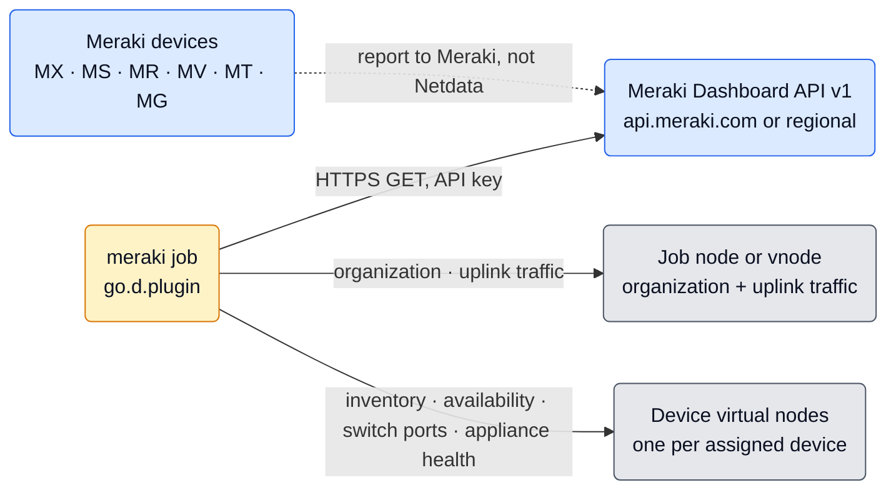
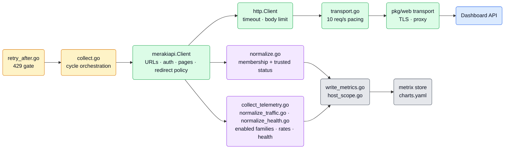
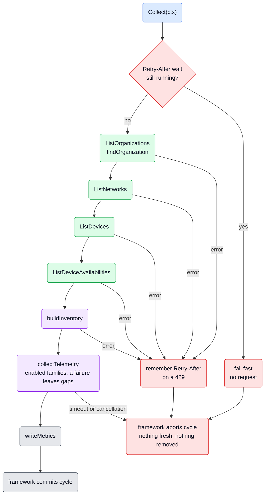
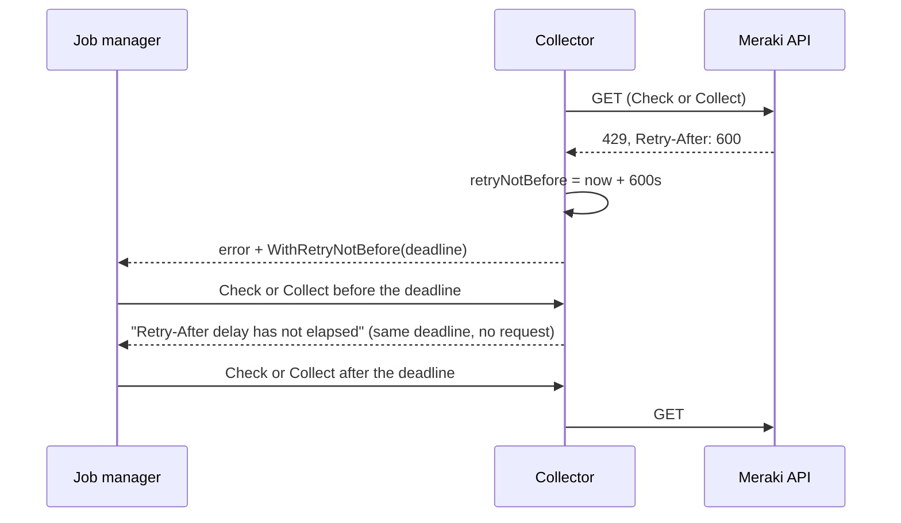

# Cisco Meraki Collector Architecture

This is a maintainer guide to the `meraki` collector, written to be read top to bottom. It starts with what the
collector is and where it sits, follows one collection cycle from start to commit (inventory first, then the optional
telemetry), then covers the machinery around it (device nodes, startup, the request budget, the API client) and ends
with reference tables for coming back later.

**Place in the documentation set.** This file is the one record of the collector's design: the reasons behind limits,
join rules and trust boundaries that the code alone does not explain. A change to collector behavior updates it in the
same PR. Operator-facing behavior (options, permissions, limits, troubleshooting) is owned by `metadata.yaml`, the
source of the integration page.

**Path convention.** Code references are relative to `src/go/plugin/go.d/collector/meraki/`, except those starting
with `src/go/`, which are repo-relative.

> [!WARNING]
> **Open item: the traffic read windows are not measured against a live Meraki organization.**
>
> Meraki documents no delay between the end of a traffic interval and its publication. The collector therefore looks
> for the latest switch port usage interval in the last **15 minutes** (`usageLookback`) and reads uplink bytes for
> the 5 minutes that ended **5 minutes** ago (`uplinkDelay`), both in `collect_telemetry.go`. Both values are informed
> guesses. If the real delay is longer, switch port traffic gaps and uplink traffic reads low.
>
> The live measurement is tracked in [issue #24614](https://github.com/netdata/netdata/issues/24614).
>
> Measure on a real organization, then set both constants and the matching `metadata.yaml` and `config_schema.json`
> text from the result:
>
> 1. Request `getOrganizationSwitchPortsUsageHistoryByDeviceByInterval` for the last 30 minutes at several offsets
>    after a 5-minute boundary. Record how long after an interval ends it first appears.
> 2. Request it for a 15-minute window and record the `interval` Meraki derives (the collector accepts 5 min, 20 min,
>    4 h and 1 day).
> 3. Read `getOrganizationApplianceUplinksUsageByNetwork` for one 5-minute window right after it ends and again 5, 10
>    and 15 minutes later. Record when the byte totals stop growing.

## Contents

**Orientation** — [Short Version](#short-version) | [Where The Collector Sits](#where-the-collector-sits) |
[The Big Picture](#the-big-picture)

**The life of a cycle** — [Gate](#stage-1--gate-on-retry-after) | [Read](#stage-2--read-the-four-lists) |
[Join](#stage-3--join-inventory-and-availability) | [Telemetry](#stage-4--read-the-enabled-telemetry) |
[Write](#stage-5--write-metrics) | [Commit](#stage-6--commit-or-abort)

**The machine around it** — [Device Nodes](#device-nodes) | [Startup And Shutdown](#startup-and-shutdown) |
[The Request Budget](#the-request-budget) | [The API Client](#the-api-client)

**Reference** — [Configuration Surface](#configuration-surface) | [Package Map](#package-map) |
[Key Invariants](#key-invariants) | [Where To Change Things](#where-to-change-things) | [Validation](#validation) |
[Sources](#sources)

## Short Version

`meraki` is a go.d framework V2 collector. One job monitors **one Meraki Dashboard organization** through the cloud
Dashboard API v1. It never talks to the devices themselves.

Every `update_every` (300 seconds by default, matching Meraki's availability refresh), one cycle:

1. **Reads** four organization lists completely, page by page: organizations, networks, assigned devices, device
   availabilities.
2. **Joins** them: the assigned-device list decides which devices exist; availability is attached only when it can be
   trusted.
3. **Reads the enabled telemetry**, each family behind its own option and off by default: switch port traffic (the
   latest interval Meraki reported in the last 15 minutes), MX/Z uplink traffic (the 5 minutes that ended 5 minutes
   ago), switch port packet rates (the last 5 minutes), and appliance uplink health (latest MX ICMP samples from
   seven to two minutes ago, plus appliance uplink states and device report age).
4. **Writes** the organization gauge and uplink traffic on the job's node, and for every assigned device an inventory
   gauge, an availability stateset and optional switch port traffic or appliance health on that device's own **virtual
   node**.

Four properties shape everything else:

- **All or nothing for inventory, gaps for optional telemetry.** No metric is written until every list has been read and
  joined and the enabled telemetry has been read. A failed list or an invalid inventory aborts the cycle, so a partial
  read can never look like removed devices. A failed optional read only leaves gaps in its own charts, except a 429,
  which also skips every remaining optional read. A timeout or cancellation aborts the whole cycle.
- **Inventory decides membership; availability only decorates.** A missing, unknown or contradictory status leaves a
  gap. It is never turned into an offline observation, and an old status is never replayed as fresh.
- **Traffic is what Meraki reported, or nothing.** Values are averages Meraki reports for a window, written as gauges. A
  missing or contradictory value is a gap, never a zero or a sum, and uplink bytes, which Meraki can add up over
  several appliances, never land on a device node.
- **The provider's budget wins.** Requests are paced to 10 per second per job, and after a 429 with `Retry-After` the
  collector sends nothing until the wait ends, including across failed startup attempts.

## Where The Collector Sits



**Framework contract.** `*Collector` implements `collectorapi.CollectorV2` (`collector.go`):

| Aspect | This collector |
| --- | --- |
| `Init()` | Validates options and builds the HTTP client and API client; no network I/O |
| `Check()` | One minimal `getOrganizationDevices` page proves access; no traversal, no metrics |
| `Collect()` | One complete read, join, telemetry and write cycle, bounded by `timeout` |
| `Cleanup()` | Closes idle connections; safe before `Init` and when called twice |
| Charts | Static `charts.yaml`, context namespace `meraki` |
| State between cycles | Only the Retry-After deadline. No inventory cache, scheduler, background loop or durable state |
| Auto-detection | None. `organization_id` and credentials are required |

## The Big Picture



A useful mental split for the rest of this document:

- **`merakiapi`** decides *how to talk to Meraki safely*: URLs, authentication, pagination, redirects, decoding and
  error text. It knows nothing about metrics and interprets nothing.
- **`transport.go`** decides *how fast*; **`retry_after.go`** decides *when not to talk at all*.
- **`normalize.go`**, **`normalize_traffic.go`** and **`normalize_health.go`** decide *what the data means*: which
  devices exist, which statuses are trustworthy, which traffic interval counts and which values are unambiguous.
  **`collect_telemetry.go`** decides which optional families to read and when to stop: one flow, so a 429 in any family
  skips every later request.
- **`write_metrics.go`** and **`host_scope.go`** decide *where it lands*: labels, virtual nodes and identities.
- The **framework** owns everything after the write: cycle commit or abort, chart materialization, host publication
  and retirement.

## The Life Of A Cycle



The whole cycle runs under one context deadline of `timeout` (60 seconds by default). It covers credential-file reads,
every page, every redirect and the pacing waits between them.

### Stage 1 — Gate on Retry-After

`checkRetryAfter` (`retry_after.go`) fails immediately while an earlier 429's wait is still running. No request is
sent, and the error carries the original deadline (see [The Request Budget](#the-request-budget)).

### Stage 2 — Read the four lists

`collect` (`collect.go`) calls the four list operations in a fixed order. Each one returns a **complete** list or
`nil` and an error; it never returns a partial list.

| Order | Operation | What the cycle takes from it |
| --- | --- | --- |
| 1 | `getOrganizations` | The configured organization's name; its absence fails the cycle |
| 2 | `getOrganizationNetworks` | Network names, joined to devices by network ID |
| 3 | `getOrganizationDevices` | Assigned devices: serial, name, model, product type, network ID |
| 4 | `getOrganizationDevicesAvailabilities` | Status and network ID per serial |

`findOrganization` (`normalize.go`) requires the configured ID in the visible list. Duplicate rows for the ID that
disagree fail the cycle rather than picking one.

The lists are read one after another, not as one atomic snapshot: Meraki can change data between requests and
between pages. Stage 3 is designed around that.

### Stage 3 — Join inventory and availability

`buildInventory` (`normalize.go`) produces one `device` per assigned serial. The assigned-device list alone decides
membership; the other lists only add metadata or status.

| Evidence | Result |
| --- | --- |
| Serial in the assigned-device list | Device exists: `device_assigned = 1` on its node |
| Known status (`online`, `alerting`, `offline`, `dormant`) for the same serial, networks compatible | One active availability state |
| No availability row, unknown or empty status | No availability value; device kept |
| Availability rows for the serial disagree | No availability value for that device only |
| Both network IDs set and different (for example, a device moved between list reads) | No availability value; device kept |
| Availability row for a serial that is not assigned | Ignored; it never creates a device |
| Identical duplicate assigned-device rows | Deduplicated |
| Assigned device without a serial, or duplicate rows that disagree | Cycle fails |
| Network belonging to another organization, or duplicate network rows that disagree | Cycle fails |
| Network row without an ID, or a device without a network | Ignored for metadata; never hides a device |

Why so strict about status, and so lenient about metadata: Meraki refreshes availability every five minutes and gives
no sample timestamp, so a status that does not clearly belong to the assigned device could be stale or misattributed.
Reporting it would invent an outage; omitting it leaves an honest gap. Missing metadata, by contrast, only makes a
label empty.

Inventory membership describes assignment, not health. Fields the collector does not read (tags, firmware, addresses)
never become identity.

### Stage 4 — Read the enabled telemetry

`collectTelemetry` (`collect_telemetry.go`) runs after the join and before any write, and only when at least one
optional family is enabled. Every family has its own window, measured from the current time truncated to the second:
appliance ICMP samples the 5 minutes that ended 2 minutes ago, switch port usage the last 15 minutes, uplink usage the
5 minutes that ended 5 minutes ago, packets the last 300 seconds. `update_every` changes how often they are read, not
the windows.

> [!WARNING]
> The 15-minute lookback and the 5-minute uplink delay are not measured against a live organization. See the open item
> at the top of this document.

| Family | Option | Request | Taken from it |
| --- | --- | --- | --- |
| Switch port traffic | `collect_switch_port_traffic` | `getOrganizationSwitchPortsUsageHistoryByDeviceByInterval` with `t0`/`t1` for the last 15 minutes, every page; skipped when no switch is assigned | Per port, `upstream`/`downstream` kilobits/s of the latest accepted interval as sent/received, and the interval's end |
| Uplink traffic | `collect_appliance_uplink_traffic` | `getOrganizationApplianceUplinksUsageByNetwork` with `t0`/`t1` for the 5 minutes that ended 5 minutes ago | Per network and interface, sent/received bytes × 8 / 300 / 1000 as kilobits/s |
| Switch port packets | `collect_switch_port_packets` | `getDeviceSwitchPortsStatusesPackets` with `timespan=300`, one per assigned switch in serial order | Per port, `ratePerSec.sent`/`recv` of the `Total` category |

The appliance status and probe reads ([Appliance uplink health](#appliance-uplink-health)) run first, then the families
in this table in table order, so packets, the one family that costs a request per switch, runs last. Only assigned
switches (`productType` `switch`) get port traffic, and only networks in the organization's network list get uplink
traffic.

`normalize_traffic.go` turns the responses into values with one rule set; the network and duplicate rules are the
shared `trustedSerials` and `observations` of `normalize.go`:

| Evidence | Result |
| --- | --- |
| A measured `0` | `0` |
| A missing, `null`, negative or non-finite value | Gap for that direction only |
| A byte total that is not a whole number | Gap for that direction |
| A port or interface without an ID, a serial that is not an assigned switch, a network not in the network list | Ignored |
| Identical duplicate observations of one port, interval or uplink | One observation |
| Duplicates that disagree | Gap for that port or uplink, never a sum |
| A usage row naming a network other than the switch's assigned one | No port traffic for that switch this cycle; packets unaffected |
| An interval with an unparsable timestamp, a length other than Meraki's 5 minutes, 20 minutes, 4 hours or 1 day (a clipped or unfinished one), or an end at or before `t0` or after `t1` | Ignored; Meraki aligns intervals, so one may start before `t0` |
| Several accepted intervals for a port | The latest wins; if it holds no value, the port has a gap rather than an older value |

Why the windows: Meraki publishes an interval some time after it ends and documents no delay, and each job collects at
a fixed offset from Meraki's 5-minute boundaries, because the go.d scheduler ticks from plugin start. A window as short
as one interval would gap at every collection whenever the delay is longer than that offset; three intervals leave
room for about ten minutes. Meraki derives the interval length from the window, so every documented length is
accepted. Uplink bytes are read from a window that ended five minutes earlier because the newest bytes may not be
counted yet; Meraki warns the same about the last five minutes of switch port and packet data. Packets have no
earlier window to read: the endpoint only takes a time span ending now.

Why the rules: these are averages over Meraki's windows, not counters, so there is nothing to derive and nothing to
carry over between cycles; a value Meraki did not report cannot be filled in. The interval age shows how old the
accepted interval is, which is all the API reveals about freshness. When more than one appliance of a network was
active, Meraki adds up their uplink bytes per interface, and the serial it reports cannot prove which appliance carried
the traffic, so uplinks belong to the network.

A failed read goes through `stopTelemetry`: it records a usable `Retry-After` at once (the cycle itself can still
succeed), logs at most one warning per family per hour, and leaves that family's gaps, or one switch's gaps for a failed
packet request. Two cases skip every remaining optional request: a 429, even without a usable `Retry-After`, and the end
of the context. `collect` checks the context again before writing, so a timeout or cancellation during optional
telemetry still aborts the whole cycle, inventory included.

### Appliance uplink health

`collect_appliance_uplink_health` is one boolean, off by default. It adds two reads before the traffic families:
`getOrganizationApplianceUplinkStatuses` (paginated, 1,000 appliances per page) and
`getOrganizationDevicesUplinksLossAndLatency` (one organization-wide unpaginated GET). Both are skipped without
assigned devices whose `productType` is `appliance`. Neither response creates device membership. Meraki documents
status for MX, Z and Secure Router, but only devices listed with product type `appliance` are read; whether Secure
Routers are listed that way is not verified. ICMP loss and latency are documented for MX only.

Health joins by assigned serial, and an appliance with a row naming another network gets nothing from that response
(`trustedSerials`, the rule switch port traffic uses). Both responses report per serial, so each appliance of a warm
spare pair keeps its own node; only uplink traffic is added up per network. An interface status is one of `active`,
`connecting`, `failed`, `not connected` (normalized to `not_connected`) and `ready`. Unknown states and duplicates that
disagree gap; `ready` is usable standby, never a failure. `lastReportedAt` describes the device, not an interface
transition: `meraki.appliance_report_age` is one nonnegative age in seconds on the device scope, with no interface
label. Repeated device rows use the latest valid nonfuture report time; that does not resolve contradictory interface
states.

Probe requests use their own window, `t0 = now - 7 minutes` and `t1 = now - 2 minutes` (`probeWindow`, `probeDelay`),
the longest and latest one Cisco allows. Per assigned serial, interface and destination IP, normalization chooses the
latest sample timestamp inside the inclusive window. Loss and latency preserve presence independently at that timestamp;
missing or null latest fields do not fall back to older samples. Identical duplicates collapse; conflicting observations
gap rather than sum, average or choose a last writer. Valid loss is finite 0–100 percent, valid latency is finite and
nonnegative milliseconds, and zero is a measurement. Sample age is `now - ts`, in seconds; no interval length or refresh
cadence is inferred from `ts`. There is no cross-destination, temporal or HA average.

The response describes `ip` as an uplink address, while the query's `ip` filter and Cisco's ICMP monitoring
documentation identify the probe destination. The collector deliberately uses `destination_ip` and does not substitute
status public/private interface addresses. An ICMP-blocking destination can yield 100% loss while internet access works;
integrated cellular may supply no ICMP statistics by default. Neither is grounds for synthesizing an outage.

Optional failures gap their own observations, except cancellation or deadline expiry, which abort the whole cycle.
No last-good health is replayed. Status cardinality is appliances × uplinks; probe cardinality additionally multiplies
by configured ICMP destinations, with no fixed destination cap claimed. No live organization has validated the sample
cadence, publication timing, cellular behavior, or how Meraki treats a `t1` that a host clock running ahead of Meraki's
puts just inside the two-minute limit.

### Stage 5 — Write metrics

`writeMetrics` (`write_metrics.go`) writes the whole cycle in one pass:

| Series | Scope | Value |
| --- | --- | --- |
| `organization_assigned_devices` | Job's default scope (the job node, or `vnode`) | Number of assigned devices; `0` for an empty organization |
| `device_assigned` | The device's host scope | Always `1` |
| `device_availability_status` | The device's host scope | Enum stateset, only when the status is trusted |
| `switch_port_traffic_sent`, `switch_port_traffic_received` | The switch's host scope | Kilobits/s per port |
| `switch_port_traffic_interval_age` | The switch's host scope | Seconds from the end of the accepted interval to the write |
| `switch_port_packets_sent`, `switch_port_packets_received` | The switch's host scope | Packets/s per port |
| `appliance_uplink_traffic_sent`, `appliance_uplink_traffic_received` | Job's default scope | Kilobits/s per network and interface |
| `appliance_uplink_status` | Appliance host scope, per interface | Five-state enum stateset |
| `appliance_report_age` | Appliance host scope | Seconds since the device last reported |
| `appliance_uplink_packet_loss`, `appliance_uplink_latency`, `appliance_uplink_sample_age` | Appliance host scope, per interface and destination IP | Latest sample loss percent, latency milliseconds and age seconds |

Chart labels: `organization_id` and `organization_name` on every series; `serial`, `device_name`, `model`,
`product_type`, `network_id` and `network_name` on device series, which switch port series extend with `port_id`;
`network_id`, `network_name` and `interface` on uplink traffic series, which carry no device label. Appliance health
uses device labels, with `interface` for states and `interface` plus `destination_ip` for probes; report age has no
interface label. Traffic and health measurements are float gauges. A port interval, report or sample time after the
write time (a clock step backwards) is skipped. The number of devices without a usable status is logged at debug
level, once per cycle.

### Stage 6 — Commit or abort

`Collect` returns an error only for a failed list, an invalid inventory or the end of the context; optional failures
were handled in stage 4. On error the framework aborts: no fresh values are published, and missed cycles do not count
toward chart expiry, so a failed read cannot retire devices. On success the framework commits, and devices absent from
a complete successful inventory stop receiving data and retire through the normal chart lifecycle. A traffic chart
that keeps getting no value in committed cycles (a failing family, a port gone) expires the same way.

## Device Nodes

Every assigned device is a separate Netdata node (`deviceHostScope`, `host_scope.go`).

**Identity.** The GUID is a SHA1 UUID in the DNS namespace over `meraki:<len(organization ID)>:<organization
ID><serial>`. The length prefix keeps the two opaque IDs from running into each other (`a` + `b:c` differs from
`a:b` + `c`). The GUID is also the scope key. Names and networks are not part of it, so renames and network moves keep
the node.

**Hostname.** The device name when it is wire-safe, `meraki-<serial>` when the device has no name, and
`meraki-<GUID>` when the name contains characters `chartemit.PrepareHostInfo` rejects.

**Host labels.** `_vnode_type=meraki_device`, `organization_id`, `serial`, `device_name`, `model`, `product_type`,
`network_id`, `network_name`.

**Why `device_assigned` exists.** V2 discovers live host scopes from fresh series and publishes a host only when it
has chart actions. Without a series that is always present, a device with no trusted status would have no node at
all. The inventory gauge anchors the node; the availability chart comes and goes with the status.

**No Vec cache.** Device instruments are bound to the host scope and labels inside each cycle instead of living in a
`Vec`. A `Vec` keeps every label tuple it has seen forever, and device and network names change.

**Lifecycle.** Host publication and ownership (including configured host authority), chart expiry and host retirement
belong to the framework. Retirement stops the node's charts; it does not promise deletion of the node's history.

**Cardinality.** One node per assigned serial, each with one inventory chart and, while its status is trusted, one
availability chart. Traffic adds up to three charts per switch port on the switch's node and one chart per MX/Z
network uplink on the job's node. Health adds one report-age chart per appliance, one status chart per interface and
up to three charts per interface/destination with valid samples. There is no device or port filter.

## Startup And Shutdown

**Init** (`collector.go`, `init.go`):

1. `validateConfig` checks what the client does not: a nonempty `organization_id` without surrounding whitespace and
   other than `.` or `..`, a positive `timeout`, and `tls_cert` together with `tls_key`. Failing here, rather than in
   Check, matters: the framework never retries an Init error.
2. `initClient` builds the shared `pkg/web` transport (TLS files, proxy), wraps it in `pacedTransport`, then in the
   standard `web` client policy (a per-request timeout equal to `timeout`, the default response body limit). TLS files
   are read through the same reduced-authority credential-file helper as the bearer token file.
3. `merakiapi.New` validates the base URL and credentials and installs the redirect policy. Nothing touches the
   network.

Transport errors at this step are replaced by a fixed message, because the underlying text can echo a proxy URL with
credentials.

**Check** runs `ProbeOrganization`: one `getOrganizationDevices` request with `perPage=3`, decoded and validated like
any page, pagination ignored, nothing written. An empty page passes: an organization without devices is valid.
Listing organizations cannot serve as the probe: Meraki exempts that call from the organization's API source-IP
restrictions, so it can succeed where every organization call would fail.

**Cleanup** closes idle connections of the collector's own HTTP client.

## The Request Budget

Meraki documents shared budgets of **10 requests per second per organization** and **100 per source IP**. Other jobs,
other Agents and other applications draw from the same budgets, so the collector can only limit its own share.

**Pacing.** `pacedTransport` (`transport.go`) spaces the start of every HTTP request of a job by at least 100 ms. It
sits below `http.Client`, so it covers every page and every redirect hop, not just every list call. A context
cancelled during the wait returns without sending.

**Retry-After.**



- Only a 429 with a positive, parseable `Retry-After` (delta-seconds or HTTP date) sets a deadline. Retry-After on
  other statuses is ignored.
- A 429 on an optional read sets the deadline the same way without failing the cycle: the remaining optional requests
  are skipped, the cycle commits, and the next Check or Collect fails fast until the deadline.
- There is no sleep, retry loop or background timer: the next Check or Collect simply fails fast until the deadline.
- Every such error carries the absolute deadline through `collectorapi.WithRetryNotBefore`. The job manager disposes a
  collector whose startup failed and builds a new one for the next attempt; the annotation lets it keep the minimum
  wait across that reconstruction. Repeated fast failures keep the original deadline instead of restarting the wait.
- The annotation only delays an automatic retry that was already allowed. It grants no retry permission and does not
  schedule collections; the framework's rules for manual and fresh activations still apply
  (`src/go/plugin/go.d/docs/how-to-write-a-collector.md#registration-and-lifecycle`).

**Traffic cost.** For `S` switches, the three traffic options add `ceil(S / 50) + S + 1` requests per cycle before
redirects; the usage history pages count every switch Meraki lists for the organization, the packet requests only the
assigned ones. At 1,000 switches that is 1,021 requests, about 102 seconds of pacing, beyond the default 60-second
`timeout`. The collector adds no cap or tuning option for it; `metadata.yaml` tells operators to raise `timeout` with
`collect_switch_port_packets` or leave it off.

Health adds one page per 1,000 returned appliance status rows plus one unpaginated organization-wide probe read,
before redirects, and no requests when no appliance is assigned. Probe destinations increase response size and
chart count, without increasing request count.

## The API Client

`merakiapi` is a collector-local client for nine read-only Dashboard API v1 operations. It returns provider data
as-is: IDs stay opaque strings, missing fields decode as empty values, measurements are pointers so that a missing or
`null` value stays apart from `0`, and unknown product types or statuses pass through uninterpreted. Callers validate
what they rely on, because the provider schema marks none of these fields required.

### Operations

Every operation is one `operation` value in `client.go`: its OpenAPI operationId (used in errors), its OpenAPI path,
its page sizes, and whether the array arrives wrapped in an `items` object. Paginated operations go through `list`,
the others through `get`. No request uses an entity filter or a generic query option, so usage history covers every
switch Meraki lists for the organization, and the collector ignores serials that are not assigned.

| Method | OpenAPI path below `/api/v1` | First `perPage` | Accepted `perPage` | Response |
| --- | --- | --- | --- | --- |
| `ListOrganizations` | `/organizations` | 9000 | 3–9000 | Array |
| `ListNetworks` | `/organizations/{organizationId}/networks` | 1000 | 3–100000 | Array |
| `ListDevices` | `/organizations/{organizationId}/devices` | 1000 | 3–5000 | Array |
| `ListDeviceAvailabilities` | `/organizations/{organizationId}/devices/availabilities` | 1000 | 3–1000 | Array |
| `ListSwitchPortUsageHistory` | `/organizations/{organizationId}/switch/ports/usage/history/byDevice/byInterval` | 50 | 3–50 | `items` object |
| `ListSwitchPortPackets` | `/devices/{serial}/switch/ports/statuses/packets` | unpaginated | — | Array |
| `ListApplianceUplinkUsage` | `/organizations/{organizationId}/appliance/uplinks/usage/byNetwork` | unpaginated | — | Array |
| `ListApplianceUplinkStatuses` | `/organizations/{organizationId}/appliance/uplink/statuses` | 1000 | 3–1000 | Array |
| `ListUplinkLossAndLatency` | `/organizations/{organizationId}/devices/uplinksLossAndLatency` | unpaginated | — | Array |

`ListDevices` returns devices assigned to networks, not the organization's unused inventory. `ProbeOrganization`
reuses the devices operation with `perPage=3` and returns no data. The path parameter is path-escaped; `.` and `..`
are rejected because escaping keeps dot segments. The usage history and uplink usage requests carry a `t0`/`t1`
window (RFC 3339, UTC), packet requests a `timespan` in seconds; Meraki derives the usage interval from the window. The
client does not restate provider limits on these values: the collector sends 15-minute and 5-minute windows and a
300-second time span.

The response types (`merakiapi/types.go`) carry only fields the collector reads. Everything else in a payload
(addresses, coordinates, notes, IMEI, enrollment strings, management details, the uplink row's serial) is discarded at
decode time.

### Construction and ownership

`New(cfg, httpClient)` performs no network I/O. The caller owns the `*http.Client`: TLS, proxy, request timeout,
response body limit, transport lifetime and idle connections. `New` copies the client to install its redirect policy
and leaves the original unchanged.

Construction requires:

- an HTTPS base URL with path `/api/v1` and no user info, query or fragment (default
  `https://api.meraki.com/api/v1`; regional bases are `api.meraki.ca`, `api.meraki.cn`, `api.meraki.in` and
  `api.gov-meraki.com`);
- exactly one of an inline API key (no CR or LF) or a bearer token file.

Methods are safe for concurrent use, subject to the transport. The client does not coordinate budgets between calls,
jobs or processes; pacing is the collector's job.

### Authentication

Every page and every accepted redirect builds a new request through `web.NewHTTPRequest` with the operation's
context. A bearer token file is read again each time through the shared reduced-authority credential-file helper, so
a rotated key applies on the next request. There is no credential cache. A request that ends up without an
`Authorization` header is refused: `pkg/web` silently skips a missing optional Kubernetes service-account token file,
and a Meraki request must never go out unauthenticated. API keys can use the framework's secret references
(`${env:...}`, `${file:...}`).

### Pagination

`list` (`client.go`) and `pagination.go` implement Meraki's Link-header pagination:

- Follow `rel="next"` until it is absent, including through empty intermediate pages. Never generate a cursor from
  the last record or infer the end from a short page.
- Read every `Link` header value and parse the RFC 8288 framing, because targets and quoted parameters can contain
  commas. The first `rel` of a link wins; extension parameters are ignored. A next link with an `anchor` (a different
  link context) is an error, not a last page.
- Resolve relative targets against the final URL of the response, including after a validated redirect.
- Accept a next link only on a trusted host (see below), on the same operation path, with only `perPage`,
  `startingAfter` and `endingBefore`, and a `perPage` within the operation's range.
- For a windowed request (usage history), a next link may also repeat `t0` and `t1`, in any RFC 3339 spelling of the
  same instants, or leave them out; the window is put back either way, and a link that moves it is rejected. Meraki
  may echo the `interval` it derived: it is dropped, so every page lets the same window decide it.
- Request each page at the canonical URL the check produced (normalized query, window restored), and reject any
  canonical page URL seen before (a pagination cycle), as well as malformed or conflicting links.
- A failed later page fails the whole list. There is no fixed page or record ceiling: the caller's context deadline
  bounds the traversal, and cancellation reaches in-flight requests and credential reads.

### Redirects and host trust

Meraki can redirect a `GET` to a regional shard host and requires authentication there. Go drops `Authorization` when
a redirect leaves the original host, so `checkRedirect` (`redirect.go`) rebuilds authentication, but only after
validating the destination:

- the same path and the same query meaning as the original request, `GET` only, at most ten hops (installing
  `CheckRedirect` removes Go's default limit, so the client keeps it);
- HTTPS without user info or fragment;
- the configured origin, or, for an official regional base on port 443, that region's `api.<root>` host and shard hosts
  of the form `n<digits>.<root>` and `n<digits>.dashboard.<root>`.

Cross-region hosts, lookalikes and every other host are rejected. A non-official origin (a proxy or private endpoint)
trusts only itself. Next links pass the same check, and every operation starts again at the configured base. A proxy
must therefore rewrite Meraki's `Location` and `Link` headers to its own address; otherwise any list longer than one
page fails with `invalid pagination target`.

The shard grammar is a conservative reading of Cisco's published examples, not an exhaustive vendor list. A new form
fails with an error and needs evidence before the trust rule is widened.

### Decoding and response limits

- Only `200` is a success. Anything else becomes an `HTTPError`; `204` is not an empty list.
- An array response must be exactly one non-null JSON array of non-null items, followed only by whitespace. Usage
  history must be exactly one JSON object whose `items` member is such an array; its other members (`meta`) are
  ignored.
- Bodies are read through `web.LimitResponseBody` with the HTTP client's limit (64 MiB by default); a larger body
  fails with `web.ErrResponseTooLarge`.
- Standard gzip is decompressed by `net/http`. Any other `Content-Encoding` still present is an error; a custom
  transport must decompress before returning.

### Errors

- `HTTPError` keeps the operation name, the status and the parsed `Retry-After` delay (zero when absent, invalid, in
  the past or overflowing). It keeps no body, URL or header. There are no automatic retries.
- HTTP statuses are not interpreted as removal or missing capability: Meraki also answers 404 to some authorization
  failures, and a successful organization listing does not prove access to the organization.
- `transportError` reports a request that got no HTTP response as `<operation>: HTTP request failed: <cause>`, keeping
  the cause (DNS, connection, TLS, proxy, refused redirect, timeout) so operators can tell failures apart, as other
  go.d collectors do. It drops the `url.Error` wrapper, whose URL can be a server-supplied redirect or page target. The
  cause can still carry diagnostic names, such as a certificate name. An unparsable `Location` header gets a fixed
  parse-failure message because `net/http` otherwise quotes the raw value before the redirect policy can inspect it.
  Refused redirects and pages also use fixed messages; credentials travel only in headers.
- `safeError` covers credential-file reads and response decoding, whose errors can carry file contents or response
  data. It keeps only `context.Canceled`, `context.DeadlineExceeded` and `web.ErrResponseTooLarge` (still matchable
  with `errors.Is`) and otherwise reports a fixed message.
- Error text never includes response bodies, the request URL, `Link` values or credentials.

## Configuration Surface

Every option maps to an operator decision; implementation tuning (page sizes, pacing, retries) is not configurable.

| Option | Operator decision | Default | Validated by |
| --- | --- | --- | --- |
| `organization_id` | Which organization this job monitors | required | `validateConfig`; path safety in the client |
| `url` | Regional API endpoint, or an authorized proxy or private endpoint | global endpoint | `merakiapi.New` |
| `api_key` | The API key, inline or as a secret reference | empty | `merakiapi.New` (exactly one credential) |
| `bearer_token_file` | A file holding the key, reread for rotation | empty | `merakiapi.New` (exactly one credential) |
| `update_every` | Polling cadence and API cost | 300 s | framework |
| `autodetection_retry` | Retry a failed start | 0 (off) | framework |
| `timeout` | Budget of one whole Init, Check or Collect | 60 s | `validateConfig` (must be positive) |
| `collect_switch_port_traffic` | Switch port traffic, at one request per 50 switches | false | YAML/JSON boolean |
| `collect_switch_port_packets` | Switch port packet rates, at one request per switch | false | YAML/JSON boolean |
| `collect_appliance_uplink_traffic` | MX/Z uplink traffic, at one request | false | YAML/JSON boolean |
| `collect_appliance_uplink_health` | Appliance uplink status and report age, and MX ICMP loss and latency, on each appliance's node | false | YAML/JSON boolean |
| `vnode` | Placement of organization and uplink traffic charts; device nodes are unaffected | empty | framework |
| `proxy_url` | Egress route | environment | `pkg/web` |
| `tls_ca`, `tls_cert`, `tls_key`, `tls_skip_verify` | Trust and client identity for a proxy or private endpoint | empty, `no` | `validateConfig` (cert and key together), `pkg/tlscfg` |

The generic HTTP options of other go.d collectors (method, body, basic auth, custom headers, `not_follow_redirects`,
`force_http2`) are deliberately absent: there is no operator need for them, and redirect and authentication policy
belong to the client. Authentication is two flat fields with a mutual-exclusion check rather than a mode switch, so
the form has no hidden branch state.

## Package Map

| File | Responsibility |
| --- | --- |
| `collector.go` | Registration, `New`, the `CollectorV2` lifecycle methods |
| `config.go` | `Config`, defaults, `validateConfig` |
| `init.go` | HTTP client and API client construction |
| `collect.go` | One cycle: read the four lists, join, read optional telemetry, write |
| `normalize.go` | `findOrganization`, `networkNamesByID`, `buildInventory` and the status trust rule; the shared network rule (`trustedSerials`) and duplicate rule (`observations`) |
| `collect_telemetry.go` | The traffic and probe windows, the enabled optional reads in order, `stopTelemetry` |
| `normalize_traffic.go` | Rate validity, interval selection |
| `normalize_health.go` | Appliance joins, uplink states, device report time, latest per-destination probe selection |
| `write_health.go` | Device-scoped report age, uplink states and ICMP probe observations |
| `metrix.go` | Metric names, the availability and uplink state vocabularies, the organization instrument |
| `write_metrics.go` | Organization, device, switch port and uplink observations; debug count of unknown statuses |
| `host_scope.go` | Device virtual node identity, hostname and labels |
| `retry_after.go` | The 429 Retry-After gate and its framework annotation |
| `transport.go` | Request pacing |
| `charts.yaml` | Chart template |
| `merakiapi/client.go` | `Client`, `New`, the operation table and its methods, the probe, `list`/`get`, page fetch and both decoders |
| `merakiapi/pagination.go` | Next-link scope and window check, RFC 8288 Link parsing |
| `merakiapi/redirect.go` | Host trust, regional roots and the redirect policy |
| `merakiapi/errors.go` | `HTTPError`, Retry-After parsing, `transportError`, `safeError` |
| `merakiapi/types.go` | Response types |

## Key Invariants

**Cycle**

- No metric is written before the four lists are read and joined and enabled optional telemetry is read. List, inventory
  and context errors abort the cycle; optional errors leave only their own gaps and never change membership.
- A failed cycle never retires a device; only a complete successful inventory can.
- An empty organization is a valid inventory and reports `0`.

**Meaning**

- Only the assigned-device list creates devices.
- A status is attached only when known, unambiguous and network-compatible; otherwise it is a gap, never `offline`.
- No status is replayed from an earlier cycle, and request time is never presented as the provider sample time.
- Traffic values are Meraki's window averages written as gauges: never derived from counters, carried over or
  backfilled, and never a sum of disagreeing duplicates.
- Uplink traffic belongs to the network and interface, never to a device. Health belongs to assigned appliance serials;
  probes also carry interface and destination IP. Device report age never carries an interface label.

**Identity**

- A device GUID depends only on the organization ID and serial. Changing the derivation re-keys every node.
- Names, models and networks are labels, never identity.

**Requests**

- Credentials go only to the configured origin or the same region's API and shard hosts.
- Nothing is sent before a pending Retry-After deadline, and nothing more in a cycle after a 429.
- Request starts per job are at least 100 ms apart, including pages and redirect hops.
- Error text carries no response body, request URL or credential; transport failures keep their cause.

## Where To Change Things

| Change | Where | Watch out for |
| --- | --- | --- |
| Add a metric from data already read | `merakiapi/types.go` (field), `normalize.go`, `metrix.go`, `write_metrics.go`, `charts.yaml`, `metadata.yaml` | Label documentation is checked against emitted series (`TestMetadataDocumentsEmittedLabels`) |
| Add an API operation | `merakiapi/client.go` (new `operation`, method), `collect.go` | Its page-size range, its effect on request count in `metadata.yaml`, and whether its failure must fail the cycle |
| Add an optional family | `merakiapi/client.go` and `types.go`, `collect_telemetry.go` (order, `stopTelemetry`), a `normalize_*.go` and a `write_*.go` file, `metrix.go`, `charts.yaml`, `config.go`, `config_schema.json` (the Optional metrics tab), `metadata.yaml` | One option per family with its request cost; which node it belongs on; the gap and duplicate rules (`trustedSerials`, `observations`) |
| Trust a new shard host form | `isShardName` / `trustedTarget` in `merakiapi/redirect.go` | Needs published evidence; add accept and reject cases to `merakiapi/redirect_test.go` |
| Add a region | `regionalRoots` in `merakiapi/redirect.go`, the `url` option text in `metadata.yaml` | Shard hosts follow automatically |
| Change the status trust rule | `availabilityStatus.trusted` in `normalize.go` | The truth table above and `TestMissingOrAmbiguousAvailability` |
| Change pacing | `requestSpacing` in `transport.go` | Meraki's published budget; `metadata.yaml` limits text |
| Change device identity | `deviceHostScope` in `host_scope.go` | Breaks node continuity for every existing installation |

## Validation

| Test | Covers |
| --- | --- |
| `TestConfigurationSerialize`, `TestInit`, `TestBeforeInit` | Config round trip, option validation, lifecycle before `Init` |
| `TestCheckIsOneOrganizationScopedPage` | The probe: one request, no pagination, no metrics |
| `TestAvailabilityStatesAndPagination`, `TestMissingOrAmbiguousAvailability` | All four states, paginated lists, the status trust rule |
| `TestDiscoveryFailureRecoveryAndRemoval`, `TestInvalidDiscovery` | Failed pages, recovery, renames, removals, cycle-failing inventory |
| `TestRetryAfterPreventsEarlyRequests`, `TestCheckExportsRetryAfterMinimum`, `TestCheckDoesNotInventRetryAfterMinimum` | The Retry-After gate and the startup annotation |
| `TestOperationDeadlineAndCancellation`, `TestPacingCoversRedirectsPagesAndCancellation` | `timeout`, cancellation, pacing across pages and redirects |
| `TestDeviceHostIdentity`, `TestManagedDevicePublicationAndRetirement` | GUID stability, hostname fallback, real `JobV2` publication and retirement |
| `TestIntegrationArtifacts`, `TestMetadataDocumentsEmittedLabels` | Chart template, metadata, schema and label drift |
| `TestTrafficCollection`, `TestTrafficOptionsAreIndependent`, `TestManagedTrafficPlacementAndFloatValues` | Values, labels, exact traffic requests, independent options, real `JobV2` placement and float output |
| `TestTrafficZeroIsAValueAndMissingIsAGap`, `TestSwitchPortTrafficIntervalSelection`, `TestSwitchPortPacketsDuplicates`, `TestApplianceUplinkTrafficAttribution` | The traffic rule set: zero versus gap, interval selection, duplicates, network attribution |
| `TestTrafficFailureLeavesOnlyItsGaps`, `TestTraffic429StopsTrafficRequests`, `TestTrafficDeadlineAbortsCycle`, `TestCollectAbortsCancellationDuringMetricWrites` | Per-family failure and recovery, the 429 stop and deadline, whole-cycle abort, including cancellation while health is written |
| `TestTrafficMethods`, `TestSwitchUsagePagination`, `TestSwitchUsageLatePageFailure`, `TestSwitchUsageHTTPPolicy`, `TestTrafficDecodeFailures` | Traffic queries, windowed next links, complete-history reads, the `items` object |
| `TestHealthCollection`, `TestHealthOptionAndEligibility`, `TestHealthManagedPublicationAndPlacement` | Exact health queries, opt-in API cost, assigned-node placement, chart coverage and float output |
| `TestHealthStatesAndReportMeaning`, `TestHealthLatestSamplesAndBounds`, `TestHealthIdentityDestinationsAndDuplicates` | States, distinct source ages, latest samples, null/zero/bounds, destination and HA identity, duplicate trust |
| `TestHealthOptionalFailureAndRecovery`, `TestHealth429StopsAllOptionalRequests`, `TestHealthMalformedProbeAndContextAbort` | Optional gaps/recovery, every health/traffic 429 position, invalid numbers and whole-cycle cancellation |
| `TestUplinkHealthMethods`, `TestUplinkStatusesPagination`, `TestUplinkStatusesLatePageFailure` | Typed health client queries, pagination and failure guarantees; `merakiapi/uplink_health_test.go` also covers decode, size, cancellation and ID failures |
| `merakiapi` tests | Construction, credentials (through the shipped credential-file path with a subprocess peer), pagination, trusted redirects, gzip and body limits, cancellation, status and Retry-After errors, transport error text |

Run from `src/go`:

```bash
go test -race -count=1 ./plugin/go.d/collector/meraki/...
```

Tests use local HTTPS fixture servers and synthetic payloads shaped by the OpenAPI schemas
(`merakiapi/testdata/`); none contains real organization or device data. Privilege transitions of the credential-file
helper are tested by its own suite. No live Meraki organization, fleet-scale run or regional shard redirect has been
exercised.

## Sources

The source contract is `meraki/openapi @ 23cd4b4ea6d06803903d41795acc717047695b4e`, `openapi/spec3.json` (API
v1.75.1, 2026-10-16).

- [Stable OpenAPI specification](https://github.com/meraki/openapi/blob/23cd4b4ea6d06803903d41795acc717047695b4e/openapi/spec3.json)
- [Getting started and regional URLs](https://developer.cisco.com/meraki/api-v1/getting-started/)
- [Authentication](https://developer.cisco.com/meraki/api-v1/authorization/)
- [Pagination](https://developer.cisco.com/meraki/api-v1/pagination/)
- [RFC 8288 Web Linking](https://www.rfc-editor.org/rfc/rfc8288#section-3)
- [Rate limits](https://developer.cisco.com/meraki/api-v1/rate-limit/)
- [Switch port usage history](https://developer.cisco.com/meraki/api-v1/get-organization-switch-ports-usage-history-by-device-by-interval/)
- [Switch port packets](https://developer.cisco.com/meraki/api-v1/get-device-switch-ports-statuses-packets/)
- [MX/Z uplink usage by network](https://developer.cisco.com/meraki/api-v1/get-organization-appliance-uplinks-usage-by-network/)
- [Appliance uplink statuses](https://developer.cisco.com/meraki/api-v1/get-organization-appliance-uplink-statuses/)
- [MX uplink loss and latency](https://developer.cisco.com/meraki/api-v1/get-organization-devices-uplinks-loss-and-latency/)
- [Uplink settings and ICMP destinations](https://documentation.meraki.com/SASE_and_SD-WAN/MX/Operate_and_Maintain/Monitoring_and_Reporting/How_to_Configure_MX_and_Z-Series_Uplink_Settings)
- [Device availabilities](https://developer.cisco.com/meraki/api-v1/get-organization-devices-availabilities/)
- [Status codes, redirects and access restrictions](https://documentation.meraki.com/Platform_Management/Dashboard_Administration/Operate_and_Maintain/How-Tos/How_to_Use_the_Cisco_Meraki_Dashboard_API)
- [API base and shard URL guidance](https://documentation.meraki.com/Platform_Management/Dashboard_Administration/Troubleshooting_and_Support/Troubleshooting/Meraki_Dashboard_URL_Update_-_PCI_Compliance)
